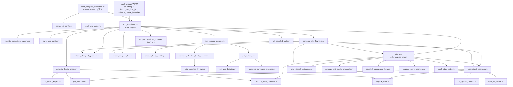

# 细菌胞体-纤毛耦合弹性流体动力学仿真

> **作者**: Lucien ([lucien-6@qq.com](mailto:lucien-6@qq.com))  
> **创建日期**: 2026-02-06  
> **更新日期**: 2026-05-04  
> **版本**: 7.3.1
> **配套文档**: `CHANGELOG.md`、`USER_GUIDE.md`、`requirements.txt`、`Brownian_Implementation_Plan.md`、`config_custom_example.json`、`config_motor_flagella_example.json`

---

## 目录

1. [项目概述](#1-项目概述)
2. [快速开始](#2-快速开始)
3. [架构与数据流](#3-架构与数据流)
4. [物理问题与建模](#4-物理问题与建模)
5. [无量纲化](#5-无量纲化)
6. [状态向量设计](#6-状态向量设计)
7. [几何重构](#7-几何重构)
8. [流体力学：正则化 Stokeslet 线段法 (RSS)](#8-流体力学正则化-stokeslet-线段法-rss)
9. [运动学矩阵 Q](#9-运动学矩阵-q)
10. [力/力矩平衡矩阵 B](#10-力力矩平衡矩阵-b)
11. [弹性恢复力矩（Kirchhoff 弹性杆）](#11-弹性恢复力矩kirchhoff-弹性杆)
12. [耦合线性系统组装与求解](#12-耦合线性系统组装与求解)
13. [固支边界条件](#13-固支边界条件)
14. [自适应基底旋转（Euler 角奇异性规避）](#14-自适应基底旋转euler-角奇异性规避)
15. [时间积分](#15-时间积分)
16. [胞体布朗动力学（分裂步 Euler-Maruyama）](#16-胞体布朗动力学分裂步-euler-maruyama)
17. [输出系统：日志、数据导出与动画](#17-输出系统日志数据导出与动画)
18. [流场可视化](#18-流场可视化)
19. [文件结构](#19-文件结构)
20. [与 Walker (2020) 的标度一致性](#20-与-walker-2020-的标度一致性)
21. [多纤毛支持](#21-多纤毛支持)
22. [验证总结](#22-验证总结)
23. [参考文献](#23-参考文献)
24. [附录 A：关键标度推导](#附录-a关键标度推导)
25. [配套文档与变更日志](#24-配套文档与变更日志)
26. [许可证](#25-许可证)

---

## 1. 项目概述

本项目模拟一个具有弹性纤毛（以 Kirchhoff 弹性杆建模）的胶囊形细菌在 Stokes 流中重力沉降的过程。细菌胞体被视为刚性胶囊体；每根纤毛为不可伸长的弹性杆，采用 Euler 角参数化。

**流体力学方法：**


| 组件                            | 方法                     | 参考文献                 |
| ----------------------------- | ---------------------- | -------------------- |
| 胞体表面（$`N_{\text{body}}`$ 个力点） | RSM 点力法                | Cortez et al. (2005) |
| 纤毛丝（每根 $`N_k`$ 段）             | RSS 精确线段积分 + Rotlet 线段 | Cortez (2018)        |


RSS（Regularized Stokeslet Segments，正则化 Stokeslet 线段法）对正则化 Stokeslet 核函数沿每段直线段进行精确积分，将正则化参数 $`\varepsilon`$ 与线段长度 $`h`$ 解耦。这使得纤毛仅需约 10 段/微米即可保持较高精度，与逐点方法相比大幅降低了计算成本。

### 核心特性

#### 物理建模

- **刚体胞体**：胶囊几何体（半球端盖 + 圆柱中段），四元数参数化姿态（无万向锁）
- **自定义胞体几何（v6.0，v7.1 全面硬化）**：`geometry_mode = 'custom'` 模式下支持导入任意 3D 点云作为胞体表面，自动三角化（`alphaShape` + `convhulln` 回退）并计算体积，`h_mean` 自动推导 RSM 正则化参数；支持用户定义附着位点（位置 + 方向 + 标签）；自定义胞体与自定义纤毛必须配套使用（不允许与参数化模型混用）。**v7.1 增强**：点云 `uniquetol` 去重（tol = 1e-6 × 包围盒尺度）消除 `h_min = 0` / RSM 奇异风险；alpha 参数在 `criticalAlpha` 上下两数量级做 15 点对数扫描并加非流形剔除；新增 Euler 示性数诊断警告非封闭表面；`L_0_suggested` 默认由三角化体积求等效球半径（可切 `'extent'`）；新增 `initial_orientation`（`quaternion` / `axis_angle` / `euler_zyx`）取代 `alpha_0` 的 Y 轴倾斜约束，并配套 JSON 往返持久化
- **胞体表面布点（v5.5）**：球帽在 MATLAB **S2 Sampling Toolbox**（Anton Semechko；File Exchange / Add-On）上生成——按面积权重得到目标帽点数后，若与 Ico/Quad 细分网格原生顶点数相差不超过 5，则将帽点数 **对齐到最近一档原生顶点数**；否则 **`N_\text{cap}<1000`** 时默认 **`ParticleSampleSphere`**，**`≥1000`** 时 **`SpiralSampleSphere`**；细分档位 **`k=0…4`** 的顶点数由 **`SubdivideSphericalMesh`** **实测**（`capsule_sphere_mesh_cache.m`），不依赖闭式公式。赤道 **`x=0`**（双精度严格为 0）上的点在平移前 **复制一份**，使左右半球帽各保留一圈。**圆柱中段**仍为轴向分圈 × 周向等角的规则格点；**v5.5.2** 起周向每圈点数 **`TN`** 在面积启发式估计后按 **`TN = max(round(TN/4)*4, 4)`** 对齐为 **4 的倍数**。**`ParticleSampleSphere` 设置（v5.5.1）**：采用工具箱默认容差（`Etol=1e-5`、`Dtol=1e-4`°、`Nitr=1e4`）；初始位置由 `SpiralSampleSphere(N, false)` 确定性生成，无随机初值依赖；`100 < SPN < 1000` 时结果经 `sphere_particle_sample_cached.m` 读写磁盘缓存（`cache/sphere_particle/spherical_points_NXXXX.mat`），避免重复迭代优化。仍与 Cortez 型 RSM「全局 **ε**」离散假设兼容
- **弹性纤毛**：Kirchhoff 不可伸长弹性杆 + Euler 角参数化（Walker 2020）
- **自定义纤毛几何（v6.0，v7.1 重写）**：`custom` 模式下支持导入任意 3D 中心线点云作为纤毛初始形态；**v7.1 起用户提供的中心线必须预先离散为等长段**（相对偏差 ≤ 1e-3，否则直接报错）；自动连续重复点去重 + 弧长 PCHIP 重采样至目标段密度；通过 Rodrigues 旋转（`rotation_between_vectors`）将纤毛根部切线对齐到附着位点方向（对齐角 > 45° 时给出警告），再在 Gram-Schmidt 构造的**局部基**（`e3` = 对齐后切向、`e1` = 弯曲面法向）中施加可选 `deflection_z`（绕 `e3` 扭转）/`deflection_x`（绕 `e1` 倾斜）附加旋转；`root_dir` 现记录**实际**首段切向而非 `site.direction`；**注意**：参数化模式下 `deflection_x` 是绕切向的扭转、`deflection_z` 是倾斜，custom 模式局部基约定恰好互换，跨模式移植配置时需交换 `deflection_x` ↔ `deflection_z`
- **内禀曲率**：per-pili 可配置静态固有曲率（`frozen`/`zero`/`constant`/`helix`）
- **主动力矩**：per-pili 时变内部主动力矩（`off`/`traveling_wave`/`custom`），支持纤毛/鞭毛主动摆动模拟
- **背景流场**：全局静态背景流（`off`/`uniform`/`shear_z`），与无量纲化方案自动兼容
- **初始姿态**：用户可配置 `alpha_0`（胞体在 XZ 平面内的倾斜角），custom 模式下额外支持 `initial_orientation`（v7.1，三选一：`quaternion` / `axis_angle` / `euler_zyx`），设置时覆盖 `alpha_0` 以支持任意初始方位

#### 流体力学

- **混合 RSM-RSS 方法**：胞体 RSM 点力 + 纤毛 RSS Stokeslet 线段 + Rotlet 线段耦合（扭转—平移）
- **胞体 RSM 默认正则化（v5.3.0）**：未指定 `eps_body` 时默认 `**eps_body = h_mean/2.6667`**（$`\varepsilon/\Delta s \approx 0.375`$），由 `batch_sweep_N_body_eps_RSM` 与 Stokes 球解析沉降对比标定；可选 `cfg.eps_body` 覆盖
- **节点 Director 插值（v5.3.2）**：`compute_node_directors.m` 统一段标架→节点标架的 SVD 极分解投影，含 `det<0` 反射修正，`ode_coupled_rhs.m` 与 `build_coupled_lin_sys.m` 共用

#### 布朗动力学

- **全系统有效摩擦**：胞体热涨落（全系统有效摩擦张量，每步动态计算包含纤毛水动力贡献的 6×6 扩散张量；可选 Fixman 中点修正）
- **布朗随机种子（v5.2.0）**：默认本地时间 `MMddHHmmss` 整数 twister 种子；可选 `cfg.brown_rng_seed` / JSON `brownian.rng_seed`；种子写入 `config.json`、`brownian_rng_seed.txt`、日志与 `simulation_results.mat`

#### 时间积分与数值稳定性

- **时间积分**：MATLAB `ode15s`（隐式刚性求解器）+ 固定 `dt_B` 布朗节点
- **自适应基底**：逐纤毛 Euler 角基底旋转以规避奇异性
- **固支边界条件**：双重施加（运动学速率约束 + 几何投影）

#### 输出与可视化

- **多格式输出**：双通道日志、`.mat` 数据、**PNG（600 dpi）+ 矢量 PDF + 可选交互式 HTML（MATLAB R2026a+，`exportgraphics`）**、3D MP4 动画、JSON 配置快照；统一由根目录 **`export_figure_png_pdf_html.m`** 封装；静态总览、初始姿态、流场及后处理批量汇总图均支持三格式；静态图导出后自动 `close` 图窗，避免大批量仿真堆积窗口（v5.1.1）
- **三维可视化**：参数化光滑胞体表面（半透明，Gouraud 着色）+ 逐纤毛着色折线，含时间梯度；自定义几何胞体使用 `trisurf` 渲染自动三角化表面
- **流场可视化（v7.1 通用化）**：末状态双平面流场图（XZ + YZ，各含 3D 表面视图与 2D 着色图；速度大小 jet 着色 + 单层深灰归一化方向箭头，无白色衬底；箭头几何尺寸较 v3.3 基准放大 50%；胞体内部遮罩）；`compute_plot_flowfield.m` 现通过新的 `build_body_visualization` 辅助函数按 `params.body_type` 分派：参数化胶囊走原路径，custom 模式使用 `alphaShape` 的 `inShape` 测试（含 bounding-sphere 回退）生成内部遮罩并用 `trisurf(params.body_faces, ...)` 渲染表面，二维剪影由通用 SDF 等值线抽取，彻底移除对 `major_axis` / `minor_axis` 的硬依赖
- **动画布局**：三面板 1×3（3D + XZ 投影 + YZ 投影），动态图像尺寸；**v5.3.1 / v5.4.4** 起先探测 `getframe` 的实际物理像素，再在 **3840×2160** 编码器安全框内钳制输出尺寸；若 HiDPI 缩放下抓帧仍偏大，则写入前自动缩放，避免 Windows 上 MPEG-4 因帧过大或帧尺寸不一致而失败

#### 配置与工程

- **几何模式切换（v6.0）**：`geometry_mode = 'parametric'`（默认，胶囊体 + 解析纤毛）或 `'custom'`（导入任意 3D 点云体 + 纤毛）；两种模式互斥，`validate_simulation_params.m` 启动时强制校验
- **外部配置**：支持 JSON 配置文件，运行时自动保存配置快照至输出目录（可追溯复现）
- **参数验证**：启动前自动执行参数合理性预检（错误聚合 + 警告分级）
- **函数化封装**：`run_simulation()` 将全部仿真逻辑封装为可编程调用的函数
- **无人值守模式**：`auto_confirm = true` 跳过所有交互对话框，支持批量参数扫描
- **纤毛结构体接口**：`parse_pili_config` 提供命名字段的用户友好纤毛定义方式
- **进度反馈**：动画渲染和流场计算配备实时文本进度条（含 ETA）
- **输出目录保护**：检测已有仿真数据时弹出覆盖/重命名/中止对话框

#### 批量扫描与后处理

- **参数扫描套件**（`batch sweep/`）：8 个独立扫描脚本分别扫描初始倾斜角（`batch_sweep_alpha`：**无纤毛**胞体）、胞体长半轴（`batch_sweep_major_axis`：**无纤毛**）、纤毛长度（含 `site_list` 附着点）、纤毛杨氏模量、胞体 `N_body`（球体无纤毛）、纤毛 `seg_per_um`、胞体 RSM `**eps_body`**（`batch_sweep_eps_body_RSM`）、`**N_body**` × `**eps_body**` 嵌套标定（`batch_sweep_N_body_eps_RSM`），均采用 headless 无头模式批量调用 `run_simulation()`
- **JSON 批量运行器**：`batch_run_from_json.m` 自动检索用户指定文件夹内全部 JSON 配置文件并依次执行，单工况失败自动跳过继续，运行结束输出对齐汇总表及批次日志
- **布朗独立重复批处理**（`batch sweep/batch_repeat_brownian.m`）：同一工况、开启布朗运动时进行多次独立重复；结果保存在 `output/<case_name_base>/001/`、`002/`、…；默认关闭初始姿态预览、强制 `auto_confirm`；`**brown_rng_seed_mode`**：`timestamp` = 每次运行不指定种子，与单次模拟相同采用 `**MMddHHmmss**` 默认（`default` 为向后兼容别名）；`fixed` = `**cfg.brown_rng_seed = rng_seed_base + k**` 可复现批量（v5.2.0）
- **批量结果后处理**（`post_processing/postprocess_cases.m`）：在父目录下多选含 `timeseries.csv` 的 Case 子文件夹，汇总沉降速度、最大水平位移、轨迹曲折度、MSD 拟合扩散系数等，导出 Excel 汇总表及**同主文件名**的批量汇总图（PNG / PDF / 可选 HTML，R2026a+）；Windows 下可选 COM 排版；全英文交互界面

---

## 2. 快速开始

### 2.1 方式一：编辑内联参数（默认）

```matlab
% 1. 在 MATLAB 中打开 main_coupled_simulation.m
% 2. 在 "Inline parameter definitions" 区域调整 cfg 结构体字段：

cfg.case_name  = 'MyCase';
cfg.alpha_0    = pi/4;
cfg.N_body     = 200;

% 3. 定义纤毛配置（命名结构体，推荐）：
pili_config(1).type      = 'linear';
pili_config(1).length_um = 3;
pili_config(1).site      = 1;
cfg.Pili_Matrix = parse_pili_config(pili_config);

% 4. 运行：
main_coupled_simulation
```

### 2.2 方式二：从 JSON 文件加载配置

```matlab
% 在 main_coupled_simulation.m 中设置：
config_file = 'configs/my_case.json';    % 指向 JSON 配置文件
% 运行即可，所有参数从 JSON 加载（参见 config_example.json 模板）
```

**JSON 与程序架构（`load_sim_config.m` / `save_sim_config.m`）**

- **顶层节**：`case_name`，`geometry_mode`（v6.0：`'parametric'` 默认或 `'custom'`），`body`，`pili`（纤毛结构体数组或原始 `[8×M]` 矩阵），`material`，`fluid`，`simulation`，`brownian`，`output`，`flowfield`，`background_flow`（v5.0）。
- `**body`**（仅 parametric 模式）：`minor_axis`，`major_axis`，`N_body`，`alpha_0`；可选 `**eps_body**`（无量纲 RSM 胞体正则化长度 $`\varepsilon/L_0`$，覆盖 `init_coupled_params` 默认 `h_mean/2.6667`）。
- `**custom_geometry`**（仅 custom 模式）：`body_points_file`（胞体点云文件路径，支持 `.csv`/`.txt`/`.mat`），`L_0_override`（可选特征长度覆盖 [m]），`alpha_0`（初始倾斜角），`eps_body`（可选 RSM 正则化覆盖），`attachment_sites`（附着位点数组，每项含 `position` [m]、`direction` [方向向量]、`label` [字符串]），`pili`（纤毛数组，每项含 `points_file`、`site_index`、`deflection_z`/`deflection_x`）。详见 `config_custom_example.json`。
- `**pili[]**`：每根纤毛至少含 `type`，`length_um`，`site`；可选 `deflection_z`，`deflection_x`，`shape_params`；v5.0 可选 `**intrinsic_curvature**`（字符串或对象）、`**active_moment**`（对象；`traveling_wave` 时含 `amplitude_Nm`，`omega_Hz`，`wavenumber`，可选 `phase_rad`，`d1_amp` / `d2_amp` / `d3_amp` 等；与 `init_coupled_params` 一致）。
- `**simulation**`：`T_obs`，`AbsTol`，`RelTol`，`delta_frac`（内部得到 `cfg.delta = π/delta_frac`），`tlim`，`dt`，`seg_per_um`。
- `**brownian**`：`enable` → `cfg.enable_brown`，`temperature` → `cfg.Temper`，`dt_B_ratio` → `cfg.dt_B = dt * dt_B_ratio`，`fixman_midpoint`；可选 `**rng_seed**` → `cfg.brown_rng_seed`（v5.2.0：正整数固定 twister 种子；省略或非正则用运行时刻 `**MMddHHmmss**` 整数默认种子）。
- `**flowfield**`：`grid_spacing_um` → `cfg.flowfield_grid_spacing`，`grid_range_um` → `cfg.flowfield_grid_range`，`quiver_skip`，`chunk_size`。
- `**background_flow**`：`type`（`off` / `uniform` / `shear_z`），`U_max` [m/s]，`direction`，`shear_axis`，`shear_height_m`（`shear_z` 且非 `off` 时需大于 0，见 `validate_simulation_params`）。
- 完整键名与默认值以 `**config_example.json**` 与 `**load_sim_config.m**` 为准；运行结束后 `**output/<case_name>/config.json**` 与 `save_sim_config` 写出格式一致。

### 2.3 方式三：编程式调用 / 批量扫描

```matlab
% 直接调用 run_simulation() 函数：
cfg = load_sim_config('configs/base.json');
cfg.alpha_0      = pi/4;
cfg.auto_confirm = true;     % 无人值守模式
[results, params, output_dir] = run_simulation(cfg);

% 参数扫描脚本参见 batch sweep/ 文件夹（8 个扫描脚本 + JSON 批量运行器 + batch_repeat_brownian 布朗重复）
```

**输出**（保存至 `output/<case_name>/`）：

```
output/MyCase/
├── simulation_results.mat    % 完整结果 + 参数（v7.3 / HDF5）
├── timeseries.csv            % 标量时间序列（10 列，纯文本）
├── config.json               % 配置快照（可直接复用以复现运行）
├── summary_plot.png          % 静态总览图（600 dpi）
├── summary_plot.pdf          % 同上，矢量 PDF（exportgraphics）
├── summary_plot.html         % 同上，交互式 HTML（MATLAB R2026a+，若生成）
├── initial_pose.png          % 初始姿态预览图（600 dpi，预览开启时）
├── initial_pose.pdf / .html  % 初始姿态矢量 / 交互式（规则同上）
├── bacteria_3d_motion.mp4    % 3D 运动动画（三面板 1×3，动态尺寸，动画开启时）
├── flowfield_panels.png      % 双平面流场 2×2 面板图（600 dpi）
├── flowfield_panels.pdf / .html  % 流场面板矢量 / 交互式（规则同上）
├── brownian_rng_seed.txt     % 布朗开启时：twister 种子一行 + 复现说明（v5.2.0）
└── simulation.log            % 完整运行日志
```

### 2.4 参数参考

**用户可配置参数**（`main_coupled_simulation.m` 内联 **或** JSON；下表为进入 `run_simulation(cfg)` 后的 **扁平 `cfg` 名**。JSON 嵌套键名见上一节及 `config_example.json`。`**load_sim_config` 缺省与内联主脚本缺省可以不同**——以所选用途为准。）


| 参数                                   | 默认值（`load_sim_config`）    | 说明                                                                                                               |
| ------------------------------------ | ------------------------- | ---------------------------------------------------------------------------------------------------------------- |
| `case_name`                          | `''`（空则输出目录可用时间戳）         | 案例名称（作为输出文件夹名）                                                                                                   |
| `minor_axis`                         | `0.4e-6`                  | 胞体椭球短半轴（体宽半径）[m]                                                                                                 |
| `major_axis`                         | `1.25e-6`                 | 胞体椭球长半轴（体长半径）[m]                                                                                                 |
| `alpha_0`                            | `0`                       | XZ 平面内初始胞体倾斜角 [rad]                                                                                              |
| `N_body`                             | `200`                     | 胞体表面力点数（请求值；实际值为球帽螺旋点数 + 圆柱规则格点数，可能与请求相差数点）                                                                        |
| `eps_body`                           | `[]`（空则用 `h_mean/2.6667`） | 可选：胞体 RSM 正则化长度（无量纲 L_0）                                                                                         |
| `seg_per_um`                         | `10`                      | 纤毛每微米段数（RSS 精确积分）                                                                                                |
| `dt`                                 | `0.1`                     | 输出时间步 [s]                                                                                                        |
| `Pili_Matrix`                        | 无纤毛时为空矩阵                  | 纤毛配置矩阵 [8 × M]（可用 `parse_pili_config` 从结构体生成）                                                                    |
| `E`                                  | `1.768e7`                 | 杨氏模量 [Pa]                                                                                                        |
| `r_pili`                             | `3e-9`                    | 纤毛半径 [m]                                                                                                         |
| `sigma_p`                            | `0.2`                     | 泊松比                                                                                                              |
| `mu`                                 | `1e-3`                    | 流体动力粘度 [Pa·s]                                                                                                    |
| `rho_bac`                            | `1180.0`                  | 细菌密度 [kg/m³]                                                                                                     |
| `rho_fluid`                          | `998.232`                 | 流体密度 [kg/m³]                                                                                                     |
| `T_obs`                              | `30.0`                    | 总观测时间 [s]                                                                                                        |
| `AbsTol` / `RelTol`                  | `1e-4`                    | ODE 求解器容差                                                                                                        |
| `delta`                              | `pi/20`                   | Euler 角奇异性阈值 [rad]                                                                                               |
| `tlim`                               | `3600`                    | ODE 段超时限制 [s]                                                                                                    |
| `preview_initial`                    | `true`                    | 积分前显示初始姿态预览                                                                                                      |
| `generate_animation`                 | `true`                    | 生成 MP4 动画                                                                                                        |
| `animation_fps`                      | `30`                      | 动画帧率                                                                                                             |
| `animation_skip`                     | `1`                       | 动画帧跳步间隔                                                                                                          |
| `enable_brown`                       | `false`                   | 启用胞体布朗运动                                                                                                         |
| `Temper`                             | `293.15`                  | 流体绝对温度 [K]（默认 20°C）                                                                                              |
| `dt_B`                               | `dt/2`                    | 布朗时间步 [s]（`enable_brown = true` 时生效）                                                                             |
| `fixman_midpoint`                    | `false`                   | Fixman 中点漂移修正（布朗，2× 代价）                                                                                          |
| `brown_rng_seed`                     | （未设）                      | v5.2.0：布朗 twister 种子；正标量=用户固定；未设则运行时用 `**MMddHHmmss`** 整数；写入 `config.json` / `results` / `brownian_rng_seed.txt` |
| `auto_confirm`                       | `false`                   | 无人值守模式（跳过所有交互对话框）                                                                                                |
| `background_flow.type`               | `'off'`                   | 背景流场类型：`'off'` / `'uniform'` / `'shear_z'`                                                                       |
| `background_flow.U_max`              | `0`                       | 背景流最大速度 [m/s]（非 off 时需 > 0）                                                                                      |
| `background_flow.direction`          | `[1,0,0]`                 | 流向单位向量                                                                                                           |
| `background_flow.shear_axis`         | `[0,0,1]`                 | 剪切梯度方向单位向量                                                                                                       |
| `background_flow.shear_height_m`     | `0`                       | 剪切层厚度 H [m]（`shear_z` 模式）。流速沿 `direction` 轴呈截断线性剖面 $`u(z) = U_{\max}\,\max(0,\min(z/H,1))`$，$`z = \mathbf{X}\cdot\mathbf{n}_{\text{shear}}`$；仅在 $`0<z<H`$ 内具备非零涡量 $`U_{\max}/H \cdot (\mathbf{n}_{\text{shear}}\times\mathbf{e}_{\text{flow}})`$，上下平台区为无涡常速场（有限厚度 Couette 层，而非无界线性剪切）|
| `pili_config(k).intrinsic_curvature` | `'frozen'`                | Per-pili 内禀曲率模式                                                                                                  |
| `pili_config(k).active_moment`       | `struct('type','off')`    | Per-pili 主动力矩配置                                                                                                  |
| `pili_config(k).root_coupling`       | `'clamped'`               | v7.0.0：Per-pili 根部连接类型；`'clamped'`（固支）或 `'free_torsion'`（自由扭转）                                               |
| `pili_config(k).motor_torque`        | `struct('type','off')`    | v7.0.0：Per-pili 马达力矩配置；`'constant'` 含 `torque_pN_nm` [pN·nm] + `max_omega_Hz` [Hz]（停转速度）                   |
| `flowfield_grid_spacing`             | `0.05`                    | 流场网格间距 [μm]                                                                                                      |
| `flowfield_grid_range`               | `10.0`                    | 流场网格范围 [μm]                                                                                                      |
| `flowfield_quiver_skip`              | `5`                       | 流场箭头降采样倍率                                                                                                        |
| `flowfield_chunk_size`               | `2000`                    | 流场评估分块大小                                                                                                         |


---

## 3. 架构与数据流

### 3.1 模块层级




### 3.2 功能分层


| 层级    | 文件                                                                                                                                                                                                                                                                                                                                                                                                   | 职责                                                                                                                                                         |
| ----- | ---------------------------------------------------------------------------------------------------------------------------------------------------------------------------------------------------------------------------------------------------------------------------------------------------------------------------------------------------------------------------------------------------- | ---------------------------------------------------------------------------------------------------------------------------------------------------------- |
| 入口脚本  | `main_coupled_simulation.m`                                                                                                                                                                                                                                                                                                                                                                          | cfg 结构体定义、配置来源选择、调用 `run_simulation`                                                                                                                       |
| 仿真引擎  | `run_simulation.m`                                                                                                                                                                                                                                                                                                                                                                                   | 积分循环、布朗积分、后处理、输出（可编程调用）                                                                                                                                    |
| 配置管理  | `load_sim_config.m`, `save_sim_config.m`, `parse_pili_config.m`                                                                                                                                                                                                                                                                                                                                      | JSON 读写、纤毛结构体→矩阵转换                                                                                                                                         |
| 参数验证  | `validate_simulation_params.m`                                                                                                                                                                                                                                                                                                                                                                       | 启动前参数合理性预检（错误聚合 + 警告分级）                                                                                                                                    |
| 初始化   | `init_coupled_params.m`, `init_coupled_state.m`                                                                                                                                                                                                                                                                                                                                                      | 特征尺度、几何构建、布朗参数、初始状态                                                                                                                                        |
| 核心计算  | `ode_coupled_rhs.m`                                                                                                                                                                                                                                                                                                                                                                                  | Q、A、B 矩阵组装，线性系统求解                                                                                                                                          |
| 几何工具  | `reconstruct_geometry.m`, `pili_*.m`, `quat_*.m`                                                                                                                                                                                                                                                                                                                                                     | 状态 ↔ 空间坐标转换                                                                                                                                                |
| 流体力学  | `build_global_resistance.m`                                                                                                                                                                                                                                                                                                                                                                          | RSS 迁移率 + Rotlet 线段迁移率 + 扭转 RFT                                                                                                                            |
| 弹性力学  | `compute_pili_elastic_moments.m`                                                                                                                                                                                                                                                                                                                                                                     | Kirchhoff 弹性杆曲率                                                                                                                                            |
| 节点标架  | `compute_node_directors.m`                                                                                                                                                                                                                                                                                                                                                                           | 段 Director → 节点 Director 插值（SVD 极分解）                                                                                                                       |
| 主动力学  | `coupled_active_moment.m`, `coupled_background_flow.m`                                                                                                                                                                                                                                                                                                                                               | Per-pili 时变主动力矩 + 全局背景流场                                                                                                                                   |
| 布朗参数  | `compute_effective_body_brownian.m`, `build_coupled_lin_sys.m`                                                                                                                                                                                                                                                                                                                                       | 全系统有效摩擦张量 → Cholesky 扩散因子（每步动态）                                                                                                                            |
| 布朗参考  | *(已删除 `compute_body_brownian_params.m`)*                                                                                                                                                                                                                                                                                                                                                             | 旧 body-only 实现已移除，功能由全系统方案取代                                                                                                                               |
| 边界条件  | `enforce_clamped_geometry.m`                                                                                                                                                                                                                                                                                                                                                                         | 固支运动学约束 + 几何投影                                                                                                                                             |
| 数值稳定性 | `adaptive_basis_check.m`                                                                                                                                                                                                                                                                                                                                                                             | Euler 角奇异性规避                                                                                                                                               |
| 几何生成  | `capsule_body_building.m`, `pili_building.m`, `pili_type_building.m`, `compute_curvature_binormal.m`                                                                                                                                                                                                                                                                                                 | 胞体/纤毛离散化                                                                                                                                                   |
| 流场可视化 | `compute_plot_flowfield.m`                                                                                                                                                                                                                                                                                                                                                                           | 末状态双平面流场评估与绘图（2×2 面板）                                                                                                                                      |
| 进度显示  | `odetpbar.m`, `render_progress_bar.m`                                                                                                                                                                                                                                                                                                                                                                | ODE 段内进度条 + 通用文本进度条（动画/流场）                                                                                                                                 |
| 批量扫描  | `batch sweep/batch_sweep_alpha.m`, `batch sweep/batch_sweep_major_axis.m`, `batch sweep/batch_sweep_pili_length.m`, `batch sweep/batch_sweep_pili_E.m`, `batch sweep/batch_sweep_N_body.m`, `batch sweep/batch_sweep_seg_per_um.m`, `batch sweep/batch_sweep_eps_body_RSM.m`, `batch sweep/batch_sweep_N_body_eps_RSM.m`, `batch sweep/batch_run_from_json.m`, `batch sweep/batch_repeat_brownian.m` | 8 个独立参数扫描脚本（初始角·无纤毛/长半轴·无纤毛/纤毛长度·`site_list`/杨氏模量/N_body·球无纤毛/seg_per_um/RSM·`eps_body`/嵌套 `N_body`×`eps_body`）+ JSON 批量运行器 + 布朗工况独立重复（`001`/`002`/… 子文件夹） |
| 工具函数  | `skew_matrix.m`, `pack_state_rates.m`, `unpack_state.m`                                                                                                                                                                                                                                                                                                                                              | 线性代数辅助、状态打包                                                                                                                                                |


---

## 4. 物理问题与建模

### 4.1 问题描述

模拟具有弹性纤毛的细菌在 Stokes 流中重力沉降：

- **胞体**：刚性胶囊体（两个半球端盖 + 圆柱中段），离散为 $`N_{\text{body}}`$ 个表面力点（默认 200）
- **纤毛**：$`M`$ 根不可伸长的 Kirchhoff 弹性杆，每根含 $`N_k`$ 段（$`N_k + 1`$ 个节点）
- **流体**：Stokes 流（零雷诺数）；所有流体力学相互作用通过 RSS（纤毛）+ RSM（胞体）实现

### 4.2 方法来源


| 组件            | 来源                          | 方法                                       |
| ------------- | --------------------------- | ---------------------------------------- |
| 胞体形状、表面点、附着位点 | 母项目 `Stokes Brown Flexible` | `capsule_body_building`, `pili_building` |
| 纤毛弹性杆模型       | Walker (2020)               | Kirchhoff 弹性杆 + Euler 角参数化               |
| 流体力学（平移）      | Cortez (2005, 2018)         | 胞体：RSM 点力；纤毛：RSS 精确线段积分 + Rotlet 线段      |
| 流体力学（扭转）      | Walker (2020)               | 阻力理论 (RFT)                               |
| 胞体姿态          | 本项目                         | 四元数参数化（规避万向锁）                            |
| 时间积分          | Walker (2020)               | MATLAB `ode15s` 隐式求解器                    |


### 4.3 核心耦合机制

1. **运动学耦合**：纤毛根部固支于胞体表面；根节点速度 = 胞体刚体运动速度
2. **流体力学耦合**：全局迁移率矩阵（胞体 RSM + 纤毛 RSS + Rotlet）捕获所有胞体—胞体、胞体—纤毛和纤毛—纤毛相互作用
3. **弹性耦合**：纤毛弹性恢复力矩通过流体力学反力反馈影响胞体运动

---

## 5. 无量纲化

### 5.1 特征尺度

所有量均以胞体半长轴 $`a`$（`major_axis`）进行无量纲化：


| 尺度   | 符号      | 定义                                    |
| ---- | ------- | ------------------------------------- |
| 长度   | $`L_0`$ | $`a`$                                 |
| 弯曲刚度 | $`EI`$  | $`E \cdot \pi r_{\text{pili}}^4 / 4`$ |
| 时间   | $`T_0`$ | $`8\pi\mu L_0^4 / EI`$                |
| 速度   | $`U_0`$ | $`L_0 / T_0`$                         |
| 力    | $`F_0`$ | $`EI / L_0^2`$                        |


### 5.2 关键无量纲参数


| 参数     | 符号              | 定义                             |
| ------ | --------------- | ------------------------------ |
| 弹性-重力数 | $`Eg`$          | $`F_{\text{sink}} L_0^2 / EI`$ |
| 细长比    | $`\varepsilon`$ | $`r_{\text{pili}} / L_0`$      |
| 泊松比    | $`\sigma`$      | 用户指定                           |


### 5.3 新功能无量纲化


| 物理量       | 无量纲化公式                                                              |
| --------- | ------------------------------------------------------------------- |
| 背景流速度     | $`u_{\text{bg,dimless}} = u_{\text{bg,phys}} / U_0`$                |
| 主动力矩（积分后） | $`M_{\text{dimless}} = M_{\text{phys}} \cdot L_{\text{pili}} / EI`$ |
| 内禀曲率      | 无量纲，与 $`\kappa`$ 同标度（曲率 × 弧长，$`s \in [0,1]`$）                       |


---

## 6. 状态向量设计

### 6.1 布局

$$
\mathbf{Z} = \underbrace{[\mathbf{X}*{\text{cm}}(3), \mathbf{q}(4)]}*{7} \underbrace{[\boldsymbol{\theta}_1, \boldsymbol{\phi}_1, \boldsymbol{\psi}*1]}*{3N_1} \cdots \underbrace{[\boldsymbol{\theta}_M, \boldsymbol{\phi}_M, \boldsymbol{\psi}*M]}*{3N_M}
$$

总自由度数：$`n = 7 + 3\sum_{k=1}^M N_k`$

### 6.2 速率向量（约化）

$$
\dot{\mathbf{z}} = [\mathbf{V}(3),  \boldsymbol{\Omega}(3),  \dot{\boldsymbol{\theta}}_1, \dot{\boldsymbol{\phi}}_1, \dot{\boldsymbol{\psi}}_1,  \ldots]
$$

自由度数：$`n_{\text{dof}} = 6 + 3\sum_k N_k`$

### 6.3 初始姿态参数 `alpha_0`

角度 `alpha_0` 定义胞体长轴（体坐标系 X 轴）在 XZ 平面内相对于 +X 方向的初始倾斜角：

- `pi/2` → 竖直（+Z 方向，标准沉降姿态）
- `0` → 水平（+X 方向）
- `-pi/2` → 倒置（-Z 方向）

---

## 7. 几何重构

`reconstruct_geometry.m` 将状态向量 $`\mathbf{Z}`$ 转换为实验室坐标系中的位置：

1. **胞体**：$`\mathbf{X}_{\text{cm}}`$ + 四元数 $`\mathbf{q}`$ → 旋转矩阵 $`R`$ → 胞体表面点 $`\mathbf{X}_i = \mathbf{X}_{\text{cm}} + R \cdot \mathbf{x}_i^{\text{local}}`$
2. **纤毛**：由胞体表面获取根部位置 + Euler 角 → `pili_spatial_coords` → 实验室坐标系节点位置
3. **标架**：`pili_directors` → 材料标架 $`(\mathbf{d}_1, \mathbf{d}_2, \mathbf{d}_3)`$，其中 $`\mathbf{d}_3`$ 为切线方向

输出：`geom` 结构体，包含 `X_all`、`X_cm`、`X_body`、`X_pili`、标架、角度等。

---

## 8. 流体力学：正则化 Stokeslet 线段法 (RSS)

### 8.1 RSM 核函数 (Cortez 2005) — 胞体表面

$$
S_{ij}^{\varepsilon} = \frac{(|\mathbf{r}|^2 + 2\varepsilon_{ij}^2)\mathbf{I} + \mathbf{r}\mathbf{r}^T}{(|\mathbf{r}|^2 + \varepsilon_{ij}^2)^{3/2}}
$$

仅应用于迁移率矩阵中胞体表面对应的列。

### 8.2 RSS 线段核函数 (Cortez 2018)

对于线段 $`\mathbf{y}(\alpha) = \mathbf{y}_0 - \alpha\mathbf{v}`$（$`\mathbf{v} = \mathbf{y}_0 - \mathbf{y}_1`$，$`L = |\mathbf{v}|`$），力密度从 $`\mathbf{f}_0`$ 到 $`\mathbf{f}_1`$ 线性变化：

$$
\mathbf{u}(\hat{\mathbf{x}}) = \mathbf{M}_1\mathbf{f}_0 + \mathbf{M}_2\mathbf{f}_1
$$

$$
\mathbf{M}*2 = L\left[(T*{1,-1} + \varepsilon^2 T_{1,-3})\mathbf{I} + T_{1,-3}\mathbf{x}_0\mathbf{x}*0^T + T*{2,-3}(\mathbf{x}_0\mathbf{v}^T + \mathbf{v}\mathbf{x}*0^T) + T*{3,-3}\mathbf{v}\mathbf{v}^T\right]
$$

$$
\mathbf{M}*1 = L\left[(T*{0,-1} + \varepsilon^2 T_{0,-3})\mathbf{I} + \cdots\right] - \mathbf{M}_2
$$

$`T_{n,q}`$ 值通过递推关系计算（Cortez 2018, Eq. 7），起始于：

- $`T_{0,-1} = \frac{1}{L}\ln\frac{H_1}{H_0}`$，其中 $`H = LR + \mathbf{x}_0 \cdot \mathbf{v}`$
- $`T_{0,-3} = \frac{1}{R_0 H_0} - \frac{1}{R_1 H_1}`$

**核心优势**：$`\mathbf{M}_1`$、$`\mathbf{M}_2`$ 已包含线段长度积分权重——无需额外的 $`\Delta s`$ 列权重。

### 8.3 全局迁移率矩阵

$$
M_{\text{weighted}} =
\begin{pmatrix}
M_{BB} & M_{BP} 
M_{PB} & M_{PP}
\end{pmatrix}
$$


| 分块         | 评估点 | 力源  | 方法     | $`\varepsilon`$         |
| ---------- | --- | --- | ------ | ----------------------- |
| $`M_{BB}`$ | 胞体  | 胞体  | RSM 点力 | $`h_{\text{mean}}/3`$   |
| $`M_{PB}`$ | 纤毛  | 胞体  | RSM 点力 | $`h_{\text{mean}}/3`$   |
| $`M_{BP}`$ | 胞体  | 纤毛  | RSS 线段 | $`r_{\text{pili}}/L_0`$ |
| $`M_{PP}`$ | 纤毛  | 纤毛  | RSS 线段 | $`r_{\text{pili}}/L_0`$ |


**配对规则**：$`\varepsilon_{ij} = \varepsilon_j`$（由力源点决定）。

**向量化组装**：所有 $`T_{n,q}`$ 值和 $`\mathbf{M}_1`$/$`\mathbf{M}_2`$ 分量以 $`[N_{\text{total}} \times N_{\text{seg,all}}]`$ 矩阵形式计算，然后散射至全局迁移率矩阵中。

### 8.4 Rotlet 线段迁移率

捕获纤毛上扭矩密度到所有评估点平移速度的流体力学耦合（Cortez 2018, Sec. 2.4）：

$$
\mathbf{u}(\hat{\mathbf{x}}) = -L\left[c_a[\mathbf{x}*0]*\times + c_b[\mathbf{v}]_\times\right]\boldsymbol{\tau}
$$

其中 $`c_a = 2T_{0,-3} + 3\varepsilon^2 T_{0,-5}`$，$`c_b = 2T_{1,-3} + 3\varepsilon^2 T_{1,-5}`$。

$`T_{n,-5}`$ 通过额外的递推关系计算，需要 $`d^2 = |\mathbf{x}_0 \times \mathbf{v}|^2 + L^2\varepsilon^2`$。

$`M_{\text{rotlet}} \in \mathbb{R}^{3N_{\text{total}} \times 3N_{\text{seg}}}`$ 将每段的三维扭矩密度映射到所有点的平移速度。

**线性系统中的集成**：

$$
\mathbf{f} = M_{\text{stokeslet}}^{-1}\left(\mathbf{Q}*{\text{trans}} - M*{\text{rotlet}} \cdot \tilde{A}*{\text{twist}} \cdot \mathbf{Q}*{\text{twist}}\right) \dot{\mathbf{z}}
$$

**物理影响**：对于典型的细菌纤毛（$`\varepsilon \sim 10^{-3}`$），Rotlet 耦合量级为 $`O(\varepsilon^4) \sim 10^{-12}`$，实际上可忽略，但确保了理论的完备性。

### 8.5 正则化参数

$$
\varepsilon_j =
\begin{cases}
h_{\text{body}}^{\text{mean}} / 2.6667 & \text{胞体表面点} 
r_{\text{pili}} / L_0 & \text{纤毛节点}
\end{cases}
$$

**胞体**（RSM，力源在封闭曲面上）：$`h_{\text{body}}^{\text{mean}}`$ 为胞体表面所有点最近邻距离的均值（平均网格间距 $`\Delta s_{\text{avg}}`$），默认取 $`h_{\text{mean}}/2.6667`$，对应比值 $`\varepsilon/\Delta s_{\text{avg}} \approx 0.375`$。该比值由 `batch_sweep_N_body_eps_RSM` 扫描不同 $`N_{\text{body}}`$ 下 $`\varepsilon = kh_{\text{mean}}`$，并与 Stokes 球解析沉降速度对比得到，在阻力矩阵精度与数值稳定性之间优于此前的 $`h_{\text{mean}}/3`$。$`\varepsilon \to 0`$ 的极限存在（退化为奇异 BEM），故 $`\varepsilon`$ 为纯数值参数，应通过与解析解（如 Stokes 球阻力）对比验证。

**纤毛**（RSS，力源在一维曲线上）：$`\varepsilon = r_{\text{pili}}/L_0`$ 是**物理参数**，代表力作用区域的空间延展半径（纤毛横截面半径）。Cortez et al. (2005) 明确指出，当力作用于曲线时 $`\varepsilon \to 0`$ 的极限不存在（速度场发散），因此 $`\varepsilon`$ 不可趋向零，而应取纤毛的物理横截面半径。细长比 $`\varepsilon/\ell = r_{\text{pili}}/L_{\text{pili}} \approx 10^{-3}`$ 远小于 1，满足细长体假设；段长与正则化参数之比 $`\Delta s/\varepsilon = \Delta s \cdot L_0 / r_{\text{pili}} \approx 22`$，RSS 精确积分在此范围内精度充分。

纤毛根部与胞体表面的间隙：$`d_{\text{gap}} = 1.1 \times (\varepsilon_{\text{body}} \cdot L_0 + r_{\text{pili}})`$。

### 8.6 平移阻力

$`\mathbf{A}_{\text{trans}} = M_{\text{weighted}}^{-1}`$ — 通过 LU 分解计算：`M_weighted \ Q_trans`（避免显式 $`O(N^3)`$ 矩阵求逆）。

### 8.7 扭转阻力 (RFT)

逐纤毛扭转阻力（阻力理论）：

$$
\tilde{A}_k = \frac{\ell_k\varepsilon_k^2}{2}\hat{A}_k, \quad [\hat{A}*k]*{3(j-1)+1:3j, j} = \mathbf{d}_3^{(j)}
$$

---

## 9. 运动学矩阵 Q

$`\mathbf{Q}_{\text{global}} \in \mathbb{R}^{n_{\text{vel}} \times n_{\text{dof}}}`$ 将速率向量 $`\dot{\mathbf{z}}`$ 映射为物理速度：

- **胞体点**：$`\mathbf{v}_i = \mathbf{V} + \boldsymbol{\Omega} \times (\mathbf{x}_i - \mathbf{X}_{\text{cm}})`$
- **纤毛节点**：由 Walker 的空间 Q 矩阵构建，通过自适应旋转 $`R_k`$ 从纤毛基底变换至实验室坐标系
- **扭转速率**：$`\psi`$ 速率通过 $`\cos\theta`$ 与 $`\theta`$ 速率耦合（Euler 角运动学）

平移子块：$`\mathbf{Q}_{\text{trans}} = \mathbf{Q}[1:3N_{\text{total}}, :]`$

扭转子块：$`\mathbf{Q}_{\text{twist}} = \mathbf{Q}[3N_{\text{total}}+1:\text{end}, :]`$

---

## 10. 力/力矩平衡矩阵 B

$`\mathbf{B}_{\text{global}} \in \mathbb{R}^{n_{\text{dof}} \times n_{\text{force}}}`$ 将分布力/力矩映射至速率向量方程：


| 行   | 方程                           | 右端项                     |
| --- | ---------------------------- | ----------------------- |
| 1–3 | 力平衡                          | $`-Eg\hat{\mathbf{g}}`$ |
| 4–6 | 力矩平衡                         | 0（无外力矩）                 |
| 7+  | 纤毛力矩平衡（每根 $`N_k`$ 段 × 3 个分量） | 弹性曲率 $`\kappa`$         |


胞体和纤毛的力贡献使用梯形求积权重。纤毛力矩平衡遵循 Walker (2020) 的公式，采用 $`\ell_k^3`$ 标度。

---

## 11. 弹性恢复力矩（Kirchhoff 弹性杆）

`compute_pili_elastic_moments.m` 计算离散曲率与固有曲率的偏差。v5.0 起，固有曲率 $`\kappa_{\alpha,0}`$ 可通过 `intrinsic_curvature` 配置为 `'frozen'`（保持初始几何）、`'zero'`、`'constant'`（用户指定常数向量）或 `'helix'`（螺旋曲率）。

设 Darboux 向量为 $`\mathbf{U} = \kappa_1 \mathbf{d}_1 + \kappa_2 \mathbf{d}_2 + \kappa_3 \mathbf{d}_3`$，则方向子的弧长导数满足 $`\mathbf{d}_\alpha' = \mathbf{U} \times \mathbf{d}_\alpha`$，从而代码使用如下投影提取曲率分量（与 Walker 2020 约定一致）：

$$
\kappa_1^{(j)} = \mathbf{d}_3^{(j)} \cdot \mathbf{d}_2'^{(j)} - \kappa_{1,0}^{(j)}
$$

$$
\kappa_2^{(j)} = \mathbf{d}_1^{(j)} \cdot \mathbf{d}_3'^{(j)} - \kappa_{2,0}^{(j)}
$$

$$
\kappa_3^{(j)} = \frac{1}{1+\sigma}\left(\mathbf{d}_2^{(j)} \cdot \mathbf{d}_1'^{(j)} - \kappa_{3,0}^{(j)}\right)
$$

> 历史注记：v7.2 及以前版本的 README 在此处误写为 $`\kappa_\alpha = \mathbf{d}_\alpha \cdot \mathbf{d}_3'`$（$`\alpha=1,2`$），与代码实现及 Walker 2020 的 $`\mathbf{U} \times \mathbf{d}_\alpha`$ 推导都不一致。v7.3.0 修正为上述形式。

---

## 12. 耦合线性系统组装与求解

每个 ODE 时间步的核心方程：

$$
\mathbf{L}\dot{\mathbf{z}} = \mathbf{R}
$$

其中：

- $`\mathbf{L} = -\mathbf{B} \cdot \mathbf{AQ}`$
- $`\mathbf{AQ} = \begin{bmatrix} M_{\text{weighted}}^{-1} \cdot \mathbf{Q}_{\text{trans,corr}} \\\\ \tilde{A}_{\text{twist}} \cdot \mathbf{Q}_{\text{twist}} \end{bmatrix}`$
- $`\mathbf{Q}_{\text{trans,corr}} = \mathbf{Q}_{\text{trans}} - M_{\text{rotlet}} \cdot \tilde{A}_{\text{twist}} \cdot \mathbf{Q}_{\text{twist}}`$
- $`\mathbf{R} = [-Eg\hat{\mathbf{g}};\; \mathbf{0};\; \boldsymbol{\kappa}_1 - \mathbf{M}_{\text{act},1}; \ldots; \boldsymbol{\kappa}_M - \mathbf{M}_{\text{act},M}] - \mathbf{B}\mathbf{A}^{-1}\mathbf{u}_{\text{bg}}`$

通过 LU 分解求解：`lin_sys \ R_global`。

---

## 13. 根部边界条件

每根纤毛的根部连接类型由 `params.root_coupling{k}` 决定，支持两种模式：

### 13.1 固支（`clamped`，默认）

纤毛根部固支于胞体表面——三个 Euler 角（θ₁, φ₁, ψ₁）均受胞体角速度运动学约束。双重施加：

1. **速率层面**（在 `build_coupled_lin_sys.m` 步骤 7 中）：将每根纤毛力矩平衡块的前 3 行替换为：

$$
[\dot{\theta}_1, \dot{\phi}_1, \dot{\psi}_1]^T = J_e \cdot \boldsymbol{\Omega}
$$

其中 $`J_e \in \mathbb{R}^{3 \times 3}`$ 为自适应基底下 Euler 角速率到角速度的雅可比矩阵，将胞体角速度 $`\boldsymbol{\Omega}`$ 映射为根节点的三个 Euler 角速率。

1. **位置层面**（在 `enforce_clamped_geometry.m` 中）：每个 ODE 步后，几何投影修正纤毛—胞体连接处的 θ₁, φ₁, ψ₁ 约束漂移。

### 13.2 自由扭转（`free_torsion`）

纤毛根部的弯曲自由度（θ₁, φ₁）仍受胞体运动学约束，但**扭转角 ψ₁ 自由**——其动力学由弹性扭转力矩和（可选的）分子马达驱动力矩支配。此模式模拟细菌鞭毛马达驱动的旋转鞭毛。

**速率层面**（`build_coupled_lin_sys.m` 步骤 7）：仅替换前 2 行（θ₁, φ₁）为运动学约束；ψ₁ 行保留原始力矩平衡方程，由弹性力矩 + 主动力矩 + 马达力矩驱动。

$$
[\dot{\theta}_1, \dot{\phi}_1]^T = J_e(1:2,:) \cdot \boldsymbol{\Omega}
$$

**位置层面**（`enforce_clamped_geometry.m`）：每个 ODE 步后仅投影 θ₁ 和 φ₁ 以修正弯曲约束漂移；ψ₁ 不被投影，允许自由扭转演化。

**马达力矩与反力矩**（`ode_coupled_rhs.m` 步骤 8d）：对 `free_torsion` 纤毛施加马达力矩 τ_eff → ψ₁ RHS；同时对胞体角动量 RHS 施加反力矩 $`-J_e(3,:)^T \cdot \tau_{\text{eff}}`$（牛顿第三定律）。

---

## 14. 自适应基底旋转（Euler 角奇异性规避）

`adaptive_basis_check.m` 监控每根纤毛的 $`|\theta_1^{(k)}|`$。当 $`\theta_1`$ 趋近 0 或 $`\pi`$（在阈值 $`\delta`$ 范围内）时，更新旋转基底 $`R_k`$ 以将工作点移离奇异性。所有 Euler 角在新基底下重新计算。

---

## 15. 时间积分

```
算法：
  对每个时间段 [t_n, t_{n+1}]：
      1. 解包 Z → X_cm, q, {θ,φ,ψ}_k
      2. 重构几何 → X_all, 标架
      3. 构建迁移率 M_weighted（胞体 RSM + 纤毛 RSS）、M_rotlet、A_twist
      4. 构建 Q_global（运动学）
      5. 求解 AQ = [M_weighted\Q_trans_corr; A_twist*Q_twist]
      6. 构建 B_global（力/力矩平衡）
      7. 计算弹性力矩 κ（逐纤毛；free_torsion 保留 κ₃(1)）
      7b. 减去 per-pili 主动力矩 M_act（如启用；free_torsion 保留 M₃(1)）
      7c. 减去背景流贡献 B·Ainv·u_bg（如启用）
      7d. 施加马达力矩 τ_motor（free_torsion 纤毛）+ 反力矩于胞体
      8. 组装线性系统 L = -B·AQ, R = [-Eg·ĝ; 0; κ - M_act + τ_motor] - B·Ainv·u_bg
      9. 施加根部边界条件（clamped: 替换 3 行; free_torsion: 替换 2 行）
     10. 求解 L·ż = R
     11. 提取 V, Ω → 计算 dq/dt = ½[0;Ω]⊗q
     12. 打包 dZ = [V; dq/dt; dθ; dφ; dψ; ...]
```

求解器：`ode15s`，配合事件驱动的分段分裂（超时事件和奇异性事件）。

---

## 16. 胞体布朗动力学（全系统有效摩擦张量 + 分裂步 Euler-Maruyama）

### 16.1 方法概述

胞体布朗运动通过**算符分裂（Operator Splitting）**与确定性弹性流体动力学解耦：

- **Step A（确定性部分）**：`ode15s` 完整求解耦合胞体-纤毛弹性流体动力学
- **Step B（随机部分）**：每隔固定的布朗时间步 `dt_B`，通过**全系统有效摩擦张量**计算布朗扩散并施加 6D Euler-Maruyama 位移

**v4.0 关键改进**（2026-03-31）：摩擦张量不再仅基于孤立胞体计算，而是在每个布朗步从包含完整体-纤毛水动力耦合的线性系统中**动态提取**有效 6×6 迁移率矩阵。纤毛的存在自然增大了系统整体阻力，从而降低了布朗扩散——更多、更长的纤毛带来更强的热扩散抑制。

### 16.2 物理模型

过阻尼 Langevin 方程（Stokes 流极限）：

$$
\boldsymbol{\Xi}*{\text{eff}} \dot{\mathbf{U}} = \mathbf{F}*{\text{det}} + \sqrt{2k_BT\boldsymbol{\Xi}_{\text{eff}}}\boldsymbol{\eta}(t)
$$

其中 $`\boldsymbol{\Xi}_{\text{eff}} \in \mathbb{R}^{6\times 6}`$ 为包含纤毛水动力贡献的**有效胞体摩擦张量**，$`\mathbf{U} = [\mathbf{V};\boldsymbol{\Omega}]`$ 为胞体广义速度，$`\boldsymbol{\eta}`$ 为 6D 高斯白噪声。完整 6×6 框架自然包含平移-旋转耦合。

### 16.3 有效摩擦张量的动态计算

`compute_effective_body_brownian.m` 在每个布朗步动态计算有效扩散张量：

1. **组装耦合线性系统** `lin_sys`（via `build_coupled_lin_sys.m`）：包含全系统水动力迁移率（RSM + RSS + Rotlet）、力/力矩平衡、和固支边界条件
2. **探测（Probing）**：用 6 个单位力/力矩探测向量求解线性系统，提取胞体响应

$$
\mathbf{M}_{\text{eff}}^{*}(:, i) = (\texttt{linsys} \backslash (-\mathbf{e}_i))(1{:}6), \quad i = 1, \ldots, 6
$$

1. **隐式 Schur 补**：$`\mathbf{M}_{\text{eff}}^{\ast} = [\boldsymbol{\Xi}_{\text{gen}}^{-1}]_{BB}`$，等价于 $`(\boldsymbol{\Xi}_{BB} - \boldsymbol{\Xi}_{BP}\boldsymbol{\Xi}_{PP}^{-1}\boldsymbol{\Xi}_{PB})^{-1}`$
2. **量纲转换**：$`M_{\text{eff,dim}}(j,i) = M_{\text{eff}}^{*}(j,i) / (S_j \cdot S_i)`$，其中 $`S = [\sqrt{8\pi\mu L_0}\mathbf{1}_3;\sqrt{8\pi\mu L_0^3}\mathbf{1}_3]`$
3. **扩散张量**：$`D_{\text{eff}} = k_BT \cdot M_{\text{eff,dim}}`$
4. **Cholesky 分解**：$`L_{\text{eff}} = \text{chol}(2D_{\text{eff}}, \text{'lower'})`$

物理含义：当胞体受到单位力/力矩时，纤毛被动通过流体拖曳（force-free，受 clamped BC 约束），总阻力自然包含纤毛贡献。

### 16.4 布朗扰动施加

在每个布朗节点 $`t = n \cdot \text{dt}_B`$ 处，直接在实验室坐标系中生成 6D 相关噪声：

$$
\delta\mathbf{U}*{\text{dim}} = L*{\text{eff}} \cdot \boldsymbol{\eta} \cdot \sqrt{\text{dt}_B}, \quad \boldsymbol{\eta} \sim \mathcal{N}(\mathbf{0}, \mathbf{I}_6)
$$

其中 $`\delta\mathbf{U} = [\delta\mathbf{X}(\text{m});\delta\boldsymbol{\Theta}(\text{rad})]`$。平移部分无量纲化后叠加到质心位置；旋转部分转换为四元数增量后左乘合成。每次扰动后重新施加固支几何投影。

### 16.5 Fixman 中点修正（可选）

由于 $`M_{\text{eff}}`$ 依赖于当前构型（纤毛形状 + 胞体朝向），过阻尼 SDE 的 Ito 形式包含漂移项 $`k_BT\nabla\cdot M_{\text{eff}}`$。Fixman 中点法通过以下步骤隐式捕获该漂移：

1. 在当前态计算 $`L_0 = \text{chol}(2 k_BT M_{\text{eff}})`$
2. 生成 $`\boldsymbol{\eta} \sim \mathcal{N}(\mathbf{0}, \mathbf{I}_6)`$
3. 试探半步：$`Z_{\text{mid}} = Z + \frac{1}{2} L_0 \boldsymbol{\eta} \sqrt{\text{dt}_B}`$
4. 在 $`Z_{\text{mid}}`$ 重算 $`L_{\text{mid}}`$
5. 实际位移：$`\delta\mathbf{U} = L_{\text{mid}} \cdot \boldsymbol{\eta} \cdot \sqrt{\text{dt}_B}`$（**同一个** $`\boldsymbol{\eta}`$）

通过 `fixman_midpoint = true` 启用（默认关闭），代价为每步 2x 线性系统组装/求解。

### 16.6 主循环积分策略

当布朗运动启用时，外层 `while` 循环的积分目标从 `T_obs_dimless` 变为 `min(T_brown_next, T_obs_dimless)`，其中 `T_brown_next` 为下一个布朗节点（以 $`dt_B / T_0`$ 为间隔的等距序列）。每当 `ode15s` 到达布朗节点时施加扰动；若被奇点事件提前终止则不施加扰动，继续积分直到节点。

### 16.7 用户配置


| 参数                       | 默认值      | 说明                                                                                                                                                          |
| ------------------------ | -------- | ----------------------------------------------------------------------------------------------------------------------------------------------------------- |
| `enable_brown`           | `false`  | 启用/禁用胞体布朗运动                                                                                                                                                 |
| `Temper`                 | `293.15` | 流体绝对温度 [K]（默认 20°C）                                                                                                                                         |
| `dt_B`                   | `dt/2`   | 布朗时间步 [s]（应远小于最短弛豫时间）                                                                                                                                       |
| `fixman_midpoint`        | `false`  | 启用 Fixman 中点修正（2x 计算成本）                                                                                                                                     |
| `brown_rng_seed`（v5.2.0） | —        | 可选；正整数则固定 `rng(...,'twister')`；未指定则默认 `**MMddHHmmss`**（`brown_rng_seed_from_clock`）；与 `config.json` / `results.brown_rng_seed` / `brownian_rng_seed.txt` 一致 |


**启用布朗运动时**，有效扩散张量在每个布朗步从全系统耦合线性系统动态计算（无预计算阶段）。旧的 body-only 实现 `compute_body_brownian_params.m` 已删除，功能完全由 `compute_effective_body_brownian.m` 取代。

---

## 17. 输出系统：日志、数据导出与动画

### 17.1 输出目录

- 非空 `case_name` → `output/<case_name>/`
- 为空 → `output/run_YYYYMMDD_HHMMSS/`

**覆盖保护**（v3.1；v5.5.7 扩展 `.json`/`.txt`；**v5.5.8** 再扩展 **`.pdf`/`.html`**）：当输出目录已包含仿真数据文件（`.mat`、`.csv`、`.log`、`.mp4`、`.png`、`.pdf`、`.html`、`.json`、`.txt`）时，弹出三选一对话框：


| 选项        | 行为                                                |
| --------- | ------------------------------------------------- |
| Overwrite | 清空目录内所有文件，重新运行                                    |
| Rename    | 为当前运行追加时间戳创建新目录（`<name>_YYYYMMDD_HHmmss`），原目录保留不变 |
| Abort     | 终止仿真，返回空结果                                        |


`auto_confirm = true`（无人值守模式）下默认执行 Rename 操作。

### 17.2 输出文件


| 文件                              | 格式              | 内容                                                                                                                  |
| ------------------------------- | --------------- | ------------------------------------------------------------------------------------------------------------------- |
| `simulation_results.mat`        | MAT v7.3 (HDF5) | `results` + `params` 完整结构体                                                                                          |
| `timeseries.csv`                | 纯文本             | 10 列标量时间序列（见下表）                                                                                                     |
| `config.json`                   | JSON            | 配置参数快照（可直接作为输入复用以精确复现运行）                                                                                            |
| `summary_plot.png`              | PNG 600 dpi     | 静态总览：CM 轨迹、沉降速度、倾斜角、快照三视图                                                                                           |
| `summary_plot.pdf`              | PDF 矢量          | 与 `summary_plot.png` 同源（`exportgraphics`，`ContentType=vector`）                                                                  |
| `summary_plot.html`             | HTML（R2026a+）   | 与上图同内容的交互式 web canvas（若当前版本支持且成功写出）                                                                                    |
| `initial_pose.png`              | PNG 600 dpi     | 初始姿态预览三视图（`preview_initial = true` 时生成）                                                                             |
| `initial_pose.pdf` / `.html`    | PDF / HTML      | 初始姿态：矢量 PDF；HTML 同上（R2026a+）                                                                                            |
| `bacteria_3d_motion.mp4`        | MPEG-4 质量 100   | 3D 动画，三面板 1×3 布局（3D + XZ + YZ 投影），动态图像尺寸（**v5.3.1 / v5.4.4**：先探测物理抓帧尺寸，再在编码器安全框内钳制并在必要时缩放写入），含光滑胞体表面 + 着色纤毛 + CM 轨迹 |
| `flowfield_panels.png`          | PNG 600 dpi     | 双平面流场 2×2 面板图：XZ + YZ，3D 表面视图 + 2D 着色图；jet 色图 + 单层深灰归一化箭头（v3.3.1 起无白边）                                              |
| `flowfield_panels.pdf`          | PDF 矢量          | 与流场 PNG 同源                                                                                                               |
| `flowfield_panels.html`         | HTML（R2026a+）   | 流场面板交互式导出（若支持且写出）                                                                                                        |
| `simulation.log`                | 纯文本             | 带时间戳的完整双通道运行日志                                                                                                      |
| `brownian_rng_seed.txt`（v5.2.0） | 纯文本             | 仅 `**enable_brown = true`**：twister 种子整数一行 + 复现说明（与 `config.json` 中 `brownian.rng_seed` 一致）                         |


**图形窗口（v5.1.1）**：`summary_plot` / `flowfield_panels` / `initial_pose` 等 figure 在 **PNG/PDF/HTML** 均写出后会被 `close`，避免连续批量调用 `run_simulation` 时堆积可见图窗。实现上由 **`export_figure_png_pdf_html.m`** 调用 **`exportgraphics`**（HTML 仅在 **R2026a+** 尝试）。仿真日志末尾 *Files saved* 仅在 **`isfile`** 为真时追加 `*.html` 文件名，避免误导。动画渲染仍使用不可见图窗并在写完后关闭（既有行为）。

**路径策略（v5.5.8）**：`main_coupled_simulation.m` 在 `clear` 之后 **`addpath(项目根)`**；`run_simulation.m` 开头**防御性**再 `addpath` 一次，便于不经入口脚本直接调用；`post_processing/` 与 `batch sweep/` **独立入口**仍保留各自 `addpath`（见各文件头注释）。

### 17.3 results 结构体字段（物理单位）


| 字段                       | 单位   | 尺寸             | 说明                                                                    |
| ------------------------ | ---- | -------------- | --------------------------------------------------------------------- |
| `t`                      | s    | `[1 × NT]`     | 物理时间序列                                                                |
| `t_dimless`              | —    | `[1 × NT]`     | 无量纲时间序列                                                               |
| `X_cm_um`                | μm   | `[3 × NT]`     | 质心位置 (X/Y/Z)                                                          |
| `V_cm_um`                | μm/s | `[3 × NT]`     | 质心速度三分量                                                               |
| `V_sink`                 | μm/s | `[1 × NT]`     | 沉降速度（Z 分量）                                                            |
| `tilt_angle`             | rad  | `[1 × NT]`     | 胞体长轴偏仰角（与 `alpha_0` 约定一致）                                             |
| `q`                      | —    | `[4 × NT]`     | 方向四元数                                                                 |
| `X_pili_um`              | μm   | cell `{M × 1}` | 各纤毛节点坐标 `[Nseg+1 × 3 × NT]`                                           |
| `F_sink_pN`              | pN   | 标量             | 净沉降力（重力浮力差）                                                           |
| `units`                  | —    | struct         | 单位及特征尺度元数据                                                            |
| `brown_rng_seed`（v5.2.0） | —    | 标量             | 仅布朗开启时：`rng` twister 种子（与 `config.json` / `brownian_rng_seed.txt` 一致） |


`**timeseries.csv` 列说明：**


| 列名                              | 单位   | 说明         |
| ------------------------------- | ---- | ---------- |
| `t_s`                           | s    | 时间         |
| `X_um`, `Y_um`, `Z_um`          | μm   | 质心坐标       |
| `Vx_um_s`, `Vy_um_s`, `Vz_um_s` | μm/s | 质心速度三分量    |
| `Vsink_um_s`                    | μm/s | 沉降速度（Z 方向） |
| `tilt_rad`                      | rad  | 胞体倾斜角      |
| `tilt_deg`                      | °    | 胞体倾斜角（度）   |


### 17.4 单位约定


| 物理量 | 输出单位        |
| --- | ----------- |
| 时间  | 秒 [s]       |
| 长度  | 微米 [μm]     |
| 速度  | 微米/秒 [μm/s] |
| 力   | 皮牛 [pN]     |
| 角度  | 弧度 [rad]    |


---

## 18. 流场可视化

`compute_plot_flowfield.m` 在仿真末状态计算并绘制 XZ 平面（Y = Y_cm）和 YZ 平面（X = X_cm）的流场图像，以 2×2 面板布局呈现。

### 18.1 计算流程

1. **状态还原**：调用 `reconstruct_geometry` 重建末状态几何；调用 `ode_coupled_rhs` 获取约束速率 `dZ`
2. **运动学提取**：从 `dZ` 提取胞体平移/旋转速度 (V, Ω) 及纤毛角速率 (dθ, dφ, dψ)
3. **节点速度**：利用刚体公式和运动链计算所有胞体/纤毛节点的平移速度 `v_trans` 与扭转速率 `v_twist`
4. **力系数求解**：重建迁移率矩阵 `M_weighted`、Rotlet 矩阵 `M_rotlet`、扭转阻力 `A_twist`；计算扭矩密度 `tau`；对 `v_trans` 施加 Rotlet 校正后求解 `f_coeffs = M_weighted \ v_trans_corr`
5. **双平面网格评估**：分别在 XZ 和 YZ 平面上，以胞体质心为中心的 10×10 μm 网格（间距 0.05 μm）上，利用 RSM（胞体）、RSS（纤毛）和 Rotlet（纤毛扭矩）核函数向量化评估流体速度，采用共享的局部函数 `evaluate_plane_velocity`，分块策略（`chunk_size = 2000`）控制内存
6. **胞体遮罩**：将各网格点变换至胞体局部坐标系，计算其到胶囊体中轴线的距离，标记位于胞体内部的点不参与绘制

### 18.2 可视化内容

2×2 面板布局：


| 位置  | 视图        | 说明                                                                                 |
| --- | --------- | ---------------------------------------------------------------------------------- |
| 左上  | 3D — XZ 面 | XZ 流场以纹理表面（`texturemap`）铺设于 3D 视图中，半透明胞体 + 纤毛叠加                                    |
| 右上  | 3D — YZ 面 | YZ 流场以纹理表面铺设于 3D 视图中，半透明胞体 + 纤毛叠加                                                  |
| 左下  | 2D — XZ 面 | 速度大小 `imagesc` + 归一化等长单层深灰 `quiver` 箭头（v3.3.1：无白色衬底；箭头尺寸较先前深色层 +50%）；胞体白色填充 + 灰色描边 |
| 右下  | 2D — YZ 面 | 速度大小 `imagesc` + 归一化等长单层深灰 `quiver` 箭头（同上）；胞体白色填充 + 灰色描边                           |


**共享特性**：

- `jet` 色图，统一色标（99 百分位数截断）
- 胞体内部遮罩（胶囊体 SDF 距离场 + `contourc` 轮廓提取）
- 纤毛穿越可视化平面处以圆圈标记

### 18.3 配置参数

流场参数已提升至主脚本 `cfg` 结构体，通过 `flow_opts` 传入 `compute_plot_flowfield`。缺省值在函数内部通过 `get_flow_opt` 回退提供：


| cfg 字段                   | flow_opts 字段      | 默认值  | 说明                |
| ------------------------ | ----------------- | ---- | ----------------- |
| `flowfield_grid_spacing` | `grid_spacing_um` | 0.05 | 网格间距 [μm]         |
| `flowfield_grid_range`   | `grid_range_um`   | 10   | 网格总范围 [μm]（10×10） |
| `flowfield_quiver_skip`  | `quiver_skip`     | 5    | 箭头降采样倍率（每 5 个点一箭） |
| `flowfield_chunk_size`   | `chunk_size`      | 2000 | 核函数评估分块大小         |


流场计算过程现配备 `render_progress_bar` 实时进度条（含 ETA），分别显示 `[FLOW-XZ]` 和 `[FLOW-YZ]` 标签。

---

## 19. 文件结构

```
Coupled_Body_Pili/
│
├── main_coupled_simulation.m           % 入口脚本：cfg 结构体定义 + 调用 run_simulation；addpath(项目根)
├── run_simulation.m                    % 仿真引擎：积分循环、布朗积分、后处理、输出；入口防御性 addpath(项目根)
├── export_figure_png_pdf_html.m        % (v5.5.8) exportgraphics：PNG 600 dpi + 矢量 PDF + 可选 HTML（R2026a+）
│
├── load_sim_config.m                   % JSON 配置文件 → cfg 结构体
├── save_sim_config.m                   % cfg 结构体 → JSON 配置快照
├── parse_pili_config.m                 % 纤毛命名结构体 → Pili_Matrix [8×M]
├── validate_simulation_params.m        % 参数合理性预检（错误聚合 + 警告分级）
├── validate_custom_geometry.m          % (v6.0) 自定义几何配置校验（文件/附着位点/纤毛索引）
│
├── init_coupled_params.m               % 参数初始化（无量纲化、几何、布朗参数）
├── init_coupled_state.m                % 初始状态向量 Z0
│
├── ode_coupled_rhs.m                   % 核心 ODE 右端项（Q/A/B 组装 + 线性求解 + Rotlet 耦合）
├── reconstruct_geometry.m              % 状态向量 → 实验室坐标系坐标
├── build_global_resistance.m           % RSS 迁移率 + Rotlet 线段 + 扭转 RFT
├── compute_pili_elastic_moments.m      % Kirchhoff 弹性杆弹性曲率偏差
├── compute_node_directors.m            % 节点 Director 插值（段均值 + SVD 极分解投影，共享工具函数）
│
├── enforce_clamped_geometry.m          % 固支几何投影（约束漂移修正）
├── adaptive_basis_check.m              % 逐纤毛自适应 Euler 角基底旋转
│
├── build_coupled_lin_sys.m              % 组装耦合线性系统（ode_coupled_rhs Steps 1-7 提取；可选 hydro 输出）
├── compute_effective_body_brownian.m   % 全系统有效布朗参数：probing → 量纲转换 → Cholesky（每步动态）
├── brown_rng_seed_from_clock.m         % (v5.2.0) 默认布朗 twister 种子：本地时间 MMddHHmmss 整数
│
├── coupled_background_flow.m           % (v5.0) 稳态背景流场评估（off/uniform/shear_z）
├── coupled_active_moment.m             % (v5.0) Per-pili 时变主动力矩（off/traveling_wave/custom）
│
├── capsule_body_building.m             % 胶囊/球体表面网格（球帽：S2 工具箱 + 对齐策略；柱面：规则格点）
├── custom_body_building.m              % (v6.0) 自定义胞体点云处理：读取、三角化、体积计算、附着位点
├── capsule_sphere_mesh_cache.m         % Ico/Quad 细分球面缓存与原生顶点数（工具箱实测）
├── snap_sphere_cap_count.m             % 帽点数与 Ico/Quad 原生 N 在 ±5 内对齐
├── capsule_sphere_cap_points.m         % 单位球帽布点（网格全长 / Particle / Spiral）
├── sphere_particle_sample_cached.m     % (v5.5.1) ParticleSampleSphere 磁盘缓存（100 < N < 1000）
│
├── pili_building.m                     % 纤毛结构初始化（刚度、曲率）
├── custom_pili_building.m              % (v6.0) 自定义纤毛中心线处理：弧长、PCHIP 重采样、方向对齐
├── pili_type_building.m                % 纤毛形态生成（5 种类型；v7.0.2 Types 4,5 弧长等间隔重采样）
├── compute_curvature_binormal.m        % 离散弹性杆曲率副法线 (Bergou 2008)
│
├── quat_to_rotmat.m                    % 四元数 → 旋转矩阵
├── quat_multiply.m                     % Hamilton 四元数乘法
├── quat_kinematics.m                   % dq/dt = ½[0;Ω]⊗q
├── skew_matrix.m                       % 3×3 反对称叉积矩阵
├── read_geometry_csv_mat.m             % (v6.0) 3D 点云文件读取（.csv/.txt/.mat，自动检测方向）
├── rotation_between_vectors.m          % (v6.0) Rodrigues 旋转公式：向量对齐旋转矩阵
│
├── pili_directors.m                    % Euler 角 → 标架 (d1, d2, d3)
├── pili_euler_angles.m                 % 标架 → Euler 角（逆运算）
├── pili_spatial_coords.m               % 根部 + Euler 角 → 节点位置
├── unpack_state.m                      % Z → 分量提取
├── pack_state_rates.m                  % 分量 → dZ 打包
│
├── compute_plot_flowfield.m            % 末状态双平面流场评估与绘图（2×2 面板）
│
├── odetpbar.m                          % ODE 段内进度条（ode15s OutputFcn）
├── render_progress_bar.m               % 通用文本进度条（动画渲染/流场计算）
│
├── post_processing/                    % 批量仿真结果后处理（Excel 汇总）
│   └── postprocess_cases.m             % 多选 Case 文件夹 → 指标汇总 → .xlsx
│
├── batch sweep/                        % 自动化参数扫描与批量运行脚本集（v5.5.7 起全部带 try/catch 单次隔离 + 持久化 summary 日志）
│   ├── batch_sweep_alpha.m             % 无纤毛胞体，扫描初始倾斜角 alpha_0（0°~90°，7 工况）
│   ├── batch_sweep_major_axis.m        % 无纤毛胞体，扫描长半轴（0.4~1.6 μm，步长 0.2 μm，7 工况）
│   ├── batch_sweep_pili_length.m       % 纤毛长度 + 可自定义 site_list（附着点）
│   ├── batch_sweep_pili_E.m            % 扫描纤毛杨氏模量（1e5~1e9 Pa，10 倍档）
│   ├── batch_sweep_N_body.m            % 球体 R=0.4 μm、无纤毛，扫描 N_body（默认 200:200:1600，见脚本内 N_body_values）
│   ├── batch_sweep_seg_per_um.m        % 扫描纤毛 seg_per_um（10~35，步长 5）
│   ├── batch_sweep_eps_body_RSM.m      % 球体无纤毛，扫描 eps_body = k·h_mean（固定 N_body）
│   ├── batch_sweep_N_body_eps_RSM.m    % 球体无纤毛，嵌套扫描 N_body × k（eps_body 标定 vs Stokes）
│   ├── batch_run_from_json.m           % JSON 批量运行器：检索文件夹→依次执行→失败跳过
│   ├── batch_repeat_brownian.m         % 布朗开启：同一工况独立重复 N 次 → output/<case>/001/…
│   └── <script>_summary_<YYYYMMDD_HHmmss>.log   % (v5.5.7) 运行时生成的扫描汇总日志（OK/FAILED/ABORTED + 墙钟 + 错误信息）
│
├── configs/                            % （可选）用户本地 JSON 目录；仓库 `.gitignore` 默认忽略，克隆后需自建
│   └── …                               % 例如将 config_example.json 复制为 configs/my_case.json 再设 config_file
│
├── config_example.json                 % 仓库内 JSON 配置模板（与 load/save_sim_config 对齐）
├── config_custom_example.json          % (v6.0) 自定义几何 JSON 配置模板（custom_geometry 节）
├── config_motor_flagella_example.json  % (v7.0) 马达驱动鞭毛 JSON 配置模板（free_torsion + motor_torque）
├── Brownian_Implementation_Plan.md     % 布朗实现补充说明（范围、Itô 漂移与 Fixman、相关源码索引）
│
├── _legacy/                            % (v5.5.4+) 冻结基线（仅供数值等价回归，不在运行路径上）
│   ├── build_coupled_lin_sys_v0.m     % 优化前基线（函数名加 _v0 后缀）
│   ├── build_global_resistance_v0.m   % 优化前基线（函数名加 _v0 后缀）
│   └── ode_coupled_rhs_v0.m           % (v5.5.5) 优化前基线（含内部 apply_Ainv_u_v0 helper）
│
├── README.md                           % 本文件（完整理论与用户说明）
├── CHANGELOG.md                        % 版本变更记录（Keep a Changelog 风格）
├── USER_GUIDE.md                       % 简明用户指南（快速上手 + 输出说明）
├── requirements.txt                    % 运行环境说明（MATLAB 工程，无 pip 依赖）
└── Cortez - 2018 - Regularized stokeslet segments.pdf
```

总计：**60 个 `.m` 源文件**（根目录 **46** + `post_processing/` **1** + `batch sweep/` **10** + `_legacy/` **3**）+ **`config_example.json`** + **`config_custom_example.json`** + **`config_motor_flagella_example.json`** + **根目录文档**（`README` / `CHANGELOG` / `USER_GUIDE` / `requirements` / `Brownian_Implementation_Plan`）+ 可选本地 `configs/`（默认被 `.gitignore` 忽略）。`_legacy/` 中 3 个 `_v0` 文件为冻结基线，仅供历史对照，不在默认仿真路径上。v5.5.4–v5.5.5 引入的一次性开发者脚本（`profile_short_run.m` / `compare_profiles.m` / `test_optimization_invariance.m` / `benchmark_direction1.m`）已在验证后从工作树移除（见 `CHANGELOG` [5.5.5] **Removed**）。

---

## 20. 与 Walker (2020) 的标度一致性

无量纲化体系经设计可在简化为无胞体的单根纤毛时精确复现 Walker 的框架。关键等价关系：

- $`Q`$ 矩阵：结构相同（基底速度 + Euler 角速率）
- $`B`$ 矩阵：力平衡使用梯形求积权重；力矩平衡使用 $`\ell^3`$ 标度
- $`\tilde{A}_{\text{twist}}`$：系数 $`\ell_k\varepsilon_k^2/2 = \varepsilon^2/(2\ell_k)`$，承担"全局尺度 ↔ 每根 Walker 尺度"的转换（与力矩行的 $`\ell_k^3`$ 配合，保证 $`L\dot z=R`$ 量纲齐次，详见 A.3）
- 弹性力矩：曲率偏差公式与 Walker 的离散算子一致

---

## 21. 多纤毛支持

### 21.1 配置

`Pili_Matrix` 的每一列定义一根纤毛。系统支持 $`M \geq 1`$ 根纤毛，各自独立设定：

- 长度、形状类型、附着位点
- Euler 角状态和自适应基底
- 弹性属性（共享材料参数，独立的固有曲率）

### 21.2 耦合


| 机制        | 实现方式                                                                              |
| --------- | --------------------------------------------------------------------------------- |
| 纤毛—纤毛流体力学 | 全局迁移率矩阵中的完全交叉耦合（$`M_{PP}`$ 块）                                                     |
| 胞体—纤毛流体力学 | $`M_{BP}`$ 和 $`M_{PB}`$ 块中的交叉耦合                                                   |
| 弹性力矩      | 逐纤毛独立计算（Kirchhoff 曲率）                                                             |
| 固支边界条件    | 逐纤毛独立约束（不同附着位点）                                                                   |
| 扭转阻力      | 块对角 $`\tilde{A} = \text{blkdiag}(\tilde{A}_1, \ldots, \tilde{A}_M)`$（局部 RFT，物理正确） |
| 自适应基底     | 逐纤毛独立检测与旋转                                                                        |


### 21.3 附着位点验证

`init_coupled_params.m` 检查 `Pili_Matrix(8,:)` 中是否存在重复附着位点，若检测到则发出警告。

### 21.4 矩阵维度汇总


| 矩阵                             | 维度                                                          |
| ------------------------------ | ----------------------------------------------------------- |
| $`\mathbf{Z}`$                 | $`7 + 3\sum_k N_k`$                                         |
| $`\dot{\mathbf{z}}`$           | $`6 + 3\sum_k N_k`$                                         |
| $`M_{\text{weighted}}`$        | $`3N_{\text{total}} \times 3N_{\text{total}}`$              |
| $`M_{\text{rotlet}}`$          | $`3N_{\text{total}} \times 3\sum_k N_k`$                    |
| $`\mathbf{Q}_{\text{global}}`$ | $`(3N_{\text{total}} + \sum_k N_k) \times n_{\text{dof}}`$  |
| $`\mathbf{B}_{\text{global}}`$ | $`n_{\text{dof}} \times (3N_{\text{total}} + 3\sum_k N_k)`$ |


---

## 22. 验证总结

### 22.1 已验证项目 (30+)


| 类别                    | 详情                                                               |
| --------------------- | ---------------------------------------------------------------- |
| RSM 胞体核函数             | $`1/(8\pi\mu)`$ 吸收、特征尺度自洽性、胶囊体积                                  |
| 四元数代数                 | 左乘约定、运动学 $`\dot{q} = \frac{1}{2}[0;\Omega]\otimes q`$、归一化        |
| Q 矩阵                  | 标度、坐标变换、根部耦合、交错排序                                                |
| B 矩阵                  | 力的梯形权重、力矩平衡、$`\ell^3`$ 标度                                        |
| RSS $`T_{n,q}`$ 递推    | 全部 6 项（$`T_{0,-1}`$ 至 $`T_{3,-3}`$）已对照 Cortez 2018 Eq. 7 验证      |
| RSS $`M_1`$/$`M_2`$ 块 | Eq. 12–13，对称性检查（机器精度），自相互作用安全                                    |
| RSS $`T_{n,-5}`$ 递推   | Rotlet 递推、$`d^2`$ 安全措施、Sec. 2.4 公式                               |
| Rotlet 反对称块           | 反对称性已验证（$`\lVert R+R^T\rVert/\lVert R\rVert = 0`$），收敛率 2.0       |
| 向量化组装                 | 所有 $`[N_{\text{total}} \times N_{\text{seg,all}}]`$ 数组与标量核函数输出一致 |
| 扭转阻力                  | $`\ell_k \varepsilon_k^2 / 2`$ 标度，量纲一致                           |
| 固支边界条件                | 雅可比矩阵推导、速率层面 + 位置层面双重施加                                          |
| 自适应基底                 | 逐纤毛检测与旋转、Euler 角重新计算                                             |
| 多纤毛                   | 状态向量、几何、Q/B 矩阵、边界条件均已验证（$`M \geq 1`$）                            |
| 线性系统                  | $`L\dot{z}=R`$ 每行逐一量纲追踪                                          |
| 布朗动力学                 | 全系统有效摩擦张量（probing method）、Cholesky 正定性检查、FDT 一致性、可选 Fixman 中点修正  |


### 22.2 缺陷修复历史（均已解决）

> 完整变更日志详见 [CHANGELOG.md](CHANGELOG.md)。


| #   | 问题                                                                                                                                  | 日期         | 修复                                                                                                                                                                                                                                               |
| --- | ----------------------------------------------------------------------------------------------------------------------------------- | ---------- | ------------------------------------------------------------------------------------------------------------------------------------------------------------------------------------------------------------------------------------------------ |
| 1   | 纤毛端点列权重不一致                                                                                                                          | 2026-02-07 | 统一 $`\Delta s`$（Walker 一致性）                                                                                                                                                                                                                      |
| 2   | `inv()` 数值稳定性                                                                                                                       | 2026-02-07 | 替换为 `\` 运算符                                                                                                                                                                                                                                      |
| 3   | 全矩阵求逆性能                                                                                                                             | 2026-02-10 | 返回 $`M_{\text{weighted}}`$，使用 LU 求解                                                                                                                                                                                                              |
| 4   | $`\tilde{A}_{\text{twist}}`$ 坐标系不匹配                                                                                                 | 2026-02-10 | 使用实验室坐标系 `d3`                                                                                                                                                                                                                                    |
| 5   | PascalCase 文件命名                                                                                                                     | 2026-02-11 | 重命名为 `snake_case`                                                                                                                                                                                                                                |
| 6   | 几何构建器中未使用的力点数据                                                                                                                      | 2026-02-11 | 移除冗余代码                                                                                                                                                                                                                                           |
| 7   | 胞体以散点渲染                                                                                                                             | 2026-02-11 | 参数化 `surf` + Gouraud 着色                                                                                                                                                                                                                          |
| 8   | 扭转阻力缺少 $`\ell_k`$ 因子                                                                                                                | 2026-02-12 | `eps_k^2/2` → `ell_k*eps_k^2/2`                                                                                                                                                                                                                  |
| 9   | `reconstruct_geometry` 冗余调用                                                                                                         | 2026-02-12 | 移至循环外                                                                                                                                                                                                                                            |
| 10  | 多纤毛统一着色                                                                                                                             | 2026-02-12 | 10 色可区分调色板                                                                                                                                                                                                                                       |
| 11  | 无附着位点冲突检测                                                                                                                           | 2026-02-12 | 添加重复位点警告                                                                                                                                                                                                                                         |
| 12  | `acos` 因浮点域错误产生 NaN                                                                                                                 | 2026-02-12 | 钳位至 $`[-1, 1]`$                                                                                                                                                                                                                                  |
| 13  | 四元数初始化假设胞体 Z 为长轴                                                                                                                    | 2026-02-12 | 修正为胞体 X 轴                                                                                                                                                                                                                                        |
| 14  | 移除纯 RSM 纤毛模式 (v2.0)                                                                                                                 | 2026-02-14 | 统一为 RSS + Rotlet；删除 `use_rss` 标志                                                                                                                                                                                                                 |
| 15  | 纤毛线宽与质心标记过大 (v2.1)                                                                                                                  | 2026-02-15 | 静态图与动画中减半                                                                                                                                                                                                                                        |
| 16  | 坐标轴范围无最小下限 (v2.1)                                                                                                                   | 2026-02-15 | 增加 `4*major_axis` 最小范围约束                                                                                                                                                                                                                         |
| 17  | 动画中 CM 轨迹断续 (v2.1)                                                                                                                  | 2026-02-15 | 使用全分辨率轨迹数据替代帧采样稀疏数据                                                                                                                                                                                                                              |
| 18  | 重力标识偏离坐标轴框 (v2.1)                                                                                                                   | 2026-02-15 | 缩小间距；添加 `drawnow` 确保位置准确                                                                                                                                                                                                                         |
| 19  | `TightInset(3)` 对三维坐标轴高估，重力标识与轴框间距仍然过大 (v2.3→v2.4)                                                                                  | 2026-02-19 | 将 `TightInset(3)` 截断至 0.020（图宽 2%）；三维摄像机投影会把 tick/axis 标签投影到 Position 框外，MATLAB 将其全部计入 TightInset 导致虚高                                                                                                                                           |
| 20  | 动画中重力标识在坐标轴全属性配置前放置，`Position` 在第一帧后收缩导致标识垂直偏移 (v2.4)                                                                               | 2026-02-19 | 在 `add_gravity_indicator_outside` 调用前预配置 `xlim/ylim/zlim`、`DataAspectRatio`、`view`、`xlabel/ylabel/zlabel` 及 `title`（字体大小一致）；`cla` 不清除 `HandleVisibility='off'` 的装饰对象，预配置状态全程稳定                                                                   |
| 21  | 根本原因：`DataAspectRatio=[1 1 1]` 等比例约束使极细长轴框（Z>>X,Y）居中于 Position 矩形，实际轴框右边缘与 Position 右边缘相差数百像素；之前所有基于 Position 右边缘的方案均无法修复此问题 (v2.4) | 2026-02-19 | 彻底重写 `add_gravity_indicator_outside`：通过正射影投影（`right=[cos az, sin az, 0]`）将数据边界框投影到屏幕水平方向，计算等比例缩放后的真实渲染宽度，以居中关系求得轴框真实右边界，完全移除对 `TightInset` 的依赖                                                                                                   |
| 22  | 静态快照中胞体与纤毛颜色偏暗，无法呈现预设明亮渐变色 (v2.4→v2.5)                                                                                              | 2026-02-19 | 移除三个快照视图的 `camlight`/`lighting('gouraud')`/`material('dull')`，改为 `lighting(axi,'none')` 均匀环境光，曲面以 `FaceColor` 原色全亮度渲染，消除单向定向光照造成的暗区                                                                                                              |
| 23  | 3D 动画中 CM 轨迹线遮挡半透明胞体和纤毛 (v2.4→v2.5)                                                                                                 | 2026-02-19 | 调整绘制顺序（胞体→纤毛→CM 标记→轨迹），绘制轨迹后立即调用 `uistack(h_traj,'bottom')` 将其移至 `Children` 数组首位，强制 Painters 渲染器最先绘制轨迹，使其位于所有对象之下                                                                                                                                |
| 24  | 胞体正则化参数 `eps_body` 由 `h_min/2` 改为 `h_mean/6` (v2.6)                                                                                 | 2026-03-01 | 原策略受球帽—圆柱拼接处局部几何（CDis/2 ≈ 38.6 nm）驱动，使 ε/Δs 系统性偏大（≈ 0.24–0.35）；新策略基于全局平均最近邻间距，ε/Δs ≈ 0.167，与 Cortez et al. (2005) 最优比值 0.154 吻合，正则化误差降低约 40%                                                                                                     |
| 25  | 胞体正则化参数 `eps_body` 由 `h_mean/6` 调整为 `h_mean/3` (v2.7)                                                                               | 2026-03-01 | 经数值测试验证，ε/Δs ≈ 0.333 对当前胶囊几何（$`a/b=3.125`$，$`N_{\text{body}}=1000`$）为经验最优值，阻力矩阵精度与数值稳定性均优于 h_mean/6                                                                                                                                              |
| 26  | 动画 CM 轨迹在 OpenGL 渲染器下遮挡纤毛 (v2.8)                                                                                                    | 2026-03-03 | `uistack('bottom')` 仅对 Painters 渲染器有效；动画中因 `FaceAlpha` 曲面强制启用 OpenGL，渲染顺序由深度缓冲（z-buffer）决定，轨迹线在几何位置靠近相机时必然遮挡纤毛。解决方案：将 `traj_color` 由 `[R G B]` 改为 4 分量 `[R G B 0.30]`（RGBA，alpha = 0.30），即使几何位置在前也不完全遮挡，同时移除无效的 `uistack` 调用                     |
| 27  | 动画视频左右两侧大面积留白 (v2.8)                                                                                                                | 2026-03-03 | `DataAspectRatio=[1 1 1]` 将等比例数据框居中于 Position 矩形，细菌沉降时 Z 范围远大于 X/Y，投影内容呈竖向细长形，固定 1080×810 横向图像导致两侧大量空白。解决方案：按正射影投影（az=45°, el=25°）将数据边界框投影到屏幕，推算内容宽高比，动态设定图像尺寸（固定高度 1440 px，宽度 = `max(1440 × proj_w/proj_h × fill_ratio, 900)`），视频分辨率随数据自适应，留白消除 |
| 28  | `validate_simulation_params.m` 重复附着位点检测索引错误 (v3.1→v3.2)                                                                             | 2026-03-17 | `sites(accumarray(ic,1)>1)` 以逻辑向量（长度=唯一位点数）索引 `sites`（长度=总纤毛数），维度不匹配导致崩溃；改为 `u_sites(counts > 1)` 正确过滤唯一位点                                                                                                                                       |
| 29  | `run_simulation.m` "覆盖" 选项未清除旧文件 (v3.1→v3.2)                                                                                        | 2026-03-17 | 输出目录覆盖对话框的 "Overwrite" 分支仅记录日志但未删除已有文件，旧输出残留；添加 `delete` 循环显式清除所有已有文件                                                                                                                                                                            |
| 30  | `load_sim_config.m` `get_json` 死代码 (v3.1→v3.2)                                                                                      | 2026-03-17 | `isnumeric(default) && islogical(default)` 恒为 `false`（`islogical` 为 `true` 时 `isnumeric` 必为 `false`），`logical(v)` 转换永远不执行；移除 `isnumeric(default) &&`                                                                                             |
| 31  | `main_coupled_simulation.m` 案例名拼写错误 (v3.1→v3.2)                                                                                     | 2026-03-17 | `'Brwon-Test-Soft'` → `'Brown-Test-Soft'`                                                                                                                                                                                                        |
| 32  | `render_progress_bar.m` 进度条无法原地更新 (v3.1→v3.2)                                                                                       | 2026-03-17 | `prev_len_container` 数值数组按值传递，函数内修改不回传至调用方，`\b` 退格数始终为 0，进度信息逐行堆叠而非原地刷新；改用 `persistent prev_msg_len` 管理状态（与 `odetpbar.m` 同模式），`current==1` 时重置                                                                                                   |
| 33  | 胞体默认 `eps_body` 由 `h_mean/3` 调整为 `h_mean/2.6667`                                                                                    | 2026-04-13 | 经 `batch_sweep_N_body_eps_RSM` 多 $`N_{\text{body}}`$ 扫描，以 Stokes 球沉降速度与解析解误差最小为准则，$`\varepsilon/\Delta s \approx 0.375`$ 优于 $`1/3`$                                                                                                              |
| 34  | 发布 **5.3.0**（2026-04-13）                                                                                                            | 2026-04-13 | 新增 `batch_sweep_N_body_eps_RSM.m`；`run_simulation` 日志横幅与 `README` / `USER_GUIDE` / `CHANGELOG` / `requirements.txt` / `docs/index.html` 版本与日期同步                                                                                                  |
| 35  | `build_coupled_lin_sys.m` 节点 Director 插值缺少 `det<0` SVD 修正 + 单段纤毛越界                                                                  | 2026-04-14 | 内联实现的 SVD 极分解缺少 `det(R)<0` 检查，可能返回不当旋转（反射而非旋转）；`N_k=1` 时边界外推索引越界。提取为独立共享函数 `compute_node_directors.m`，含完整 `det<0` 修正与 `min(2,N_k)` 安全防护，同时消除与 `ode_coupled_rhs.m` 的代码重复                                                                          |


### 22.3 功能历史

> 完整变更日志详见 [CHANGELOG.md](CHANGELOG.md)。

#### v2.x — 基础框架与渲染优化


| #   | 功能                                                                                                                                                                                                                  | 日期         |
| --- | ------------------------------------------------------------------------------------------------------------------------------------------------------------------------------------------------------------------- | ---------- |
| 1   | 初始姿态参数化 `alpha_0`                                                                                                                                                                                                   | 2026-02-12 |
| 2   | 案例命名 `case_name`                                                                                                                                                                                                    | 2026-02-12 |
| 3   | 专业进度条 `odetpbar.m`                                                                                                                                                                                                  | 2026-02-12 |
| 4   | 多纤毛可区分着色                                                                                                                                                                                                            | 2026-02-12 |
| 5   | 附着位点冲突检测                                                                                                                                                                                                            | 2026-02-12 |
| 6   | ODE 事件触发日志                                                                                                                                                                                                          | 2026-02-12 |
| 7   | 初始姿态交互式预览                                                                                                                                                                                                           | 2026-02-12 |
| 8   | 纤毛 RSS 流体力学 (Cortez 2018)                                                                                                                                                                                           | 2026-02-14 |
| 9   | 向量化 RSS 组装（消除线段循环）                                                                                                                                                                                                  | 2026-02-14 |
| 10  | Rotlet 线段迁移率 $`M_{\text{rotlet}}`$                                                                                                                                                                                  | 2026-02-14 |
| 11  | 纯 RSS 模式——移除 RSM 纤毛回退 (v2.0)                                                                                                                                                                                        | 2026-02-14 |
| 12  | 纤毛线宽与质心标记减半 (v2.1)                                                                                                                                                                                                  | 2026-02-15 |
| 13  | 坐标轴范围最小下限 `4*major_axis` (v2.1)                                                                                                                                                                                     | 2026-02-15 |
| 14  | 动画中全分辨率 CM 轨迹 (v2.1)                                                                                                                                                                                                | 2026-02-15 |
| 15  | 重力标识紧贴坐标轴框 (v2.1)                                                                                                                                                                                                   | 2026-02-15 |
| 16  | `results.tilt_angle`：胞体长轴偏仰角时间序列 (v2.2)                                                                                                                                                                             | 2026-02-18 |
| 17  | `results.V_cm_um`：质心速度三分量时间序列 (v2.2)                                                                                                                                                                                | 2026-02-18 |
| 18  | 初始姿态预览图自动保存为 `initial_pose.png` (v2.2)                                                                                                                                                                              | 2026-02-18 |
| 19  | `timeseries.csv` 导出：10 列标量时间序列，便于外部工具调用 (v2.2)                                                                                                                                                                      | 2026-02-18 |
| 20  | summary_plot 第 3 子图替换为胞体倾斜角时间演化图 (v2.2)                                                                                                                                                                             | 2026-02-18 |
| 21  | 修复重力标识位置偏移：`sgtitle` 后调用以获取最终 Position (v2.3)                                                                                                                                                                       | 2026-02-18 |
| 22  | 重力标识定位改用 `TightInset(3)` 精确计算内容右边界 (v2.3)                                                                                                                                                                           | 2026-02-18 |
| 23  | 根治重力标识右偏：`TightInset(3)` 截断至 0.020，消除三维轴标签余量虚高 (v2.4)                                                                                                                                                               | 2026-02-19 |
| 24  | 动画轴完整预配置（`xlim/ylim/zlim` + `DataAspectRatio` + `view` + 轴标签 + `title`）后再放置重力标识，`Position` 全帧稳定 (v2.4)                                                                                                              | 2026-02-19 |
| 25  | 彻底根治：正射影投影法计算 `DataAspectRatio=[1 1 1]` 等比例约束下的轴框真实渲染宽度，完全移除对 `TightInset`/`Position` 右边缘的依赖；对极细长数据范围（细菌沉降 Z>>X,Y）准确有效 (v2.4)                                                                                       | 2026-02-19 |
| 26  | 静态快照均匀光照：三视图改用 `lighting('none')` 环境光，消除 Gouraud 单向光照对非正对摄像机曲面的暗化，胞体/纤毛以真实颜色渐变完整呈现 (v2.5)                                                                                                                           | 2026-02-19 |
| 27  | 动画 CM 轨迹置底层渲染：绘制完成后调用 `uistack(h_traj,'bottom')`，轨迹线始终位于胞体与纤毛之下，不影响半透明胞体及纤毛的视觉效果 (v2.5)                                                                                                                             | 2026-02-19 |
| 28  | 胞体正则化参数优化为 `h_mean/6`（v2.6）：正则化参数策略由局部最小间距 `h_min/2` 改为全局平均最近邻间距 `h_mean/6`，ε/Δs ≈ 0.167，符合 Cortez et al. (2005) 对球体算例的最优配置，兼顾正则化精度与数值稳定性                                                                           | 2026-03-01 |
| 29  | 胞体正则化参数进一步调整为 `h_mean/3`（v2.7）：经数值测试，ε/Δs ≈ 0.333 对当前胶囊几何为经验最优，精度与稳定性优于 `h_mean/6`                                                                                                                                  | 2026-03-01 |
| 30  | PNG 输出分辨率升级至 600 dpi（v2.8）：`initial_pose.png` 由 200 dpi 升至 600 dpi；`summary_plot.png` 由 300 dpi 升至 600 dpi，满足期刊投稿图像质量要求                                                                                             | 2026-03-03 |
| 31  | 坐标轴最小范围由 4 倍半长轴（5 μm）改为 4 倍胞体全长（10 μm，= `4 × 2 × major_axis`）（v2.8）：确保三视图在细菌几何尺度下具有充足的空间背景；同时为 `initial_pose.png` 新增最小范围约束（此前无约束），三图规则统一                                                                            | 2026-03-03 |
| 32  | 动画视频分辨率与质量提升（v2.8）：图像高度由 900 px 提升至 1440 px（2K 级纵向分辨率），最小宽度由 560 px 提升至 900 px；MPEG-4 压缩质量由 95 升至最高值 100，视频更清晰锐利                                                                                                    | 2026-03-03 |
| 33  | XZ 平面流场可视化（v2.9）：新增 `compute_flowfield_xz.m`，在仿真末状态计算并绘制 XZ 平面流场。利用 RSM/RSS/Rotlet 核函数在 10×10 μm 网格（间距 0.1 μm）上向量化评估流体速度，jet 色图背景着色速度大小 + 归一化等长 quiver 箭头表示流向；胞体内部由球冠柱距离场遮罩；分块策略控制内存；输出 `flowfield_xz.png`（600 dpi） | 2026-03-06 |


#### v3.x — 工程化与批量扫描


| #   | 功能                                                                                                                                                                                                                                                                                                                                                                                    | 日期         |
| --- | ------------------------------------------------------------------------------------------------------------------------------------------------------------------------------------------------------------------------------------------------------------------------------------------------------------------------------------------------------------------------------------- | ---------- |
| 34  | 胞体布朗动力学（v3.0）：新增分裂步算符分裂（Operator Splitting）框架，`ode15s` 确定性求解器与固定间隔 `dt_B` Euler-Maruyama 布朗扰动解耦。RSM 摩擦矩阵 → Schur 补解耦 → Cholesky 扩散因子；四元数旋转布朗扰动；布朗节点后自动重施加固支几何投影                                                                                                                                                                                                                       | 2026-03-14 |
| 35  | `compute_body_brownian_params.m` 新建（v3.0）：基于 RSM 迁移率矩阵构建胶囊体 6×6 刚体摩擦矩阵，Schur 补解耦平移/旋转子块，Cholesky 分解生成 Euler-Maruyama 所需的 $`L_T`$、$`L_R`$ 因子                                                                                                                                                                                                                                           | 2026-03-14 |
| 36  | 双平面流场 2×2 面板可视化（v3.0）：`compute_flowfield_xz.m` 重构为 `compute_plot_flowfield.m`，同时计算 XZ 和 YZ 平面流场；2×2 面板布局（3D 表面视图 + 2D imagesc，各含 XZ 和 YZ）；统一色标（99 百分位截断）；`contourc` 轮廓提取胞体遮罩轮廓；输出 `flowfield_panels.png`                                                                                                                                                                              | 2026-03-14 |
| 37  | 流场网格间距由 0.1 μm 细化至 0.05 μm（v3.0）：分辨率翻倍，流场细节更清晰                                                                                                                                                                                                                                                                                                                                        | 2026-03-14 |
| 38  | 动画三面板 1×3 布局（v3.0）：3D 视图（左）+ XZ 投影（中）+ YZ 投影（右），每帧三个面板同步更新；XZ/YZ 面板采用正射影投影（`Projection = orthographic`），手动补充封闭轴框线                                                                                                                                                                                                                                                                     | 2026-03-14 |
| 39  | 动画图像尺寸自适应（v3.0）：固定高度 1200 px，宽度按正射影投影数据边界框宽高比动态计算（最小 1800 px），适配 1×3 三面板布局                                                                                                                                                                                                                                                                                                            | 2026-03-14 |
| 40  | 流场参数提升至主脚本（v3.1）：`grid_spacing_um`、`grid_range_um`、`quiver_skip`、`chunk_size` 从 `compute_plot_flowfield` 硬编码提升至 `cfg` 结构体，通过 `flow_opts` 传入，函数内通过 `get_flow_opt` 回退默认值                                                                                                                                                                                                                | 2026-03-17 |
| 41  | 纤毛结构体接口（v3.1）：新增 `parse_pili_config.m`，支持以命名字段（`type`, `length_um`, `site` 等）定义纤毛配置，自动转换为 `Pili_Matrix [8×M]`；保留原始矩阵格式向后兼容                                                                                                                                                                                                                                                            | 2026-03-17 |
| 42  | 无人值守模式（v3.1）：新增 `auto_confirm` 参数（默认 `false`），设为 `true` 时跳过初始姿态预览确认和输出目录覆盖对话框，支持无交互批量运行                                                                                                                                                                                                                                                                                               | 2026-03-17 |
| 43  | 参数合理性预检（v3.1）：新增 `validate_simulation_params.m`，在仿真启动前对所有用户参数执行合理性检查；错误聚合（一次性报告全部违规）+ 警告分级（次优但可接受的参数值）                                                                                                                                                                                                                                                                                | 2026-03-17 |
| 44  | 输出目录覆盖保护（v3.1）：检测到输出目录已包含仿真数据文件时，弹出三选一对话框（覆盖/重命名/中止）；`auto_confirm` 模式下默认重命名（追加时间戳）                                                                                                                                                                                                                                                                                                   | 2026-03-17 |
| 45  | 通用文本进度条（v3.1→v3.2 修复）：新增 `render_progress_bar.m`，为动画渲染（`[ANIM]`）和流场计算（`[FLOW-XZ]`/`[FLOW-YZ]`）提供带 ETA 的实时进度反馈；0.25s 刷新节流，`\b` 原地更新；v3.2 改用 `persistent` 变量管理状态（解决值传递导致无法原地刷新的问题）                                                                                                                                                                                                      | 2026-03-17 |
| 46  | 外部 JSON 配置系统（v3.1）：新增 `load_sim_config.m` / `save_sim_config.m`，支持从 JSON 文件加载参数 + 运行时自动保存 `config.json` 至输出目录；配置快照可直接复用以精确复现运行                                                                                                                                                                                                                                                        | 2026-03-17 |
| 47  | 函数化封装 + 批量扫描（v3.1）：核心仿真逻辑封装为 `run_simulation(cfg)` 函数，支持编程式调用；`main_coupled_simulation.m` 简化为入口脚本；新增 `batch_sweep_example.m` 参数扫描示例                                                                                                                                                                                                                                                   | 2026-03-17 |
| 48  | 参数扫描套件 `batch sweep/`（v3.3）：`batch_sweep_example.m` 重命名为 `batch_sweep_alpha.m` 并与 5 个新脚本统一归入 `batch sweep/` 子文件夹；各脚本分别扫描：初始倾斜角 `alpha_0`（7 工况）、胞体长半轴 `major_axis`（6 工况）、纤毛长度 `length_um`（6 工况）、纤毛附着点位 `site`（14 工况）、纤毛数量（6 工况）、纤毛杨氏模量 `E`（5 工况）；全部采用 headless 无头模式；代码审查修复杨氏模量脚本注释错误及 case_name 小数点问题（`1p77e07` 格式）                                                                    | 2026-03-18 |
| 49  | JSON 批量运行器 `batch_run_from_json.m`（v3.3）：`uigetdir` 交互选择文件夹（支持硬编码路径旁路）→ 自动发现并字母序排列全部 `*.json` → `load_sim_config` 加载并强制 headless 覆盖 → `try-catch` 捕获异常跳过失败工况继续执行 → 运行结束输出对齐汇总表（状态 / 稳态 V_sink / 耗时 / 错误原因）→ 自动生成 `batch_summary_*.log`；ETA 基于历史均值动态估算；使用 `mean(...,'omitnan')` 消除 Statistics Toolbox 依赖                                                                               | 2026-03-18 |
| 50  | 批量脚本代码审查修复（v3.3）：修复 `batch_run_from_json.m` 的死代码（`cfg.generate_animation` 自赋值）与冗余赋值（`blog_fid=-1` 在 `fopen` 已返回 -1 后的重复写入）                                                                                                                                                                                                                                                            | 2026-03-18 |
| 51  | 流场 2D `quiver` 单层深灰箭头（v3.3.1）：移除白色衬底叠绘；箭头长度/线宽/箭头头相对原深色层放大 50%，便于在 jet 背景上判读                                                                                                                                                                                                                                                                                                          | 2026-03-30 |
| 52  | 配套文档与版本对齐（v3.3.1）：新增 `CHANGELOG.md`、`USER_GUIDE.md`、`requirements.txt`；`README.md` 增补 §25；`run_simulation` 日志横幅版本与发布一致                                                                                                                                                                                                                                                                | 2026-03-30 |
| 53  | 批量扫描套件（v3.3.2）：新增 `batch_sweep_N_body.m`（球体 R=0.4 μm、无纤毛；**当前**脚本默认 `N_body_values = 200:200:1600`）、`batch_sweep_seg_per_um.m`（10–35 步长 5）；删除 `batch_sweep_pili_count.m`；各 `batch_sweep_*.m` 统一 `T_obs=200`、关布朗、开动画且 `animation_skip=5`、`case_name` 连字符、默认纤毛 `E=3.279e8` Pa；`batch_sweep_pili_length` 支持 `site_list`；`batch_sweep_pili_E` 扫描 `1e5`–`1e9` Pa（10 倍档）；`validate_simulation_params` 允许等轴球体 | 2026-03-30 |
| 54  | `batch_sweep_alpha.m`（v3.3.3）：改为**无纤毛**胞体（`Pili_Matrix` 空），仅扫描胶囊胞体初始倾角 `alpha_0`；文档与版本号同步至 3.3.3                                                                                                                                                                                                                                                                                      | 2026-03-30 |
| 55  | 删除 `batch_sweep_pili_site.m`（v3.3.4）：附着点扫描由 `batch_sweep_pili_length.m` 的 `site_list` 覆盖；MATLAB 源文件 38 个、批量扫描脚本 6 个 + JSON 运行器                                                                                                                                                                                                                                                        | 2026-03-30 |
| 56  | `batch_sweep_major_axis.m`（v3.3.5）：无纤毛胞体长半轴扫描改为 **0.4~1.6 μm、步长 0.2 μm**（7 工况）；首档为等轴球（`major_axis = minor_axis`）                                                                                                                                                                                                                                                                      | 2026-03-30 |


#### v4.x — 全系统布朗动力学


| #   | 功能                                                                                                                                                                                                                                                                                                                                                                                          | 日期         |
| --- | ------------------------------------------------------------------------------------------------------------------------------------------------------------------------------------------------------------------------------------------------------------------------------------------------------------------------------------------------------------------------------------------- | ---------- |
| 57  | 全系统有效摩擦张量布朗动力学（v4.0）：布朗扩散张量不再基于孤立胞体预计算，而是在每个布朗步通过 probing method 从完整体-纤毛耦合线性系统动态提取有效 6×6 迁移率（隐式 Schur 补缩并纤毛自由度），纤毛数量与长度自然抑制热扩散；新增 `build_coupled_lin_sys.m`（提取 `ode_coupled_rhs` Steps 1-7 为可复用子程序）和 `compute_effective_body_brownian.m`（探测 + 量纲转换 + Cholesky）；可选 Fixman 中点修正消除构型相关漂移；删除旧 body-only `compute_body_brownian_params.m`；修复 `main_coupled_simulation.m` 缺失 `fixman_midpoint` 参数 | 2026-03-31 |


#### v5.x–v7.x — 物理功能扩展、审查与文档同步

> **历史勘误（v7.3.1）**：下表早期条目保留发布当时的历史语境；其中 v7.2.0 关于 `R_global(4:6) -= tau_eff * d3_lab(seg 1)` 的“反作用力矩”说明已被 v7.3.0 推翻。当前生产代码不向 `R_global(4:6)` 添加任何马达反作用项；马达只进入纤毛根段 d3 自然力矩平衡行，系统角动量行保持不含内部力矩。


| #   | 功能                                                                                                                                                                                                                                                                                                                                                                                                                                                                                                                              | 日期         |
| --- | ------------------------------------------------------------------------------------------------------------------------------------------------------------------------------------------------------------------------------------------------------------------------------------------------------------------------------------------------------------------------------------------------------------------------------------------------------------------------------------------------------------------------------- | ---------- |
| 88  | **7.3.1**（2026-05-04）：**文档、帮助文件、依赖说明与项目网页同步优化（零数值影响）**。统一 `README.md`、`USER_GUIDE.md`、`requirements.txt`、`CHANGELOG.md`、`run_simulation.m`、`main_coupled_simulation.m` 与 `docs/index.html` 的版本/日期信息；将 v7.2.0 关于“马达反作用力矩”的历史表述明确标记为已被 v7.3.0 的系统角动量审查推翻；网页 `docs/index.html` 更新为当前 v7.3.x 项目状态，突出 `free_torsion + motor` 的正确物理处理、custom geometry、Brownian dynamics、RSM/RSS/Rotlet 耦合、JSON 配置、批量后处理和输出体系。**兼容性**：无任何 MATLAB 数值路径、API、JSON schema 或输出结构变化；相对 v7.3.0 仅为文档与网站发布 | 2026-05-04 |
| 58  | 内禀曲率 + 主动力矩 + 背景流场三合一物理功能扩展（v5.0）：新增 `coupled_background_flow.m`（稳态背景流 off/uniform/shear_z）和 `coupled_active_moment.m`（per-pili 时变主动力矩 off/traveling_wave/custom）；`build_coupled_lin_sys` 新增可选 `hydro` 输出；`ode_coupled_rhs` 整合主动力矩减去和背景流 B·Ainv·u_bg 贡献；`init_coupled_params` 新增三组 Name-Value 配置（内禀曲率 frozen/zero/constant/helix、主动力矩、背景流）并自动无量纲化；`parse_pili_config` 新增 `pili_ext` 第二输出透传扩展字段；`load/save_sim_config` 解析/写入新 JSON 节；`validate_simulation_params` 新增完整参数验证规则；`main_coupled_simulation` 新增内联配置示例。所有新功能默认关闭，完全向后兼容 | 2026-04-03 |
| 59  | 批量仿真结果后处理（v5.1）：新增 `post_processing/postprocess_cases.m`，父目录下多选含 `timeseries.csv` 的 Case 子文件夹，汇总沉降速度、最大水平位移、轨迹曲折度、MSD 拟合扩散系数等，导出 Excel；英文界面；Windows 下可选 Excel COM 排版；`run_simulation` 日志横幅版本号同步为 **5.1.0**                                                                                                                                                                                                                                                                                                                      | 2026-04-07 |
| 60  | 批量友好图窗管理（v5.1.1）：`exportgraphics` 保存 `summary_plot.png` / `flowfield_panels.png` 后立即 `close` 对应 figure（`run_simulation.m`、`compute_plot_flowfield.m`），避免大批量仿真堆积 MATLAB 图窗；日志横幅版本号 **5.1.1**                                                                                                                                                                                                                                                                                                                                     | 2026-04-08 |
| 61  | 布朗 twister 种子策略（v5.2.0）：默认 `**MMddHHmmss`** 整数（`brown_rng_seed_from_clock`）；可选 `**cfg.brown_rng_seed**` / JSON `**brownian.rng_seed**`；种子写入 `config.json`、`brownian_rng_seed.txt`、`simulation.log`、`results`/`params`；`batch_repeat_brownian` 改为 `**cfg.brown_rng_seed = rng_seed_base + k**`；日志横幅 **5.2.0**                                                                                                                                                                                                                    | 2026-04-10 |
| 62  | 默认离散与 ODE 限时（v5.2.1）：`**N_body` = 200**（原 250）、`**tlim` = 360 s**（原 120 s）；`load_sim_config` / `init_coupled_params` / 主脚本与批量模板同步；日志横幅 **5.2.1**                                                                                                                                                                                                                                                                                                                                                                                | 2026-04-10 |
| 63  | 发布 **5.3.0**（2026-04-13）：胞体默认 RSM 正则化 `h_mean/2.6667`（`batch_sweep_N_body_eps_RSM` 标定）；新增 `batch_sweep_N_body_eps_RSM.m`；`init_coupled_params` / `build_global_resistance` / README §8.5；日志横幅 `**5.3.0`**；`README` / `USER_GUIDE` / `CHANGELOG` / `requirements.txt` / `docs/index.html` 版本与日期同步                                                                                                                                                                                                                                | 2026-04-13 |
| 64  | **5.3.1**（2026-04-14）：`bacteria_3d_motion.mp4` 生成 — 图窗像素在 **3840×2160** 内等比缩放（保留原宽高比），`getframe` 使用图窗 `Position` 固定矩形，避免 Windows MPEG-4 编码器报帧尺寸超限或帧间尺寸不一致；日志横幅 `**5.3.1`**；文档与 `requirements.txt` 同步                                                                                                                                                                                                                                                                                                                            | 2026-04-14 |
| 65  | **5.3.2**（2026-04-14）：新增共享工具函数 `compute_node_directors.m`（段 Director → 节点 Director 插值 + SVD 极分解投影 + `det<0` 修正）；修复 `build_coupled_lin_sys.m` 节点 Director 缺 `det<0` 检查与 `N_k=1` 越界；`ode_coupled_rhs.m` 向量化弹性/主动力矩写入 `R_global`；`validate_simulation_params.m` 增 `wavenumber`/`d3_amp` 警告；`coupled_active_moment.m` 补充 `d3_amp` 物理含义文档                                                                                                                                                                                            | 2026-04-14 |
| 66  | **5.4.1**（2026-04-15）：移除主动力矩 `**breaststroke`** 模式；保留 `off` / `traveling_wave` / `custom`；`config_example.json` 第二根纤毛示例改为 `traveling_wave`；文档与日志横幅同步 **5.4.1**（v5.4.0 曾引入 `breaststroke`，见 `CHANGELOG`）                                                                                                                                                                                                                                                                                                                         | 2026-04-15 |
| 67  | **5.4.2**（2026-04-15）：`traveling_wave` 主动力矩新增可选 `**phase_rad`** [rad]（默认 0），用于调节 $`\Phi=k_w s-\omega t+\phi`$ 的时间相位；`coupled_active_moment` / `init_coupled_params` / `validate_simulation_params` / `config_example.json` 同步                                                                                                                                                                                                                                                                                                   | 2026-04-15 |
| 68  | **5.4.3**（2026-04-15）：当时全部 **47** 个 `.m` 文件头注释移除 `Updated:` 历史行，统一以 `Author:` / `Created:` 结尾（**当前**仓库 `.m` 总数见 §19）；`build_coupled_lin_sys.m` Syntax 补写 3-输出调用形式；`brown_rng_seed_from_clock.m` 补全标准化头注释；`postprocess_cases.m` 头注释统一项目规范风格                                                                                                                                                                                                                                                                                                                   | 2026-04-15 |
| 69  | **5.4.4**（2026-04-15）：修复 `run_simulation.m` 的 MP4 导出在 Windows HiDPI / 显示缩放下仍可能超过 MPEG-4 编码器限制的问题；动画流程现在先探测 `getframe` 实际物理像素尺寸，再把编码输出尺寸钳制到合法偶数分辨率；若抓帧仍偏大，则写入前自动缩放 `frame.cdata`。同时将 `main_coupled_simulation.m` 的内联示例一度改为单纤毛高频主动摆动（`OnePili-Active-HighFre-Test`）；**当前**默认_inline demo 已演进为双纤毛对称行波（`TwoPili-Active-HighFre-Test-Symmetry`，见源码 `cfg.case_name`） | 2026-04-15 |
| 70  | **5.5.0**（2026-04-18）：胞体球帽表面离散改为 **MATLAB S2 Sampling Toolbox**（`ParticleSampleSphere` / `SpiralSampleSphere` / Ico·Quad **`SubdivideSphericalMesh`**）；`snap_sphere_cap_count` 在 ±5 内对齐到最近原生顶点数；原生 **`N`** 由 **`capsule_sphere_mesh_cache`** 对工具箱细分结果 **实测**；赤道 **`x==0`** 严格复制至左右帽；新增 `capsule_sphere_mesh_cache.m`、`snap_sphere_cap_count.m`、`capsule_sphere_cap_points.m`；圆柱格点规则不变 | 2026-04-18 |
| 71  | **5.5.1**（2026-04-18）：`ParticleSampleSphere` 改用工具箱默认容差（`Etol=1e-5`、`Dtol=1e-4`°、`Nitr=1e4`）；初始位置改由 `SpiralSampleSphere(N,false)` 确定性生成（无 RNG）；新增 `sphere_particle_sample_cached.m`：`100 < SPN < 1000` 时将收敛点集缓存至 `cache/sphere_particle/spherical_points_NXXXX.mat`，命中时跳过迭代优化直接加载；缓存附 `meta` 字段校验（容差、`Vo_method`、格式版本），不匹配则重算覆盖，任何 I/O 失败均静默降级为直接计算 | 2026-04-18 |
| 72  | **5.5.2**（2026-04-20）：`capsule_body_building.m` 圆柱段周向分辨率 **`TN`** 在 `ceil(CPN/Turns)` 之后按 **`TN = max(round(TN/4)*4, 4)`** 对齐为 4 的倍数；圆柱总点数及实际 **`N_body`** 可能相对请求值进一步变化 | 2026-04-20 |
| 73  | **5.5.3**（2026-04-20）：工程默认 ODE 超时 **`tlim`** 由 **360 s** 统一改为 **3600 s**（`load_sim_config`、`main_coupled_simulation`、JSON 模板、`batch sweep`、文档）；版本号对齐 **5.5.3** | 2026-04-20 |
| 74  | **5.5.4**（2026-04-21）：热路径向量化性能优化（数值位等价，容差 `1e-14`，实测最大相对偏差 `~1.8e-20`）。`build_coupled_lin_sys.m` 共 7 处向量化（胞体 Q 块步进直写 + 纤毛 Q 下三角三角函数掩码化 + `row_order` 整体置换 + `A_twist_total` 单次 `blkdiag(...)` + 胞体 B 力行 + 角动量行 + `B_k` 四子块按掩码/`cross`/`sub2ind` 重写）；`build_global_resistance.m` 共 3 处向量化（Stokeslet 散射 `[M1,0]+[0,M2]` shift-add、Rotlet 散射步进直写、`Atilde_k` `sub2ind` 线性索引）。综合实测端到端 `run_simulation` **95.97 s → 81.80 s (−14.8 %)**、`build_coupled_lin_sys` **−17.1 %**、`ode_coupled_rhs` **−16.4 %**；`init_coupled_params.m` 新增静态字段 `params.quad_weights` 预计算全局梯形求积权重（原 `get_trapezoidal_weight` 局部辅助函数删除）；新增 `test_optimization_invariance.m` 数值等价回归脚本与 `compare_profiles.m` 性能对比脚本；`_legacy/` 冻结优化前基线 `build_coupled_lin_sys_v0.m` / `build_global_resistance_v0.m` 作为等价性参照；无 API 变更，不影响任何现有功能与数值行为 | 2026-04-21 |
| 75  | **5.5.5**（2026-04-21）：**Direction 1 — `M_weighted` LU 分解复用**（非对称矩阵，非 Cholesky；经实测 `\|\|M-Mᵀ\|\|_F/\|\|M\|\|_F ≈ 0.56`，且 RSM+RSS 混合内核导致矩阵非正定，Cholesky 方案被证否）。`build_coupled_lin_sys.m` 用 `decomposition(M_weighted, 'lu', 'CheckCondition', false)` 一次 LU 同时服务 `AQ_trans = M\Q_trans_corr`（本函数）与 `apply_Ainv_u` 里的背景流场求解（经 `hydro.dM_weighted` 传递），避免每 RHS 调用两次独立的 O(N³) LU；`CheckCondition=false` 关闭 MATLAB 每次求解自动 `rcond` 估计（节省 O(N²)/次）。`ode_coupled_rhs.m::apply_Ainv_u` 优先读 `hydro.dM_weighted`，缺失时回退到 `hydro.M_weighted\` 保持向后兼容。**开发阶段**曾用 `benchmark_direction1.m` 测得（DOFs = 1807）：`bg=off` 中位 **767.5 ms → 731.6 ms (−4.7 %)**；`bg=uniform` 中位 **868.2 ms → 731.7 ms (−15.7 %)**（该基准脚本随后在清理中自工作树移除，数值见 `CHANGELOG`）。等价性：所有 D1 涉及量在 `Z0`/`Zp` 两状态与冻结 `_legacy/ode_coupled_rhs_v0.m` 参照一致；无 API 变更 | 2026-04-21 |
| 76  | **5.5.6**（2026-04-21）：**布朗模块完善（零数值影响）+ 配置示例微调**。布朗：`validate_simulation_params.m` 新增两条警告（`enable_brown + 纤毛存在 + fixman_midpoint=false` 提示 Itô 漂移项被丢弃；`dt_B > 10% × min(τ_trans, τ_rot)` 的 Stokes-Einstein 球体粗估提示下调 `dt_B`），仅在 `enable_brown=true` 时激活；`compute_effective_body_brownian.m` 插入**只读诊断钩子**——对称化前相对 Frobenius 非对称性 `> 1e-6` 触发 `AsymmetryHigh`，量纲化后 `rcond(M_eff_dim) < 1e-10` 触发 `IllConditioned`；**Step 1→Step 5 数值流程一字不改**，输出签名 `[L_eff, D_eff, M_eff_dim]` 不变。`batch sweep/batch_repeat_brownian.m` seed 模式 `'default' → 'timestamp'`（自解释命名），`'default'` 保留为**静默向后兼容别名**，运行时归一化无警告无 deprecation。`Brownian_Implementation_Plan.md` 新增 §1.5 Scope & Simplifying Assumptions（明确建模范围与未建模项）与 §2.4.1 Stochastic Interpretation & Missing Drift（精确 Itô SDE、漂移遗漏量级、Fixman 中点恢复机理、实务决策矩阵）。配置：`config_example.json` 纤毛杨氏模量 `E = 1.768e7 → 3.279e8`（更硬纤毛，演示用）、`T_obs = 30.0 → 0.5` s（更短演示时长）。无 API 变更，无数值路径改动 | 2026-04-21 |
| 77  | **5.5.7**（2026-04-21）：**日志/汇报/落盘专项完善（零数值影响）**。`run_simulation.m` `[PARAMS]` 段新增**每根纤毛** `intrinsic_curvature.type` / `active_moment.type`（`traveling_wave` 额外打印 `amplitude_Nm` / `frequency_Hz` / `wavelength`），以及**全局** `background_flow` 三路分支（`off` / `uniform` / `shear_z`，含 `U_max`、`direction`、`shear_axis`、`shear_height_m`）；新增两个本地辅助 `fmt_field_value` / `get_field_default` 做 `'(n/a)'` 容错。`Files saved` 清单补齐 `Config : config.json` 与（仅 `enable_brown=true`）`Seed : brownian_rng_seed.txt`，列宽统一；覆盖探测白名单 `data_exts` 扩充 `.json` / `.txt`；空 `case_name` 分支打印真实 `run-<MMddHHmmss>` 而非占位字符串。`save_sim_config.m` / `load_sim_config.m` **双向持久化** `compute_flowfield`（默认 `true`），解决从 `config.json` 重放时流场开关被静默翻回的配置-行为错配。`batch sweep/` 八个扫描脚本统一引入 `try/catch` 单次隔离 + 带时间戳的 `<script>_summary_<ts>.log`（含脚本名、扫描变量/栅格、每次 run 的 `OK`/`FAILED`/`ABORTED` 状态、墙钟时间、错误信息、最终成功/失败统计与产物路径）；两个 RSM 脚本的 `.mat` 同步保存 `run_status` / `run_walltime` / `run_errmsg`；修复 `batch_sweep_N_body_eps_RSM.m` 行首杂散字符 `d` 导致无法解析的语法错误。`post_processing/postprocess_cases.m` 弃用的 `datestr(now, …)` 两处调用改为 `datetime('now', 'Format', …)`。**无任何物理/ODE/线性系统/布朗内核/时间积分路径改动**；任意 v5.5.7 之前的工况以同参运行得到逐位等价的 `results.mat` 与 `timeseries.csv`，新增内容严格是可观测性与健壮性的扩充 | 2026-04-21 |
| 78  | **5.5.8**（2026-04-22）：**期刊向导出扩展 + 可选交互式 HTML（零数值影响）**。新增 **`export_figure_png_pdf_html.m`**：`exportgraphics` 统一写出 **PNG（600 dpi）**、**矢量 PDF**、以及在 **MATLAB R2026a+** 下的 **交互式 `.html`**（web canvas）。适用于 `initial_pose`、`summary_plot`、`flowfield_panels` 及 **`postprocess_cases`** 与 Excel **同主文件名**的批量汇总图（2×2 柱状指标面板）。`main_coupled_simulation.m` / `run_simulation.m` 头注释明确路径策略（主入口 + `run_simulation` 防御性 `addpath(项目根)`；后处理与批扫脚本保留独立 `addpath`）。覆盖探测 `data_exts` 含 `.pdf`/`.html`；仿真结束 *Files saved* 与后处理完成信息**仅在 `isfile` 时列出 HTML**。根目录 `.m` 计数 **41**（总计 **55**） | 2026-04-22 |
| 79  | **6.0.0**（2026-04-29）：**自定义几何模型导入**。新增 `geometry_mode = 'custom'`：用户可导入任意 3D 点云作为胞体和纤毛几何，替代参数化胶囊/解析纤毛模型；自定义胞体与自定义纤毛**必须配套使用**（启动时校验，不允许混用）。新增 5 个函数：`read_geometry_csv_mat.m`（点云文件读取，支持 `.csv`/`.txt`/`.mat`，自动检测矩阵方向）、`rotation_between_vectors.m`（Rodrigues 旋转公式，向量对齐）、`custom_body_building.m`（胞体点云处理：`alphaShape` + `convhulln` 自动三角化、体积计算、附着位点）、`custom_pili_building.m`（纤毛中心线处理：弧长计算、PCHIP 重采样、Rodrigues 方向对齐、附加旋转）、`validate_custom_geometry.m`（自定义几何配置校验）。修改 6 个核心函数：`init_coupled_params.m`（`geometry_mode` 分发调度）、`load_sim_config.m` / `save_sim_config.m`（JSON 解析/持久化 custom 节）、`validate_simulation_params.m`（互斥校验 + custom 验证分发）、`run_simulation.m`（`trisurf` 可视化 + 条件日志）、`main_coupled_simulation.m`（内联 custom 示例）。新增 `config_custom_example.json` 配置模板。**参数化模式完全向后兼容**，`geometry_mode` 默认 `'parametric'`，现有工况无需任何修改 | 2026-04-29 |
| 84  | **7.0.3**（2026-04-30）：**CSV 解析分隔符修复**。修复 `read_geometry_csv_mat.m` 中 `read_csv_points` 的逗号分隔符解析 Bug：MATLAB `sscanf('%f')` 不识别逗号为数值分隔符，导致所有逗号分隔的 CSV 几何文件（体点云与纤毛中心线）静默解析失败（每行仅提取第一个数后截断，最终报告 "Point data must have 3 columns, got 0"）；修复方案为在 `sscanf` 解析前将逗号和制表符统一替换为空格，使函数接受逗号分隔、空格分隔、制表符分隔及混合分隔的 CSV 文件。**数值路径无任何改动**；此前纯空间分隔的 CSV 文件解析不受影响 | 2026-04-30 |
| 87  | **7.3.0**（2026-05-04）：**v7.2 审查后续修复**。在对 v7.2 的二次深度审查中确认 v7.0/v7.2 把"马达反作用力矩"加入 `R_global(4:6)` 的做法在物理上始终错误——`R_global(4:6)` 是**整个系统**（胞体 + 全部纤毛节点）的角动量平衡（`B_global(4:6,:)` 用求积权重对所有点的 `r × f` 求和），而胞体↔纤毛之间的马达力矩是**内部**力偶，按牛顿第三定律在系统总和中相互抵消，写入系统方程等同于凭空注入外力矩、过约束胞体转动。**修复（Issue #1，物理）**：`ode_coupled_rhs.m` 不再向 `R_global(4:6)` 添加 `−τ · d3_lab` 或 `−τ · J_euler(3,:)'`；马达 `+τ` 仍施加于纤毛段 1 的 d3 力矩平衡行（驱动 `dψ_1/dt`），胞体反应运动经全局 mobility 求解 + 根部运动学约束（θ₁, φ₁ 锁定 Ω）隐式自洽传播。`geom.J_euler3{k}` 仅保留作诊断之用；`tests/test_motor_reaction_torque.m` 改写为只打印两候选向量与 v7.3.0 规则的取证脚本。**修复（Issue #3，文档）**：`README` §11 的 `κ_α` 公式由错误的 `d_α · d_3'` 形式更正为与代码及 Walker 2020 一致的 `κ_1 = d_3 · d_2'`、`κ_2 = d_1 · d_3'`、`κ_3 = (d_2 · d_1' − κ_{3,0})/(1+σ)`，并显式给出 Darboux 向量定义。**修复（Issue #4 / #5，注释/可用性）**：`pili_building.m` 明确 sites 2-5/7-10 位于胶囊圆柱-球冠**交界处**而非曲面本体；`custom_pili_building.m` 对非零 `deflection_z`/`deflection_x` 抛出 `DeflectionAxisSwap` 警告，提示 custom 模式两轴语义与 parametric 模式相反。**修复（Issue #8，鲁棒性）**：`compute_plot_flowfield.m` 增加 `numel(params.rot) == M_pili` 与 `numel(Z) == 7+3·sum(N_segs)` 的形状自检，防止未来在中间时刻误用导致 `params.rot` 与 `Z` 不同步。**新增（Issue #7+#9，校验）**：`validate_simulation_params.m` 为 `free_torsion + motor_torque = constant` 配置加入失速曲线诊断——估算 `ω_steady/ω_max ≈ τ_motor / (4πμ r_pili² L_pilus · ω_max + τ_motor)`，超过 0.4 触发提示，超过 0.7 强烈建议调参，避免 `DPSI1_PREV` 显式滞后近似在接近失速点拖慢 `ode15s`。**性能（Issue #10）**：`coupled_background_flow.m` 把段间扭转率内层循环替换为 `d3_k * Ω_half'` 矩阵积、`reshape(u_trans.', [], 1)` 平展平移块，热路径数值等价向量化。**文档（Issue #12）**：`README` §A.3 重新推导 `Ã_twist` 的 `ℓ_k` 因子——明确该因子来源于"全局尺度 ↔ 每根 Walker 2020 尺度"的两步无量纲化转换（`c_t·Δs_k → ε²/2`，再除 `ℓ_k` 因 `ε_k = ε/ℓ_k`），与 `build_coupled_lin_sys.m` 中力矩行的 `ℓ_k³` 配合保证 `L ż = R` 量纲齐次；§13.4 对应条目同步更新。**兼容性**：`free_torsion + motor_torque ≠ off` 配置的胞体 Ω 与 `dψ_1/dt` 数值会与 v7.0–v7.2 不同（去除虚假外力矩），需重新生成；`clamped` 路径与 `free_torsion + motor = off` 路径 bit-exact 不变 | 2026-05-04 |
| 86  | **7.2.0**（2026-05-04）：**自由扭转 / 马达力矩功能审查与修复**。针对 v7.0 引入的 `root_coupling = 'free_torsion'` + `motor_torque` 功能，经全面审查发现并修复三处问题。**修复（Issue 2，物理）**：`ode_coupled_rhs.m` 中胞体反作用力矩由 `R_global(4:6) -= J_euler(3,:)' * tau_eff` 改为 `R_global(4:6) -= tau_eff * d3_lab(seg 1)`（`geom.d3{k}(1,:)`），严格符合牛顿第三定律——`J_euler(3,:)` 是 `ω → ψ̇` 的运动学反演（始终 z 分量为零），与物理上的 d₃_lab 仅在 θ₁ = π/2 + φ₁ = 0 时巧合一致；旧实现违反系统总角动量守恒。**修复（Issue 1，跨步状态）**：MATLAB struct 按值传递导致 `params.dpsi1_prev{k} = z_dot(psi1_col)` 在函数返回时丢失，跨 ODE 调用记忆完全失效，致使马达"线性速度限制"功能事实上等同于"恒定满力矩"。改用 `ode_coupled_rhs.m` 内 `persistent DPSI1_PREV LAST_RUN_TOKEN` 实现跨步缓存，由 `init_coupled_params.m` 注入的 `params.run_token = uint64(tic)` 在同 MATLAB 会话内的多个仿真间自动失效（防串台）；`run_simulation.m` 主积分循环开始处补 `clear ode_coupled_rhs` 作为防御性显式重置，同 `clear odetpbar` 模式。**修复（Issue 3，初值）**：当 `alpha_0 ≠ 0` 或 custom `initial_orientation` 非单位时，free_torsion 纤毛 ψ₁ 初值为零无法满足 BC `D_lab = R_body · D_local`，触发 `init_coupled_state` 方向自检警告并在 t=0 时引入虚假扭转弹性能。`enforce_clamped_geometry.m` 新增可选第三参数 `force_full_projection`（默认 `false`）；`init_coupled_state.m` 改为 `enforce_clamped_geometry(Z0, params, true)`，在初始化时**强制全投影 ψ₁**（让 free_torsion ψ₁ 从自洽 BC 起步），运行时所有调用保留默认 `false` 行为以维持 ψ₁ 自由演化。**新增**：`init_coupled_params.m` 新增 `params.run_token` 与 `params.dpsi1_prev` 占位字段。**修复（次生 BUG，JSON Schema）**：`load_sim_config.m` 在 parametric 模式下解析 `pili[]` 数组时仅判断 `isstruct(jp)`，而 MATLAB `jsondecode` 在 JSON 数组对象**字段集不一致**时（例如 `config_motor_flagella_example.json` 的两根菌毛——一根有 `root_coupling`/`motor_torque`、一根没有）会返回 cell-array-of-struct 而非 struct array，导致解析失败、走入 fallback `Pili_Matrix = zeros(8, 0)`，**所有菌毛被静默丢弃**（症状：初始姿态预览中只有胞体而无菌毛）。v7.1.0 已在 custom 路径上引入 `normalise_json_struct_array.m` 处理此问题，现将 parametric 路径同样接入，对 cell array / struct array / 数字矩阵三种输入形态做统一规范化后再调用 `parse_pili_config`。**清理**：`ode_coupled_rhs.m` BC RHS 零化循环的 `col_offset` 变量更名 `row_offset_bc`（仅纠正命名歧义，数值 bit-exact 不变）；`build_coupled_lin_sys.m` 中 `geom.J_euler3{k}` 注释更新为"诊断/测试用，已不在生产 RHS 中读取"。**演示参数**：`config_motor_flagella_example.json` `T_obs: 0.5 → 1.0` s 与 `dt: 0.1 → 0.001` s（适配 `max_omega_Hz = 300` 的 ~3.33 ms 转动周期，每周期 ~3 帧），新增 `_comment_T_obs` / `_comment_dt` 字段记录改动理由（`load_sim_config` 容忍未知字段）。**文档**：`USER_GUIDE.md` §7 新增 *Interaction with `active_moment` and `intrinsic_curvature`* 子节（free_torsion + d3_amp ≠ 0 + motor 三源叠加驱动 ψ₁）与 *Notes on physics (v7.2.0 corrections)*；`CHANGELOG.md` 新增完整 [7.2.0] 条目。**兼容性**：`clamped` 模式 bit-exact 不受影响；既有 `free_torsion` 仿真结果应重新生成（旧反作用力矩方向系统性偏差不可忽略）；既有以"同质字段"或纯数字矩阵形式提供的 `pili[]` 行为不变 | 2026-05-04 |
| 85  | **7.1.0**（2026-05-04）：**自定义几何专项硬化**。对 `custom` 模式做了一次全面加固，覆盖 I/O、几何诊断、纤毛运动学正确性、JSON 可配置性与流场可视化五大方面。**新增**：`parse_initial_orientation.m`（将 `quaternion` / `axis_angle` / `euler_zyx` 转为标量优先单位四元数，custom 模式下覆盖 `alpha_0`）、`normalise_json_struct_array.m`（调和 `jsondecode` 的 cell/struct 二义性）、`geometry/` 样例 CSV（`example_body_sphere.csv`、`example_body_capsule.csv`、`example_pilus_linear.csv`、`example_pilus_helix.csv`）与生成器 `generate_example_geometry.m`；**新增强制约束**——用户纤毛中心线必须等长分段（相对偏差 ≤ 1e-3），同时 `custom_pili_building.m` 记录并在 > 45° 时警告根部对齐角。**重写**：`read_geometry_csv_mat.m` 改用 `readmatrix` + `detectImportOptions`（`CommentStyle = {'#','%'}`）并预分配手动回退路径，消除 `[all_data; vals']` 的 O(N²) 扩张；`custom_body_building.m` 用 `uniquetol` 去重、15 点对数 alpha 扫描 + 非流形剔除、Euler 示性数诊断，`L_0_suggested` 默认改为等效球半径（`'volume'`；可切 `'extent'`）；`custom_pili_building.m` 先去重再 PCHIP 重采样，`deflection_z/_x` 改在由 Gram-Schmidt 构造的局部基（`e3` = 对齐切向，`e1` = 弯曲面法向）中施加，`root_dir` 存储所有变换后的真实首段切向；`compute_plot_flowfield.m` 通过 `build_body_visualization` 辅助函数按 `params.body_type` 分派，custom 模式用 `alphaShape` 的 `inShape` 生成内部遮罩、`trisurf` 渲染表面，移除对 `major_axis`/`minor_axis` 的硬依赖。**Per-pilus 扩展字段打通**：`intrinsic_curvature`、`active_moment`、`root_coupling`、`motor_torque` 现从 `custom_geometry.pili[*]` 经 `cfg.pili_ext` 全链路贯通，由共享 `validate_pili_ext` 帮助器对参数化与 custom 两种模式做一致校验，`save_sim_config.m` 支持 JSON 往返。**`main_coupled_simulation.m`**：移除无效 `F:\...\config_test_custom.json` 引用，内联 custom 块补齐可直接运行的示例并显式将 `cfg.custom_geometry.initial_orientation` 提升至顶层 `cfg.initial_orientation`，与 JSON 路径对齐。**命名告警**：custom 模式局部基约定 `deflection_z` = 绕 `e3` 扭转、`deflection_x` = 绕 `e1` 倾斜；参数化模式中两者几何作用恰好互换（`deflection_x` = 扭转、`deflection_z` = 倾斜）；跨模式移植非零偏转需交换 `deflection_x` ↔ `deflection_z`。**兼容性**：参数化配置完全 bit-exact；v6.x–v7.0.x 的 custom 配置若含非等长纤毛段或非零 custom-mode `deflection_*`，需按上述规则重新离散/调参 | 2026-05-04 |
| 83  | **7.0.2**（2026-04-30）：**日志输出优化 + 语法修复**。`validate_simulation_params.m` 与 `init_coupled_state.m` 中恢复 MATLAB 原生 `warning()` 调用（保留 `logf_h` 日志文件记录），恢复命令行窗口警告的橙色默认显示；修复 `adaptive_basis_check.m` 第 114 行 `sprintf` 字符串续接中不可见 Unicode 字符导致的语法解析错误（`'意外的''Post-rotation min(theta, pi-theta)...''。'`）。`init_coupled_params.m` 日志输出精简：移除冗余的 "Print summary" 参数汇总块与 "Computed adaptive gap distance" 日志行，相关信息已统一汇入 `run_simulation.m` 的 `[INIT]` 段。`main_coupled_simulation.m` 日志头输出与 `[PARAMS]` 段去重精简。**数值路径无任何改动**；现有运行结果完全可复现 | 2026-04-30 |
| 82  | **7.0.1**（2026-04-30）：**纤毛形态弧长等间隔重采样修复（Types 4, 5）**。`pili_type_building.m` 中 Type 4（扩展正弦）和 Type 5（锥形螺旋）的采样策略由"参数空间等间隔"改为"弧长空间等间隔"：通过超精细扫描（Δ=1e-4）计算累积弧长，再用 PCHIP 直接对坐标分量做弧长→坐标插值，确保所有节点间距在弧长意义上精确等于 `ds = L/N_seg`。此前，参数等间隔采样导致这两种曲线类型的段弧长不均匀（根部短、尖端长），与 Kirchhoff 不可伸长杆的常数段长假设矛盾，引发 `init_coupled_state` 的重建误差自检警告（Type 5 误差可达 0.47 无量纲单位 ≈ 587 nm）。修复后重建误差降至 ~0.014。Type 1–3 的弧长天然均匀，代码路径不变。函数头注释新增 "Sampling strategy" 段落。**完全向后兼容**——Type 1/2/3 代码路径未改动；Type 4/5 的初始几何形状本身不变，仅节点分布从"参数均匀"变为"弧长均匀" | 2026-04-30 |
| 81  | **7.0.0**（2026-04-29）：**自由扭转根部耦合 + 恒定马达力矩模型**。每根纤毛可独立配置根部连接类型 `root_coupling ∈ {'clamped', 'free_torsion'}`：`'clamped'`（默认）为传统固支，θ₁/φ₁/ψ₁ 全部受胞体角速度约束；`'free_torsion'` 仅约束弯曲（θ₁, φ₁），扭转角 ψ₁ 由弹性扭转力矩 + 马达驱动力矩支配——模拟细菌鞭毛马达。马达力矩模型 `motor_torque.type ∈ {'off', 'constant'}`：`'constant'` 在根部段施加恒定力矩 `torque_pN_nm` [pN·nm]，含线性速度限制（`max_omega_Hz` 停转速度）；反力矩（牛顿第三定律）通过 `J_euler(3,:)` 投射至胞体角动量 RHS。修改 11 个核心函数：`build_coupled_lin_sys.m`（Step 7 条件性根 BC + `geom.J_euler3{k}`）、`compute_pili_elastic_moments.m`（free_torsion 保留 κ₃(1)）、`coupled_active_moment.m`（free_torsion 保留 M₃(1)）、`ode_coupled_rhs.m`（Step 8d 马达力矩 + 反力矩 + 条件性 RHS 零化 + `dpsi1_prev` 存储）、`enforce_clamped_geometry.m`（条件性 ψ₁ 投影）、`init_coupled_params.m`（`root_coupling` / `motor_torque` addParameter + 无量纲化）、`validate_simulation_params.m`（新校验规则）、`parse_pili_config.m` / `save_sim_config.m` / `run_simulation.m` / `main_coupled_simulation.m`（配置传递链）。新增 `config_motor_flagella_example.json` 配置模板。**clamped 模式完全向后兼容**，默认行为不变 | 2026-04-29 |
| 80  | **6.1.0**（2026-04-29）：**双通道日志系统 + 默认参数统一**。`run_simulation.m` 新增双通道日志器：`logf`（控制台+文件双写，文件条目含 `[HH:mm:ss]` 时间戳）与 `logf_file`（仅文件，高频诊断用）；日志句柄通过 `init_coupled_params` 注入 `params` 传递至子函数，保存 `.mat` 前 `rmfield` 移除不可序列化的函数句柄。`init_coupled_params.m`、`init_coupled_state.m`、`build_coupled_lin_sys.m`、`compute_effective_body_brownian.m`、`adaptive_basis_check.m`、`validate_simulation_params.m` 中所有 `fprintf` / `warning` 替换为 `logf_h` + 保留 `warning`，确保诊断信息完整写入 `simulation.log`；动画渲染进度每 10% 写入日志文件。默认参数统一：`E` 全局统一为 `3.279e8` Pa，`N_body` 全局统一为 300（含 `config_example.json`）；两个 JSON 模板补齐 `compute_flowfield: true`。**完全向后兼容**——所有日志句柄参数均可选，独立调用子函数时静默回退至 `fprintf` / no-op；无任何物理/ODE/线性系统/布朗内核/时间积分路径改动 | 2026-04-29 |


---

## 23. 参考文献

1. **Walker, B.J. et al. (2020)**. "Filament mechanics in a half-space via regularised Stokeslet segments." *Physical Review E*, 102(2), 023101.
2. **Cortez, R. et al. (2005)**. "The method of regularized Stokeslets in three dimensions: analysis, validation, and application to helical swimming." *Physics of Fluids*, 17(3), 031504.
3. **Cortez, R. (2018)**. "Regularized Stokeslet segments." *Journal of Computational Physics*, 375, 783–796.
4. **Bergou, M. et al. (2008)**. "Discrete elastic rods." *ACM Transactions on Graphics*, 27(3), 63.

---

## 附录 A：关键标度推导

### A.1 时间尺度

$$
T_0 = \frac{8\pi\mu L_0^4}{EI} = \frac{8\pi\mu a^4}{E \cdot \pi r^4/4} = \frac{32\mu a^4}{E r^4}
$$

### A.2 弹性-重力数

$$
Eg = \frac{F_{\text{sink}} L_0^2}{EI} = \frac{\Delta\rho \cdot V_{\text{capsule}} \cdot g \cdot a^2}{EI}
$$

### A.3 扭转阻力 $`\ell_k`$ 因子（v7.3.0 重新推导）

纤毛单位长度扭转阻力（RFT 主导项）为有量纲 $`c_t = 4\pi\mu r_{\text{pili}}^2`$（$`[\text{N·m·s/rad}]`$，每米力矩-角速度系数）。在 `build_global_resistance.m` 中实际写入的是

$$
\tilde A_k = \frac{\ell_k\,\varepsilon_k^2}{2}\,\hat A_k
$$

其中 $`\hat A_k`$ 仅承载方向子 $`\mathbf d_3^{(j)}`$，$`\ell_k = L_{\text{pili},k}/L_0`$，$`\varepsilon_k = r_{\text{pili}}/L_{\text{pili},k}`$。该系数同时反映两层无量纲化转换：

1. **每段扭转阻力**（沿 $`\mathbf d_3`$ 方向）= $`c_t \cdot \Delta s_k = 4\pi\mu r_{\text{pili}}^2 \cdot L_{\text{pili},k}/N_k`$。除以 $`\Delta s_k`$ 后，每米的扭转阻力系数无量纲化时给出 $`\varepsilon^2/2`$（其中 $`\varepsilon = r_{\text{pili}}/L_0`$，全局尺度）。
2. **每根纤毛的内部 Walker 标度**：$`\kappa_\alpha`$、$`m_{\text{active}}`$ 等以**每根**（per-rod）尺度定义（Walker 2020 风格），其特征长度为 $`L_{\text{pili},k}`$，因此 $`\varepsilon_k = r_{\text{pili}}/L_{\text{pili},k} = \varepsilon/\ell_k`$。从全局尺度转回每根尺度时，扭转阻力额外承担 $`\ell_k`$ 因子，使最终系数为 $`\ell_k\varepsilon_k^2/2 = \varepsilon^2/(2\ell_k)`$。

随后在 `build_coupled_lin_sys.m` 中，纤毛力矩平衡使用 Walker (2020) 标度，每根纤毛的力矩行整体乘 $`\ell_k^3`$ 把方程从每根尺度转回全局尺度。$`\ell_k^3`$ 与 $`A_{\text{twist}}`$ 中的 $`1/\ell_k`$ 共同保证 $`L\dot z = R`$ 各行量纲齐次（详见 A.4）。

> 历史注记：v7.2 README 在此处只写"$`\ell_k`$ 因子确保量纲一致性"，未明确给出"全局尺度 ↔ 每根 Walker 尺度"的转换链路。这导致独立审计时容易把 $`1/\ell_k`$ 误判为缺失因子。v7.3.0 起在此明示推导链。

### A.4 线性系统 $`L\dot{z}=R`$ 逐行量纲检查

所有行均已验证量纲一致：

- 第 1–3 行（力）：两侧均为 $`[F_0]`$
- 第 4–6 行（力矩）：两侧均为 $`[F_0 \cdot L_0]`$
- 纤毛力矩行：两侧均为 $`[EI/L_0]`$

---

## 24. 配套文档与变更日志


| 文件                 | 说明                                                                    |
| ------------------ | --------------------------------------------------------------------- |
| `CHANGELOG.md`     | 版本变更记录（Keep a Changelog 风格）                                           |
| `USER_GUIDE.md`    | 简明用户指南：快速上手、主要输出、`flowfield_panels.png` 与流场参数说明                       |
| `Brownian_Implementation_Plan.md` | 布朗实现补充：建模范围、Itô 漂移与 `fixman_midpoint`、`validate_simulation_params` / 批处理索引 |
| `requirements.txt` | 运行环境说明（MATLAB 工程；无 Python/pip 依赖）；标注发布版本与日期（**7.0.2**，**2026-04-30**）；**R2026a+** 注记交互式 HTML 导出；可选 **S2 Sampling Toolbox**（胞体球帽） |


长篇理论、公式与完整参数表仍以本文件为准。

---

## 25. 许可证

MIT License

Copyright (c) 2026 Lucien

Permission is hereby granted, free of charge, to any person obtaining a copy
of this software and associated documentation files (the "Software"), to deal
in the Software without restriction, including without limitation the rights
to use, copy, modify, merge, publish, distribute, sublicense, and/or sell
copies of the Software, and to permit persons to whom the Software is
furnished to do so, subject to the following conditions:

The above copyright notice and this permission notice shall be included in all
copies or substantial portions of the Software.

THE SOFTWARE IS PROVIDED "AS IS", WITHOUT WARRANTY OF ANY KIND, EXPRESS OR
IMPLIED, INCLUDING BUT NOT LIMITED TO THE WARRANTIES OF MERCHANTABILITY,
FITNESS FOR A PARTICULAR PURPOSE AND NONINFRINGEMENT. IN NO EVENT SHALL THE
AUTHORS OR COPYRIGHT HOLDERS BE LIABLE FOR ANY CLAIM, DAMAGES OR OTHER
LIABILITY, WHETHER IN AN ACTION OF CONTRACT, TORT OR OTHERWISE, ARISING FROM,
OUT OF OR IN CONNECTION WITH THE SOFTWARE OR THE USE OR OTHER DEALINGS IN THE
SOFTWARE.